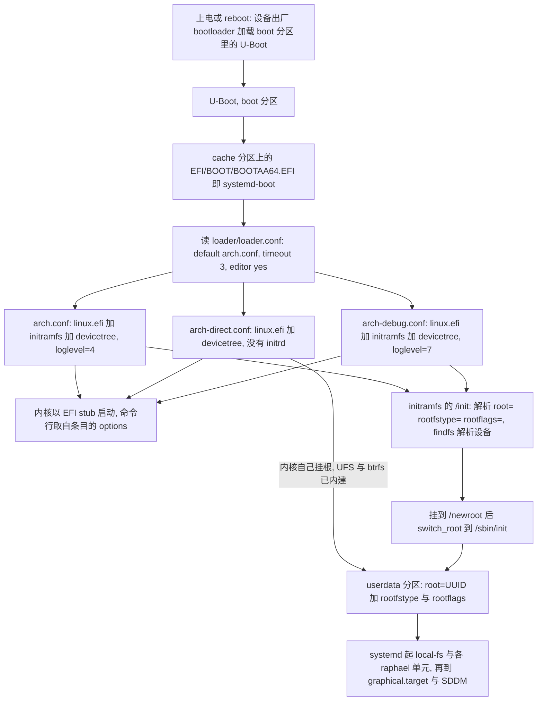
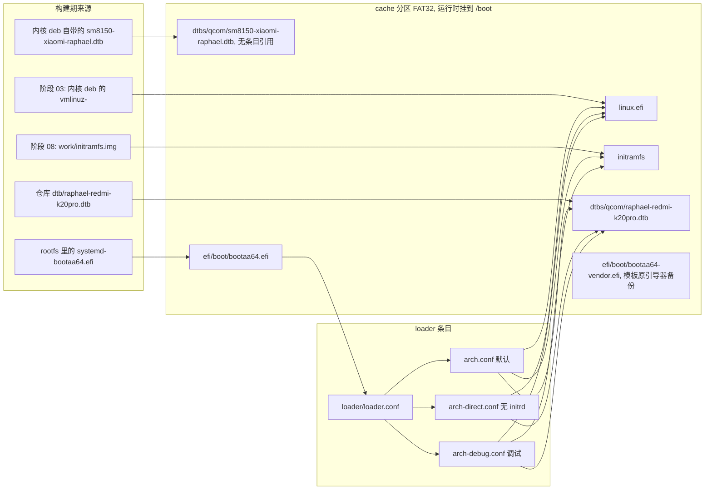
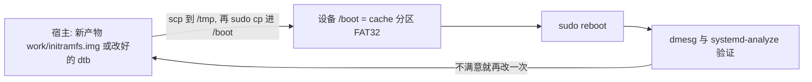

# 引导链与镜像/分区布局

本页把两件事合成一条线：**设备是怎么起来的**（上电 → … → `systemd`），以及**镜像里的每个文件落在哪个分区、由哪个阶段产出**。理解了这条线，就能回答这个仓库里最常被问的几个问题：为什么刷机要刷三个分区？为什么 `/boot` 上换一个文件就不用重新刷机？三个启动项分别在什么情况下救命？内核、设备树、initramfs 各自从哪来？

产物与分区的总览见[系统总览](overview.md)，逐步的构建流程见[构建流水线各阶段](build-pipeline-stages.md)。

## 三份产物与四个分区

| 产物 | 谁产出 | 落到哪个分区 | 内容 |
|:--|:--|:--|:--|
| `work/uboot/u-boot.img` | 阶段 00 从上游 release 的 zip 里解出（本仓库**不编译** U-Boot） | `boot` | 引导器本体 |
| `out/boot-cache.img` | 阶段 10，基于上游 256 MiB FAT32 模板原地改写 | `cache` | systemd-boot + 内核 + initramfs + dtb + 三个启动项；运行时挂到 `/boot` |
| `out/rootfs.img` / `out/rootfs.sparse.img` | 阶段 09 | `userdata` | Arch Linux ARM 根文件系统（默认 btrfs） |
| —— | —— | `dtbo` | **没有产物**：刷机时被 `fastboot erase dtbo` 清掉 |

刷机命令的顺序是固定的：先 `erase dtbo boot cache userdata`，再 `flash boot`（U-Boot）、`flash cache`（引导镜像）、`flash userdata`（根文件系统），最后 `reboot`（[`scripts/11-flash.sh`](../../scripts/11-flash.sh#L106-L117)、[`scripts/99-make-release.sh`](../../scripts/99-make-release.sh#L74-L100)）。注意 `boot` 分区上放的**只有 U-Boot**，内核和 initramfs 都在 `cache` 分区里——这是本项目与「boot 分区放内核」的常见直觉最大的差别。

`erase dtbo` 有一个必须提前知道的副作用：每台设备的蓝牙地址是产线写进设备自己 `dtbo` 里的厂商设备树中的，擦掉后就找不回来了（`persist` / `bluetooth` 分区里都没有明文地址），所以刷机前一定要先记下地址或走事后注入，细节见[刷机与恢复](../operations/flashing-and-recovery.md)。

## 上电到 systemd：完整引导链



上图是设备从冷启动到用户会话的完整链条，以及三个引导项各自走的路；`arch-direct.conf` 是唯一跳过 initramfs 的分支。

逐步说明：

1. **U-Boot（`boot` 分区）**：设备原有的 bootloader 加载它，本项目不参与编译，只从上游 `linux-xiaomi-raphael-uboot` release 的 zip 里解出 `u-boot.img`（[`config/build.conf`](../../config/build.conf#L20-L23)、[`scripts/00-fetch.sh`](../../scripts/00-fetch.sh#L24-L40)）。这一层是引导链的**上游边界**：它提供 UEFI 运行环境、内存信息与一份现场设备树，本仓库改不了它。
2. **EFI 回退路径（`cache` 分区）**：U-Boot 加载的是 FAT 上的可移动介质回退路径 `\EFI\BOOT\BOOTAA64.EFI`，也就是 systemd-boot（[`scripts/10-image-boot.sh`](../../scripts/10-image-boot.sh#L5-L9)）。因为路径名固定，**不需要写 EFI NVRAM 启动项**，`fastboot flash cache` 就等于「换掉引导器」。
3. **loader 配置与条目**：systemd-boot 读 `loader/loader.conf` 决定默认条目与倒计时，用户在这 3 秒窗口里可以选别的条目（[`scripts/10-image-boot.sh`](../../scripts/10-image-boot.sh#L119-L125)）。
4. **内核与命令行**：条目里的 `linux /linux.efi` 是内核 Image（EFI stub），`options` 行就是内核命令行——改内核参数要动的是 loader 条目（即 `cache` 分区上的文件），不是 U-Boot。
5. **initramfs（可选）**：`arch.conf` / `arch-debug.conf` 会先执行 `/init`，它解析命令行里的 `root=` / `rootfstype=` / `rootflags=`、用 `findfs` 解析设备、挂到 `/newroot` 后 `switch_root`；解析不到设备或挂载失败就落进救援 shell（[`scripts/08-initramfs.sh`](../../scripts/08-initramfs.sh#L93-L168)）。
6. **根文件系统与 systemd**：`root=` 指向 `userdata` 分区，挂载选项与 `/etc/fstab` 同源（下一节详述）。之后就是 systemd 的正常开机路径，服务归属见[运行时的启动顺序与服务归属](../runtime/boot-sequence-and-service-ownership.md)。

## cache 分区 = 运行时 `/boot`：条目到文件的映射

`fstab` 里 `/boot` 那一行把 `cache` 分区挂上来：

```text
PARTLABEL=cache  /boot  vfat  umask=0077,nofail,noatime,x-systemd.device-timeout=10  0  0
```

（[`scripts/lib.sh`](../../scripts/lib.sh#L429-L430)）两个后果都重要：挂载点用 `PARTLABEL=cache` 定位，靠的是设备 GPT 里 Android 留下的分区名；而 `nofail` 意味着这个分区万一挂不上只是单个单元失败，不会把启动拖进 emergency——代价是那时 `/boot` 看到的是 rootfs 里那份内容而不是 FAT。加上 `umask=0077`，**只有 root 能读/写 `/boot`**，所以下面所有「scp 换文件」的操作都要 `sudo`。

`cache` 分区（FAT32，构建时与 256 MiB 模板同尺寸）的内容与它们的来源：

```text
cache 分区 (FAT32, 运行时挂到 /boot)
├── efi/boot/bootaa64.efi                  systemd-boot（来自 rootfs 里的 systemd 包）
├── efi/boot/bootaa64-vendor.efi           模板自带引导器的备份（没有任何条目引用）
├── linux.efi                              内核 Image（EFI stub）
├── initramfs                              阶段 08 手工组装的 initramfs
├── dtbs/qcom/raphael-redmi-k20pro.dtb     条目实际引用的设备树（仓库补丁版）
├── dtbs/qcom/sm8150-xiaomi-raphael.dtb    内核 deb 自带，拷进来但没有条目引用
└── loader/
    ├── loader.conf                        default arch.conf / timeout 3 / editor yes
    └── entries/{arch,arch-direct,arch-debug}.conf
```



上图是「哪个阶段产出哪个文件、哪个 loader 条目加载哪些文件」的对照：三个条目都引用同一份 `linux.efi`，设备树只有仓库那份被 `devicetree` 行引用。

这张镜像**不是从零生成的**，而是在上游 256 MiB FAT32 模板 `dl/xiaomi-k20pro-boot.img` 上原地改写：用 mtools 直接读写，不需要 root、也不需要挂载（[`scripts/10-image-boot.sh`](../../scripts/10-image-boot.sh#L22-L24)、[`scripts/lib.sh`](../../scripts/lib.sh#L129-L154)）。改写时做四件事：

- 用 **rootfs 里那份 systemd-boot** 覆盖 `::/efi/boot/bootaa64.efi`，保证引导器与镜像里的 systemd 同版本（[`scripts/10-image-boot.sh`](../../scripts/10-image-boot.sh#L82-L93)）；
- 把模板自带的厂商引导器先抽出来备份成 `::/efi/boot/bootaa64-vendor.efi`（[`scripts/10-image-boot.sh`](../../scripts/10-image-boot.sh#L164-L172)）；
- 删掉模板里那个必然失败的上游条目 `::/loader/entries/ubuntu.conf`（[`scripts/10-image-boot.sh`](../../scripts/10-image-boot.sh#L152-L162)）；
- 写入自己的 `linux.efi`、`initramfs`、dtb 与 `loader/*`（[`scripts/10-image-boot.sh`](../../scripts/10-image-boot.sh#L174-L184)）。

**内核、DTB、initramfs 的出处**：

| 进 FAT 的文件 | 阶段 | 原始来源 | 缺失时的行为 |
|:--|:--|:--|:--|
| `linux.efi` | 阶段 10 复制 `$ROOT/boot/Image` | 阶段 03 解包 `kernel-deb` 的 `vmlinuz-*`（[`scripts/03-kernel.sh`](../../scripts/03-kernel.sh#L65-L72)） | 直接 `die`（提示先跑阶段 03） |
| `initramfs` | 阶段 10 复制 `work/initramfs.img` | 阶段 08 手工组装（[`scripts/08-initramfs.sh`](../../scripts/08-initramfs.sh#L170-L177)） | 直接 `die`（提示先跑阶段 08） |
| `dtbs/qcom/raphael-redmi-k20pro.dtb` | 阶段 10 复制仓库 `dtb/` | 从设备导出的 U-Boot DT + 本项目三处修改 | 只 WARN：条目**不写** `devicetree` 行，内核只能用 U-Boot 现场下发的那份 DT，蓝牙地址注入也跳过（症状是蓝牙与麦克风不可用） |
| `dtbs/qcom/sm8150-xiaomi-raphael.dtb` | 阶段 10 复制 `$ROOT/usr/lib/modules/$KV/dtbs/qcom/` | 内核 deb | 可选，没有条目引用它 |
| `efi/boot/bootaa64.efi` | 阶段 10 复制 rootfs 里的 systemd-boot | Arch 的 systemd 包 | 只 WARN：保留模板自带引导器 |
| `loader/loader.conf` 与三个条目 | 阶段 10 现场生成 | 布局、UUID 与 `WIFI_COUNTRY` | —— |

设备树的来源有一处**注释与代码不一致**，排障时要按实际行为理解：脚本头部（2026-10-15 的说明）写着「直接用内核作者 deb 里那份」，但真正决定条目内容的 `DT_LINE` 仍然是：只要仓库里的 `dtb/raphael-redmi-k20pro.dtb` 存在，三个条目就都带 `devicetree /dtbs/qcom/raphael-redmi-k20pro.dtb`（[`scripts/10-image-boot.sh`](../../scripts/10-image-boot.sh#L33-L53)）。也就是说，**内核 deb 那份 DTB 只是被拷进镜像陪跑**，实际加载的是仓库里带补丁的那一份——排查音频、蓝牙、面板问题时以条目里实际出现的路径为准（用 `mdir -i out/boot-cache.img ::/loader/entries/arch.conf` 直接看）。

最后一个容易误解的点：阶段 03 与阶段 08 会把内核和 initramfs 也**写进 rootfs 的 `/boot` 目录**（`$ROOT/boot/Image`、`vmlinuz-<kver>`、`config-<kver>`、`System.map-<kver>`、`initramfs-raphael.img`）。那只是**宿主侧的暂存**——阶段 10 是从这棵树里读文件的（[`scripts/10-image-boot.sh`](../../scripts/10-image-boot.sh#L26-L33)）；而在设备上，运行时 `cache` 分区被挂到 `/boot`，这些文件被挂载遮蔽，真正生效的永远是 FAT 上的 `linux.efi` / `initramfs`。

## 三个 loader 条目各自救什么场

`loader/loader.conf` 定下默认条目与交互行为：

```text
default  arch.conf
timeout  3
editor   yes
console-mode keep
```

`editor yes` 是刻意保留的：可以在启动菜单里临时编辑某个条目的命令行（比如换 `root=` 或去掉 `rootflags=`）来验证猜想，不必重新打包镜像（[`scripts/10-image-boot.sh`](../../scripts/10-image-boot.sh#L119-L125)）。

| 条目 | 加载什么 | `options` 追加 | 救什么场 |
|:--|:--|:--|:--|
| `arch.conf`（默认） | `linux.efi` + `initramfs` + `devicetree` | `loglevel=4` | 正常启动；日志级别低，开机更安静 |
| `arch-direct.conf` | `linux.efi` + `devicetree`，**没有 `initrd`** | `loglevel=7` | initramfs 坏掉时的救命项：内核自己挂根（UFS / btrfs / ext4 都已内建），绕开 initramfs 的解析与救援逻辑 |
| `arch-debug.conf` | `linux.efi` + `initramfs` + `devicetree` | `loglevel=7 systemd.log_level=debug` | 需要看细节时用：内核与 systemd 都开到 debug |

三个条目都指向同一份内核与同一份 `devicetree`（[`scripts/10-image-boot.sh`](../../scripts/10-image-boot.sh#L127-L151)）。

关于 `arch-debug.conf` 有个名称上的陷阱：它的标题写着 `debug shell`，但它的内容**只是提高日志级别，并不会切到 `rescue.target` 或单用户模式**。真正的「救援 shell」是 initramfs 在挂根失败时给出的那个 busybox shell（见下一节），所以想进 shell 要在屏幕上等到它失败，并且需要一把 OTG 键盘（README §9 的排障表就是这么写的）。

## 引导参数：怎么生成，必须和谁一致

阶段 10 按当前布局与 UUID 拼出引导参数，三个条目共用同一份，只有 `loglevel` 等尾部不同：

```text
root=UUID=<work/rootfs.uuid> rootfstype=<btrfs|ext4> [rootflags=<btrfs_opts ...>] [cfg80211.ieee80211_regdom=<WIFI_COUNTRY>] rw rootwait console=tty0
```

（[`scripts/10-image-boot.sh`](../../scripts/10-image-boot.sh#L95-L118)）

| 参数 | 来源 | 说明 |
|:--|:--|:--|
| `root=UUID=...` | `rootfs_uuid()` 生成的 `work/rootfs.uuid` | 与阶段 09 建文件系统时用的 `-U` 是同一个值；**rootfs 镜像与 `boot-cache.img` 必须成套刷写**，否则 initramfs 解析不到根设备 |
| `rootfstype=` | `rootfs_layout()`（`work/rootfs-layout`） | `btrfs` 或 `ext4` |
| `rootflags=` | `btrfs_opts()`；子卷布局时是 `subvol=/@,compress=...,noatime,ssd,discard=async,space_cache=v2` | 与 `/etc/fstab` 根行**同一个函数**，所以不会一边写 `compress=zstd:3` 另一边写别的 |
| `cfg80211.ieee80211_regdom=` | `WIFI_COUNTRY`（默认 `CN`） | 只在非空时写入。这条是无线管制域的**唯一**入口：阶段 04 已经**故意删掉** `regulatory.db`/`regulatory.db.p7s`（内核 `CONFIG_CFG80211_REQUIRE_SIGNED_REGDB=y` 且不信任该签名），所以不设它就退化成世界域、5GHz 信道大量不可用 |
| `rw rootwait console=tty0` | 固定字符串 | `rw` 让根一开始就可写（fstab 里根行**不能**加 `nofail`，否则 systemd 可能跳过重挂 rw）；`console=tty0` 把内核日志送到屏幕，是手机上看开机日志的方式 |

**这条链路的一致性契约**（细节与历史事故全过程见 [rootfs 布局与 fstab](../concepts/rootfs-layout-and-fstab.md)）：

- 布局只判定一次（`lib.sh:rootfs_layout()` → `work/rootfs-layout`），四处消费：阶段 06 写 `/etc/fstab`、阶段 09 造镜像、阶段 10 写 `rootfstype=`/`rootflags=`、阶段 08 的 initramfs `/init` 在运行时解析命令行。
- 历史上真出过一次「**开不了机**」的事故：缓存里写着 `btrfs-subvol`，但阶段 09 的 loop 挂载失败、实际回退成 `btrfs-flat`，而 fstab 早已按 subvol 写好 → 镜像里没有 `/@` 子卷，内核却按 `rootflags=subvol=/@` 去挂。现在的兜底是阶段 09 在回退分支里**先重写 fstab、再 `mkfs.btrfs -r`**，并在末尾把最终布局与 UUID 写回 `work/` 供阶段 10 读取（[`scripts/lib.sh`](../../scripts/lib.sh#L395-L400)、[`scripts/09-image-rootfs.sh`](../../scripts/09-image-rootfs.sh#L137-L152)）。看到日志里出现「回退单子卷布局」就该确认 fstab 与引导参数都跟着变了。
- **文档比代码旧**：`README.md` §1.1 展示的 fstab 仍是旧的 `PARTLABEL=userdata` 形式（`/home` 与 `/boot` 的 `pass` 列还写着 `2`），`release/刷机说明.txt` 也把根文件系统写成 `ext4`，而默认是 btrfs、根行用 `UUID=`（[`README.md`](../../README.md#L97-L127)、[`scripts/99-make-release.sh`](../../scripts/99-make-release.sh#L79-L91)）。这两处都是漂移的文档，**一律以 `lib.sh:write_root_fstab()` 与阶段 10 生成的实际条目为准**。
- 没有任何自动步骤把 loader 条目里的 `rootflags=` 与镜像里的 `/etc/fstab` 做交叉核对；CI 只打印 FAT 目录与 `arch.conf` 原文供人工比对（[`.github/workflows/build.yml`](../../.github/workflows/build.yml#L354-L367)）。

## initramfs：来源、职责与两个硬约束

`initramfs` 不是 mkinitcpio 产物（阶段 06 会把 rootfs 里的 `mkinitcpio` preset 清掉），而是阶段 08 手工拼的 cpio + zstd 归档：静态 `busybox` + 五个模块 + 少量早期固件 + 一个 `/init` 脚本，产到 `work/initramfs.img`（[`scripts/08-initramfs.sh`](../../scripts/08-initramfs.sh#L1-L9)、[`scripts/06-config.sh`](../../scripts/06-config.sh#L366-L374)）。它存在的理由不是「根需要驱动」（UFS/ext4/btrfs 都已内建），而是**挂根失败时给一个救援 shell**，也为将来做全盘加密留接口。

`/init` 的实际行为（[`scripts/08-initramfs.sh`](../../scripts/08-initramfs.sh#L93-L168)）：

- 挂 `proc`/`sys`/`dev`/`dev/pts`；
- 从 `/proc/cmdline` 里抠 `root=` / `rootfstype=` / `rootflags=` / `rw|ro`，`findfs` 解析 `UUID=`/`LABEL=`/`PARTUUID=`（`PARTLABEL=` 走 `/dev/disk/by-partlabel/`），最多轮询 40 × 0.25 s（10 秒）等设备出现；
- 按 `rootfstype` 挂到 `/newroot`，确认里面有 `/sbin/init` 或 `/usr/lib/systemd/systemd`；
- `mount --move` 三个伪文件系统后 `switch_root /newroot /sbin/init`；
- 任何一步失败就调 `rescue()`：在 `/dev/tty0` 上打印可用设备（`/dev/sd*`、`/dev/mmcblk*`）并给一个 shell —— 这就是「引导参数与镜像布局对不上」最典型的现场。

两个硬约束，任何一个破了都会产出「能刷但表现诡异」的镜像：

1. **必须有 `/lib -> usr/lib` 软链**。内核固件加载器只按 `/lib/firmware` 找文件，不认 `/usr/lib/firmware`；少了这条软链，特意塞进 initramfs 的 GPU 固件等于没塞——`msm_dpu`/`adreno` 是内建驱动、开机不到 1 秒就 probe，实机会看到 `0.63s Direct firmware load for qcom/a630_sqe.fw failed` 而 10 秒后才「补上」，症状就是开机/熄屏瞬间花屏（[`scripts/08-initramfs.sh`](../../scripts/08-initramfs.sh#L20-L30)、[`README.md`](../../README.md#L710-L742)）。
2. **busybox 必须是 `/usr/bin/busybox`（静态版，392 个 applet）**。阶段 08 会断言 `mount`/`umount`/`switch_root`/`findfs`/`modprobe`/`sh` 都在，缺一个直接失败——`mkinitcpio-busybox` 里那份精简版没有这些 applet，不能用来拼自建 initramfs（[`scripts/08-initramfs.sh`](../../scripts/08-initramfs.sh#L32-L48)）。

早期固件只放「内建驱动会在挂根之前就要的」那几份：Adreno 的 `a630_sqe.fw`/`a630_gmu.bin`/`a640_gmu.bin`、remoteproc 的 `a640_zap.mbn`/`ipa_fws.mbn`（[`scripts/08-initramfs.sh`](../../scripts/08-initramfs.sh#L65-L90)）。脚本里还有一个 `regulatory.db` 的拷贝循环，但阶段 04 已经把它删了，所以这个循环在正常构建里**什么也不拷**——无线管制域只能靠上一节的 `cfg80211.ieee80211_regdom=`（[`scripts/04-firmware.sh`](../../scripts/04-firmware.sh#L96-L99)）。

一个容易想错的地方：阶段 08 还会拷 `phy-qcom-qmp-ufs`、`ufs-qcom`、`scsi_common`、`ext4`、`crc32c_generic` 五个模块进 initramfs，但 `/init` 全程**不调用 `modprobe`**（内核里 UFS/ext4 已内建，顶层的模块拷进来只是备用）。也就是说，`lsinitcpio` 里看到的这几个 `.ko` 在正常启动路径上并没有被加载（[`scripts/08-initramfs.sh`](../../scripts/08-initramfs.sh#L50-L63)）。

## `/boot` 就是 `cache`：本仓库最重要的迭代捷径

因为 `cache` 分区在运行时就是 `/boot`，**换内核、initramfs、设备树、甚至 loader 条目，都不需要重新刷机**——把文件放进 `/boot` 覆盖同名文件、重启即可。这是本项目迭代最快的技巧，也是历史上修掉「花屏」这种问题能当天验证的原因：



上图：免刷机的验证回路——只有 `cache` 分区上的文件参与启动，所以这个回路不涉及 `fastboot`。

两个真实的例子（都来自本仓库的踩坑记录）：

```bash
# 换 initramfs（例如验证 /lib 软链修复）：期望 failed to load a630_sqe 计数为 0
scp work/initramfs.img user@172.16.42.1:/tmp/initramfs.new
ssh user@172.16.42.1 'echo 1234 | sudo -S cp /tmp/initramfs.new /boot/initramfs && sudo reboot'

# 换设备树：条目里引用的是 /dtbs/qcom/raphael-redmi-k20pro.dtb
scp dtb/raphael-redmi-k20pro.dtb user@172.16.42.1:/tmp/
ssh user@172.16.42.1 'echo 1234 | sudo -S cp /tmp/raphael-redmi-k20pro.dtb /boot/dtbs/qcom/ && sudo reboot'
```

这条捷径的**边界**也要记住：

- 只有 FAT 上的那些文件能这样换：`linux.efi`、`initramfs`、`dtbs/qcom/*.dtb`、`loader/entries/*.conf`、`efi/boot/bootaa64.efi`。**U-Boot 本体在 `boot` 分区**，只能 `fastboot flash boot`（[`scripts/11-flash.sh`](../../scripts/11-flash.sh#L106-L115)）。
- `umask=0077` 让 `/boot` 只有 root 可读写，所以 `scp` 要先落到 `/tmp` 再用 `sudo` 拷。
- 引导器与 rootfs 的 systemd 版本可能不同步：`pacman -Syu` 只更新 rootfs 里那份，不会更新 `/boot/efi/boot/bootaa64.efi`。要更新引导器就得重新生成并刷 `cache`，**不要在设备上 `pacman -Syu` 之后立刻重启就以为引导器也升级了**（[`HANDOVER.md`](../../HANDOVER.md#L396-L401)、[`HANDOVER.md`](../../HANDOVER.md#L455-L456)）。
- 手机侧改 `/boot` 不改变宿主上的 `out/boot-cache.img`；验证成功的改动要回写脚本/输入资源（例如 `dtb/`），否则下一次构建又会退回原样。

同一条「只改一个文件」的思路上还有一个**刷机前**的操作：蓝牙地址写的就是 FAT 镜像里那份设备树的 `bluetooth/local-bd-address`，所以公开镜像可以在不改构建的前提下注入地址——`./scripts/bt-mac.sh set boot-cache.img "11 22 33 44 55 66"`（原地改，先留 `.bak`），或 `./scripts/11-flash.sh --flash --bt-mac "..."`（把副本写到 `work/boot-cache-<mac>.img` 再刷）（[`scripts/lib.sh`](../../scripts/lib.sh#L376-L393)、[`scripts/bt-mac.sh`](../../scripts/bt-mac.sh#L49-L56)、[`scripts/11-flash.sh`](../../scripts/11-flash.sh#L88-L104)）。地址写法是**设备树小端字节序**，与 `bluetoothctl` 显示的正好相反；格式不对时阶段 10 **只打印 WARN 不报错**（"该镜像蓝牙不可用"），所以构建日志里那行「已注入…」才是判断依据。

## 失败语义与排查入口

| 现象 | 引导链上的位置 | 处理 |
|:--|:--|:--|
| 刷完黑屏、无反应 | `cache` 没刷成功或分区太小（镜像与 256 MiB 模板同尺寸，脚本拿 `BOOTFAT_SIZE_MB` 比对，不一致只 WARN 不拦） | 长按电源 10 秒强制重启；重新 `fastboot flash cache`；确认 `cache` 分区 ≥ 256 MiB（[`scripts/10-image-boot.sh`](../../scripts/10-image-boot.sh#L186-L193)） |
| 卡在 systemd-boot 菜单 | 条目/内核/initramfs 有问题 | 选 `arch-direct.conf`（不加载 initramfs 直接挂根） |
| 内核起来了但挂根失败 | initramfs 挂不上根 | 用 `arch-debug.conf` 看 `loglevel=7` 与 `systemd.log_level=debug` 的日志；initramfs 会打印可用设备并给救援 shell（需要 OTG 键盘） |
| 救援 shell 说「无法解析根设备」 | `root=UUID=` 指向的文件系统不存在 | `rootfs` 镜像与 `boot-cache.img` 不是同一次构建（UUID 换了）；成套重新跑 09/10 并成套刷写 |
| 挂载失败但 UUID 正确 | `rootflags=subvol=/@` 与镜像布局不一致 | 就是上面那个历史事故的现场：确认 `work/rootfs-layout`、`/etc/fstab`、条目里的 `rootflags=` 三者一致 |
| 蓝牙不可用 | 设备树里的 `local-bd-address` 缺失或格式错 | 构建刷机时注入地址（只 WARN 不报错，去日志里确认）；原厂 NVM 另见 README §8.9 |
| 5GHz Wi-Fi 连不上 | 引导参数里没有 `cfg80211.ieee80211_regdom` | 在 `config/build.conf` 里设 `WIFI_COUNTRY` 后重跑阶段 10 |

## 相关页面

- [系统总览](overview.md) —— 宿主构建与设备运行时的分工、产物与分区总表。
- [仓库结构与入口](repository-layout-and-entrypoints.md) —— 各阶段脚本、`config/`、随仓库分发的 `dtb/` 与生成目录的生命周期。
- [构建流水线各阶段](build-pipeline-stages.md) —— 阶段 03/08/09/10 的逐步细节与失败点。
- [rootfs 布局与 fstab](../concepts/rootfs-layout-and-fstab.md) —— `root=`/`rootfstype=`/`rootflags=` 与 fstab 的一致性契约、历史事故与残留缺口。
- [刷机与恢复](../operations/flashing-and-recovery.md) —— `fastboot` 顺序、备份、`--bt-mac` 与回 Android 的路径。
- [运行时的启动顺序与服务归属](../runtime/boot-sequence-and-service-ownership.md) —— `switch_root` 之后 systemd 拉起哪些单元。
- [失败模式与不变量](../concepts/failure-modes-and-invariants.md) —— 这类「开不了机」问题在全局故障语义里的位置。
