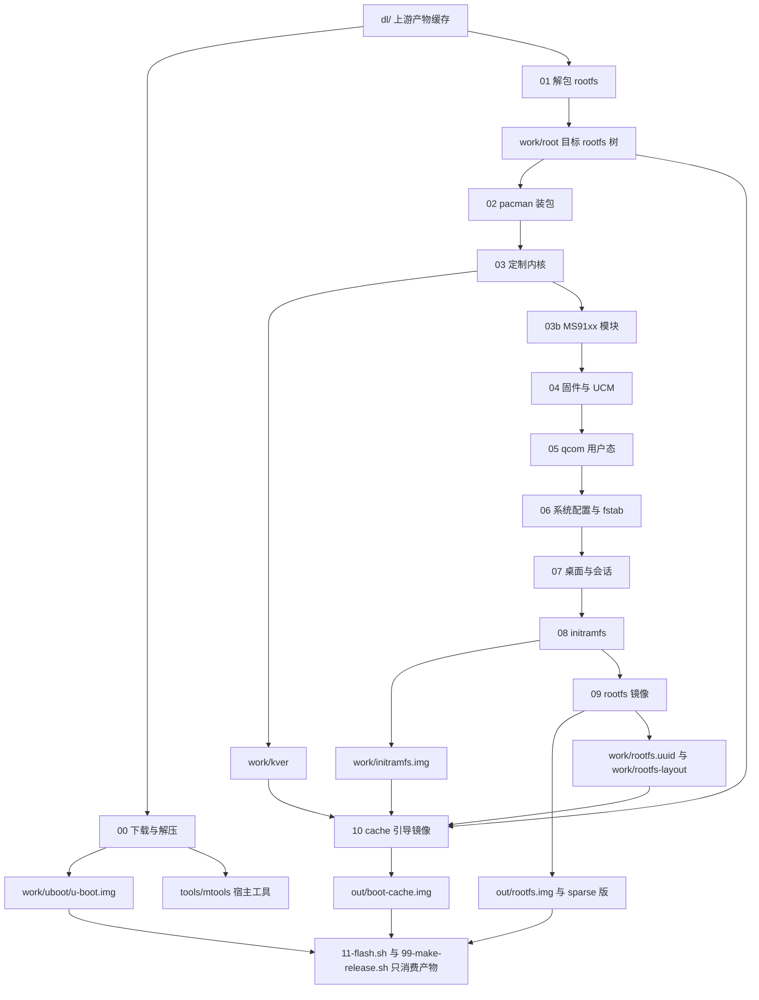

# 构建流水线：阶段契约与子集重建语义

整条流水线里真正被反复改写的对象只有一个：`work/root` 这棵目标 rootfs 树。阶段 01→07 轮流在它上面增删改，阶段 08 从它取件组装 initramfs，阶段 09 把它灌成磁盘镜像，阶段 10 再从树里取内核与 initramfs 组装引导镜像。因此阶段号的先后**就是语义依赖的先后**，而不是"一串独立的脚本"——后面阶段读的正是前面阶段的落点。

本页按契约讲每个阶段：前置条件是什么、从 `dl/` 读什么、往 `work/root`（设备上生效）与 `work/`·`out/` 写什么、产物交给谁、能不能重复跑、失败时是中断整轮构建还是只告警。硬失败与仅告警**如何判定**以及历史事故的完整清单在[失败模式与不变量](../concepts/failure-modes-and-invariants.md)，这里只标注该阶段会不会中断构建。

## 调度层：所有阶段共用的契约

- 唯一入口是 [`build.sh`](../../build.sh)，阶段清单就是它的 `STAGES` 数组（[`build.sh`](../../build.sh#L26-L39)）。数组外的 `scripts/*.sh` 永远不会被构建执行；阶段号不是独立字段，而是脚本名里第一个 `-` 之前的前缀（`03b-ms91xx.sh` → `03b`）。
- 每阶段都以 `bash scripts/<脚本名>` 在**仓库根**启动（`build.sh` 开头 `cd "$PROJ"`），输出 `2>&1 | tee -a logs/build.log`；任一阶段非零退出即打印"阶段失败，详见 logs/build.log"并 `exit 1`（[`build.sh`](../../build.sh#L16-L19), [`build.sh`](../../build.sh#L89-L102)）。
- 阶段脚本**不接收命令行参数**，`--from`/`--only` 只决定跑不跑；跨阶段的状态一律通过 `work/` 下的文件传递，这正是契约的存放处。
- 命名空间自举不是每个阶段都做：`00-fetch.sh`（此时还没有 rootfs）与 `03b-ms91xx.sh`（纯宿主交叉编译）不调用 `require_ns`；`08-initramfs.sh` 只 `require_ns`、不 `ns_mount`；其余阶段 `require_ns` + `ns_mount`（机制见[无 root 构建运行时](rootless-build-runtime.md)）。`11-flash.sh` 与 `99-make-release.sh` 干脆只 `source lib.sh`，因为它们不碰目标树、也不做 chroot。

上图：阶段主链（00→10）与它写下的中间落点；01–07 反复改写同一棵 `work/root`，08/09/10 才把它固化成 `out/` 里的产物，刷机与发布工具只读不写。

## 契约矩阵

| 阶段 | 硬前置 | 读 | 写进 `work/root`（设备上生效） | 写进 `work/`·`out/`·`dl/` | 会中断构建的情况 |
|:--|:--|:--|:--|:--|:--|
| `00-fetch.sh` | 网络；`unzip` | `dl/` 里已缓存的同名文件 | 无 | `dl/` 上游产物；`work/uboot/u-boot.img`；`tools/mtools` | 下载重试后仍失败、缺 `unzip`、从 zip 里解不出 `u-boot.img` |
| `01-rootfs.sh` | `dl/…latest.tar.gz` 非空；userns | `dl/` tarball；`work/kver`（要保留的那版模块） | 整套基础系统树 + setuid/setgid 位；删掉发行版非 `*sm8150*` 内核模块与 `/boot/vmlinuz*`、`/boot/dtbs` | `work/setid-list.txt`、`work/logs/tar-warnings.txt` | 缺 tarball；解包后仍无 `usr/bin/bash`；qemu 垫片自检失败 |
| `02-pacman.sh` | rootfs 已解包 | 镜像仓库；`config/build.conf` 的包列表 | 全部软件包；`/etc/pacman.conf`（关 Landlock 沙箱、`IgnorePkg=linux-firmware`、archlinuxcn 源）、`/etc/pacman.d/mirrorlist`；删 `/home/alarm` | `work/pacman-build.conf`、`work/empty-hooks`、`work/pkgcache` | 选中桌面的关键包缺失；关键程序烟雾测试跑不起来（缺的普通包只 warn） |
| `03-kernel.sh` | 两个内核 deb 已缓存 | `dl/linux-image-*.deb`、`linux-headers-*.deb` | `/usr/lib/modules/$KV`、`/boot/Image` + `vmlinuz-$KV`、`dtbs/qcom/`、`/usr/src/linux-headers-$KV` 及 `build` 软链 | `work/deb/{image,headers}`、`work/kver` | 找不到模块目录 / `vmlinuz` / qcom dtb 目录 / `sm8150-xiaomi-raphael.dtb`（`depmod` 失败只 warn） |
| `03b-ms91xx.sh` | `work/kver` 与 `work/deb/headers/usr/src/linux-headers-$KV`；`vendor/ms91xx` | 上两者 + 宿主编译器 | `/usr/lib/modules/$KV/updates/msdisp/usbdisp_drm.ko`、`/etc/modules-load.d/raphael-msdisp.conf` | `work/ms91xx-build`、`work/ms91xx-*.log` | 缺 kver / 头文件树 / 源码；`.ko` 没编出来（`SKIP_MS91XX=1` 可整段跳过） |
| `04-firmware.sh` | 两个 deb 已缓存；有 `work/pacman-build.conf` 才能增删固件包 | `dl/firmware-xiaomi-raphael.deb`、`alsa-xiaomi-raphael.deb`；rootfs 的 pacman 数据库 | `/usr/lib/firmware/`（设备专属固件、删同名未压缩件、删 `regulatory.db*`）、`/usr/share/qcom/`（音频 acdb）、`/usr/share/alsa/ucm2/` | `work/deb/fw`、`work/deb/alsa` | 解包失败即中断；**自检缺项只 warn**（累计 FAIL 后照样"完成"） |
| `05-qcom.sh` | rootfs 里已有 `libudev`/`liblzma`/`libzstd`（来自 02）；clang | 上游源码 tarball（`dl/`）、ALARM gcc 包；rootfs 作为 sysroot | `/usr/lib/libqrtr.so.1` + 头文件 + pkgconfig、`/usr/bin/{rmtfs,pd-mapper,tqftpserv,qrtr-*}`、三个单元与 udev 规则、`/etc/modules-load.d/raphael-pd-mapper.conf`；enable `rmtfs`/`tqftpserv`，**disable 用户态 `pd-mapper`** | `work/qcom-src`、`work/qcom-out`、`work/gcc-sysroot`、`logs/build-<组件>.log` | 末尾校验缺 `rmtfs` / `tqftpserv` / `libqrtr.so.1`（单组件编译失败只 warn，但会被这道校验兜住） |
| `06-config.sh` | 02 装好的系统（systemd/pacman/dnsmasq/sshd…） | `work/kver`、`work/rootfs-layout`、`work/rootfs.uuid`、`config/build.conf` | `/etc/fstab`、`hostname`/`hosts`/locale/vconsole/timezone、用户与 sudoers、sshd、NetworkManager（并 disable+mask `systemd-networkd*`/`systemd-resolved*`）、USB NCM 单元、zram、logind/journald/faillock、UCM `conf.d/` 四套声卡名、音频 init/routing 的单元与 timer、蓝牙原厂固件服务、`modules-load.d`、看门狗关闭、首启动单元（密钥环/交换文件/snapper/扩容） | `dl/`（霞鹜文楷字体，仅选了桌面时）；其余纯写树 | 密码哈希自检失败即中断；其余多为 warn（`locale-gen`、找不到某个单元、扩容兜底路径） |
| `07-desktop.sh` | 02 装好的 sddm/桌面/字体（选了桌面时） | `config/build.conf` 的 `HAVE_*`/`PRIMARY_SESSION`；树内实际存在的会话 `.desktop` | `/etc/fonts/local.conf`、`/etc/sddm.conf.d/10-raphael.conf`、家目录预置、dconf system db、phosh 包装脚本与 wlroots 二进制补丁、PipeWire/WirePlumber 用户服务软链、电源键守护；纯命令行分支反向删除 SDDM 一切残留 | `dl/`（Catppuccin 配色等按需下载） | 基本不中断（`chsh`/补丁/找不到 `phosh.desktop` 都是 warn） |
| `08-initramfs.sh` | `work/kver`；`/usr/bin/busybox` | rootfs 的模块与早期固件 | `/boot/initramfs-raphael.img`（备份副本） | `work/initramfs/`、`work/initramfs.img` | 缺 kver、缺 busybox、busybox 缺关键 applet（缺某条早期固件只跳过） |
| `09-image-rootfs.sh` | 完整的 `work/root` 树 | 整棵树；`work/rootfs-layout`、`work/rootfs.uuid` | 回退分支里重写 `/etc/fstab`；删 qemu 垫片、pacman 包缓存、`/tmp` 内容；重置 `machine-id` 与 SSH 主机密钥；重写 `/etc/resolv.conf` | `out/rootfs.img`、`out/rootfs.sparse.img`、`work/rootfs.uuid`、`work/rootfs-layout` | 树里仍残留 `systemd-networkd*`/`systemd-resolved*` 的 enable 软链；**非真 root 的属主归一化只 warn 并继续** |
| `10-image-boot.sh` | FAT 模板、树的 `/boot/Image`、`work/initramfs.img` | 上列 + `dtb/raphael-redmi-k20pro.dtb` + 布局/UUID + `RAPHAEL_BT_MAC`/`config/local.conf` | 无（只读树） | `out/boot-cache.img`、`work/bootstage`、`work/vendor-efi` | 缺 FAT 模板 / `Image` / `initramfs.img`；缺 DTB、无蓝牙地址、找不到 `systemd-boot` 只 warn |

## 输入与基础系统：00 / 01 / 02

**00 只负责"东西到手"**。`fetch()` 的策略是"目标文件非空即视为已缓存"，不校验内容、不比对上游版本（[`scripts/lib.sh`](../../scripts/lib.sh#L33-L40)）；因此 `dl/` 是**存在即可信**的缓存，怀疑损坏时唯一手段是手工删掉那个文件。这一阶段还必须把 U-Boot 的 zip **解压**出 `work/uboot/u-boot.img`——刷机脚本与发布打包都要它，历史上"只下载不解压"在本地看不出来，到干净环境里就让发布包少了 `u-boot.img`（[`scripts/00-fetch.sh`](../../scripts/00-fetch.sh#L24-L40)）。它同时是 `tools/mtools`（无 root 读写 FAT 镜像）的填充者。

**01 的核心契约是"树在就跳过"**：只要 `$ROOT/usr/bin/bash` 与 `pacman` 可执行，就整段跳过解包，只报"rootfs 已存在"（[`scripts/01-rootfs.sh`](../../scripts/01-rootfs.sh#L19-L42)）。但**两次解包之后**的动作每次都跑：按 tarball 元数据校正 setuid/setgid 位（[`scripts/01-rootfs.sh`](../../scripts/01-rootfs.sh#L48-L64)），以及删掉发行版自带的通用内核模块与 `/boot/vmlinuz*`、`/boot/dtbs`（保留 `*sm8150*` 与 `work/kver` 指的那版，[`scripts/01-rootfs.sh`](../../scripts/01-rootfs.sh#L66-L90)）。这两条合起来的效果是：**换掉 rootfs tarball 而不删 `work/root`，这次构建根本不会用到新 tarball**。

**02 把"装包"和"对齐快照"分成两步**。先用宿主 pacman 以 `--arch aarch64 -r "$ROOT" --noscriptlet` 装列表里的包（不执行任何 install scriptlet），然后做一次 `-Su` 全量升级——因为 ALARM 的 rootfs tarball 常落后仓库数周，`-S --needed` 不会升级树里已有的包，容易留下"新库配旧依赖"的半升级状态（[`scripts/02-pacman.sh`](../../scripts/02-pacman.sh#L145-L162)）。scriptlet 被跳过的那部分在末尾用 qemu 补跑（`ldconfig`/`sysusers`/`tmpfiles`/字体与 schema 缓存），再对 `bash`/`dnsmasq`/`nft`/`nmcli`/`iw`/`wpa_supplicant` 做"能不能真的跑起来"的烟雾测试（[`scripts/02-pacman.sh`](../../scripts/02-pacman.sh#L193-L247)）。

设备上生效的落点有两类：装出来的软件包，以及被改写的 `/etc/pacman.conf` + `/etc/pacman.d/mirrorlist`——其中"关掉 pacman 沙箱"（作者内核没编 Landlock，否则设备上 `pacman -Sy` 直接失败）与 `IgnorePkg = linux-firmware`（避免发行版固件覆盖设备专属固件）都是**必须在镜像里**的键（[`scripts/02-pacman.sh`](../../scripts/02-pacman.sh#L52-L101)）。

02 的失败是分层的：仓库里不存在的包只 warn 并跳过，但选中桌面的关键包（`sddm` + 各桌面自身的关键包）缺失就 `die`，理由是"能刷但进不去桌面"的镜像不该出厂（[`scripts/02-pacman.sh`](../../scripts/02-pacman.sh#L107-L139)）。另有一条增量重建语义：**02 只装不删**——除 `PKGS_PRUNE` 名单与显式 `-Rdd`（如 `plasma-bigscreen`）之外不清理旧包，所以改了 `DESKTOPS` 后，上一轮装进来的桌面包会留在树里（[`scripts/02-pacman.sh`](../../scripts/02-pacman.sh#L164-L183)）。

## 内核、驱动、固件与 qcom 用户态：03 / 03b / 04 / 05

**03 是 `work/kver` 的唯一生产者**，`03b`、`04`、`06`、`08`、`10` 都读它（[`scripts/03-kernel.sh`](../../scripts/03-kernel.sh#L117-L118)）。它把 Debian 包重排成 Arch 布局（模块进 `/usr/lib/modules/$KV`、上游的 `vmlinuz-*` 同时落成 `/boot/Image`），并显式清掉上一版内核的模块目录、头文件与 `/boot/vmlinuz-*`/`config-*`/`System.map-*`——因为下面的 `cp` 只覆盖同名目录，清得不干净就会在镜像里留两套内核（[`scripts/03-kernel.sh`](../../scripts/03-kernel.sh#L33-L72)）。设备树这一节对上游打包布局做了双路径识别（`boot/dtbs/qcom` 与 `usr/lib/linux-image-<kver>/qcom`），只挑 `sm8150-*.dtb`（全拷会把引导镜像撑大 40 多 MB），并且要求 `sm8150-xiaomi-raphael.dtb` 存在，否则 `die`（[`scripts/03-kernel.sh`](../../scripts/03-kernel.sh#L74-L99)）。

**03b 完全寄生在 03 的中间产物上**：它要 `work/kver` 与 `work/deb/headers/usr/src/linux-headers-$KV` 这棵头文件树（缺任一即 `die`），把 `vendor/ms91xx` 的驱动交叉编译成模块。它对树只加三样东西：模块本体、`/etc/modules-load.d/raphael-msdisp.conf`、`depmod` 更新。注意落盘顺序：**自加载配置写在".ko 是否生成"的检查之前**（[`scripts/03b-ms91xx.sh`](../../scripts/03b-ms91xx.sh#L96-L105)），所以编译失败或被 `SKIP_MS91XX=1` 跳过时，树里可能留下一条指向不存在模块的开机加载项。设备上生效的产物是"插上 USB 投屏器就能用第二块屏"这件事本身。

**04 处理的是"哪份固件被真正加载"**。作者的设备专属固件是 `.zst` 压缩的，而内核固件加载器优先尝试**无后缀**的同一路径，所以它逐条找出同名未压缩文件并删除；同时按上游 Debian 的做法删掉 `regulatory.db`/`regulatory.db.p7s`（签名密钥不被 vendor 内核信任，加载必然失败，退化为世界域）。设备上生效的落点有三处：`/usr/lib/firmware/`（Wi-Fi/蓝牙 NVM/ADSP/GPU 固件）、`/usr/share/qcom/`（音频 acdb 与传感器）、`/usr/share/alsa/ucm2/`（UCM 声卡描述）（[`scripts/04-firmware.sh`](../../scripts/04-firmware.sh#L83-L110)）。它的自检只统计 FAIL 并 warn——**这个阶段"完成"不代表固件齐全**（[`scripts/04-firmware.sh`](../../scripts/04-firmware.sh#L112-L148)）。它还是唯一用 `work/pacman-build.conf` 来增删 `linux-firmware-*` 包（省 1 GB 级无关固件）的阶段：没有这个文件时那段会静默跳过（[`scripts/04-firmware.sh`](../../scripts/04-firmware.sh#L40-L64)）。

**05 的产物是"没有它设备就是残废"的那几个守护进程**。它用宿主 clang（`--target=aarch64-linux-gnu --sysroot="$ROOT"` + ALARM gcc 包的 `crt`/`libgcc`）交叉编译 `qrtr`/`rmtfs`/`pd-mapper`/`tqftpserv`，装进 rootfs 的 `/usr/lib` 与 `/usr/bin`，并落地 `rmtfs.service`、`rmtfs-dir.service`、`99-rmtfs.rules`、`pd-mapper.service`（`sed` 改写上游模板）与手写的 `tqftpserv.service`；`rmtfs`/`tqftpserv` 会被 enable，而**用户态 `pd-mapper` 被显式 disable**，因为它要提供的电源域由内核 `qcom_pd_mapper` 覆盖（[`scripts/05-qcom.sh`](../../scripts/05-qcom.sh#L139-L230)）。收尾校验把 `rmtfs`、`tqftpserv`、`libqrtr.so.1` 视为必需（缺失 `die`），`qrtr-lookup`/`pd-mapper` 缺失只 warn；这里的注释也解释了为什么 `libqrtr.so` 的软链必须补——否则其余组件会**全部**链接失败而脚本只 warn（[`scripts/05-qcom.sh`](../../scripts/05-qcom.sh#L79-L92), [`scripts/05-qcom.sh`](../../scripts/05-qcom.sh#L237-L258)）。

这里还有一条**阶段顺序不可交换**的实例：05 会 disable `pd-mapper`，而 06 又会把 `pd-mapper`/`rmtfs`/`tqftpserv` 一起 enable。只跑 05（不跟着跑 06）的结果是把音频/调制解调器依赖的守护进程关掉（[`scripts/06-config.sh`](../../scripts/06-config.sh#L195-L212)）。

## 配置与会话：06 / 07

**06 是"设备上怎么配置"的唯一集中点**，写下的绝大多数东西都属于"刷机后立即生效"。按主题扫一遍：身份与时间（`hostname`/`hosts`/locale/vconsole/timezone，[`scripts/06-config.sh`](../../scripts/06-config.sh#L33-L53)）、**fstab**（走 `lib.sh:write_root_fstab()`，与 09/10 共用同一份布局与 UUID，见 [rootfs 布局、fstab 与 UUID 的一致性契约](../concepts/rootfs-layout-and-fstab.md)）、账户与 sudoers（[`scripts/06-config.sh`](../../scripts/06-config.sh#L110-L142)）、sshd（[`scripts/06-config.sh`](../../scripts/06-config.sh#L147-L154)）、网络（NetworkManager 配置 + disable **并 mask** `systemd-networkd*`/`systemd-resolved*`，USB NCM 的 `dnsmasq` 配置与 `usb-ncm.service`）、zram、logind/journald/faillock/`environment`、**音频**（UCM `conf.d/` 下四套声卡名、`raphael-audio-init` 与 `raphael-audio-routing` 的单元+timer、`modprobe.d` 的黑名单）、蓝牙原厂固件服务、`modules-load.d`、关闭 systemd 看门狗，以及一批首启动单元（pacman 密钥环、交换文件、snapper、扩容兜底）（[`scripts/06-config.sh`](../../scripts/06-config.sh#L56-L105), [`scripts/06-config.sh`](../../scripts/06-config.sh#L159-L240), [`scripts/06-config.sh`](../../scripts/06-config.sh#L243-L410), [`scripts/06-config.sh`](../../scripts/06-config.sh#L461-L807), [`scripts/06-config.sh`](../../scripts/06-config.sh#L1054-L1072)）。

06 里有一类动作与"配置"无关、纯粹是**增量重建的卫生工作**：清掉上一版留下的 `networkd`/`resolved` enable 软链、清掉 `mkinitcpio` preset（本项目的 initramfs 是 08 手工组的）、清掉已被移除的 AUR 首启动单元与 `/etc/motd` 提示（[`scripts/06-config.sh`](../../scripts/06-config.sh#L217-L239), [`scripts/06-config.sh`](../../scripts/06-config.sh#L362-L376), [`scripts/06-config.sh`](../../scripts/06-config.sh#L1179-L1210)）。与之配套的是 09 的一道前置断言：灌镜像之前如果还能找到 `systemd-networkd*`/`systemd-resolved*` 的 enable 软链就 `die`，不让"每次开机多一个 failed 单元"的镜像流出去（[`scripts/09-image-rootfs.sh`](../../scripts/09-image-rootfs.sh#L86-L102)）。

**07 按 `DESKTOPS` 分两条互斥的路**。有桌面时：写字体的 `local.conf`、`/etc/sddm.conf.d/10-raphael.conf`（含自动登录到 `DESKTOPS` 第一个会话）、enable `sddm`、`set-default graphical.target`，然后按所选桌面写各自的用户级预置（Plasma 的电源/锁屏/虚拟键盘，Phosh 的会话包装 + wlroots 二进制补丁，GNOME/Phosh 的 dconf 系统默认值）（[`scripts/07-desktop.sh`](../../scripts/07-desktop.sh#L25-L121), [`scripts/07-desktop.sh`](../../scripts/07-desktop.sh#L222-L301)）。纯命令行时走 `else` 分支：删掉 SDDM 的单元与软链、删 SDDM 配置、`set-default multi-user.target`，否则开机时 systemd 会去拉一个不存在的单元（[`scripts/07-desktop.sh`](../../scripts/07-desktop.sh#L303-L322)）。**两条路都跑**的是与桌面无关的部分：PipeWire/WirePlumber 的用户服务软链（构建期跳过了 scriptlet，发行版的 user preset 没执行，不显式建软链就是"有声音选项但没有设备"）、蓝牙/ModemManager/传感器/时间同步的 enable，以及电源键守护——后者只在非 KDE 时 enable，因为 KDE 的 PowerDevil 已经接管了电源键，而 06 把 logind 的 `HandlePowerKey` 设成了 `ignore`（[`scripts/07-desktop.sh`](../../scripts/07-desktop.sh#L332-L342), [`scripts/07-desktop.sh`](../../scripts/07-desktop.sh#L362-L368), [`scripts/07-desktop.sh`](../../scripts/07-desktop.sh#L544-L555)）。

07 内部还有一条**写后清理的顺序约束**：13.1–13.9 生成一套"个性化"配置，13.10 又把它撤掉（保留包本身），13.11 的 fcitx5/Rime 收尾必须排在 13.10 **之后**——写在前面的会被 `rm -rf` 掉，镜像里只剩 `/etc/skel` 那份（[`scripts/07-desktop.sh`](../../scripts/07-desktop.sh#L986-L1047), [`scripts/07-desktop.sh`](../../scripts/07-desktop.sh#L1049-L1097)）。这也解释了为什么 13.1–13.9 整段只在选了 KDE 时执行（[`scripts/07-desktop.sh`](../../scripts/07-desktop.sh#L559-L566)）：否则 phosh/GNOME/纯命令行构建会白跑一遍"写了马上删"的工作。注意 13.10 本身对**所有**形态都会跑，它的作用是清理上一版遗留在家目录里的个性化文件，属于卫生工作而不是"配置桌面"。

## 产物装配：08 / 09 / 10

**08 手工组装 initramfs**（不依赖 mkinitcpio 执行环境）：静态 `/usr/bin/busybox` + 少量模块 + 早期固件（remoteproc 的 `a640_zap.mbn`/`ipa_fws.mbn`、GPU 的 `a630_sqe.fw`/`a640_gmu.bin`、`regulatory.db`），打包成 `work/initramfs.img`，并**拷一份进 rootfs 的 `/boot/initramfs-raphael.img`**（[`scripts/08-initramfs.sh`](../../scripts/08-initramfs.sh#L18-L48), [`scripts/08-initramfs.sh`](../../scripts/08-initramfs.sh#L62-L90), [`scripts/08-initramfs.sh`](../../scripts/08-initramfs.sh#L170-L177)）。两个细节值得记住：`/lib → usr/lib` 软链必须在（内核固件加载器只认 `/lib/firmware`，缺了它塞进来的 GPU 固件等于没塞，真机表现为开机/熄屏花屏）；`/init` 自己解析 `root=`/`rootfstype=`/`rootflags=`，挂载失败就落到救援 shell。

**09 把树灌成镜像**，并且是流水线里"清理 + 归一化 + 落盘"三件事的集合：先卸载构建期挂进 `$ROOT` 的 `proc`/`sys`/`dev`（否则会把宿主的 `/proc` 内容整份拷进镜像），删掉 qemu 垫片、pacman 包缓存、`/tmp` 残留、`machine-id` 与 SSH 主机密钥（让每台设备首启动生成自己的身份），重写 `/etc/resolv.conf` 的兜底 DNS（`ns_mount` 会把宿主那份拷进来），再做属主归一化，最后按 `work/rootfs-layout` 走三条成像路径之一（`btrfs-subvol` 是"空文件系统 → 带压缩 loop 挂载 → 建子卷 → `cp -a`"，另两条是 `mkfs -r`/`mke2fs -d` 直接写块），产出 `out/rootfs.img` 与 `out/rootfs.sparse.img`，并把最终的布局与 UUID 写回 `work/`（[`scripts/09-image-rootfs.sh`](../../scripts/09-image-rootfs.sh#L20-L42), [`scripts/09-image-rootfs.sh`](../../scripts/09-image-rootfs.sh#L62-L84), [`scripts/09-image-rootfs.sh`](../../scripts/09-image-rootfs.sh#L103-L185)）。

09 有一处"危险但只 warn"的例外必须点出来：属主归一化要求真 root，非真 root 时 `normalize_ownership` 只 warn 并返回非零，09 用 `|| warn` 继续成像。这样产出的镜像里 setuid 程序会失效，刷进去后 `mount`/`sudo`/`sshd` 全挂——**构建成功 ≠ 镜像可用**（[`scripts/09-image-rootfs.sh`](../../scripts/09-image-rootfs.sh#L79-L84), [`scripts/lib.sh`](../../scripts/lib.sh#L262-L306)）；而该函数在真 root 下会断言关键 setuid 程序是 `0:0` 且带 `s` 位，否则 `die`。

**10 每次从 `dl/` 的 FAT 模板重新生成** `out/boot-cache.img`：拷模板 → 写入 `/linux.efi`（树的 `/boot/Image`）、`/initramfs`（`work/initramfs.img`）、`dtbs/qcom/*`（含构建时注入蓝牙地址的那份）、`/loader/loader.conf` 与三个条目（`arch.conf`/`arch-direct.conf`/`arch-debug.conf`）→ 用 rootfs 自带的 `systemd-boot` 覆盖模板引导器（原版备份成 `bootaa64-vendor.efi`）→ 删掉模板里的 `ubuntu.conf`（[`scripts/10-image-boot.sh`](../../scripts/10-image-boot.sh#L20-L33), [`scripts/10-image-boot.sh`](../../scripts/10-image-boot.sh#L119-L184)）。引导参数里的 `root=UUID=`/`rootfstype=`/`rootflags=` 与 09 的成像布局**同源**（同一个 `rootfs_layout()` 与 `btrfs_opts()`），所以这一阶段必须排在 09 之后。失败分层同样明显：缺模板、缺 `/boot/Image`、缺 `work/initramfs.img` 都 `die`；缺 `dtb/raphael-redmi-k20pro.dtb`、没给蓝牙地址、找不到 `systemd-boot` 只 warn（缺 DTB 时条目干脆不写 `devicetree` 行，蓝牙地址注入一并跳过）（[`scripts/10-image-boot.sh`](../../scripts/10-image-boot.sh#L50-L100)）。

## STAGES 之外的消费者：11 与 99

`11-flash.sh` 与 `99-make-release.sh` **不在 `build.sh` 的 `STAGES` 数组里**（`build.sh --list` 只在末尾把它们当提示列出来），它们是流水线的下游读者：只消费 `out/` 里的产物（外加 `work/uboot/u-boot.img`），从不写 `work/root`。

| 脚本 | 硬前置 | 处置 | 失败语义 |
|:--|:--|:--|:--|
| `11-flash.sh` | `work/uboot/u-boot.img`、`out/boot-cache.img`、`out/rootfs.sparse.img`（回退 `out/rootfs.img`） | `fastboot erase dtbo/boot/cache/userdata` 后分别刷 U-Boot、引导镜像、rootfs；`--dry-run` 只打印命令；`--bt-mac` 时先把 `out/boot-cache.img` 复制成 `work/boot-cache-<hex>.img` 再注入设备树（**不就地改产物**）；`--backup` 走 TWRP 备份 boot/dtbo/cache | 缺任一产物即 `die`；备份模式下缺 `dl/twrp-*.img` 直接退出；纯粹是宿主侧操作，失败不影响构建 |
| `99-make-release.sh` | `out/` 里至少有一件产物，且 `work/uboot/u-boot.img` 必须存在 | 先 `rm -f release/*`；对 >100 MB 的 `.img` 做 zstd（`RAPHAEL_RELEASE_ZSTD_LEVEL`，本地默认 19）并按 1900 MB 分卷，其余文件原样拷贝；生成 `release/SHA256SUMS`、`release/刷机说明.txt`、`release/upload.sh`（`gh release create`）；`--upload` 直接发布 | 缺 `u-boot.img` 或 `out/` 为空即 `die`（历史上"有几个打几个"导致发布包少一件而说明里还让人刷它） |

`11-flash.sh` 结尾还会读 `work/root/etc/sddm.conf.d/10-raphael.conf` 的 `Session=` 来告诉用户"这次会进哪个桌面"，并在树仍在位时列出已装会话——所以它虽然不需要 `work/root` 才能刷机，但**没有树时这条提示会退化**（[`scripts/11-flash.sh`](../../scripts/11-flash.sh#L84-L130)）。

## 跨阶段状态：`work/` 里的契约文件

阶段脚本不接命令行参数，除少数显式开关（`SKIP_MS91XX`、`RAPHAEL_FORCE_LAYOUT`、`RAPHAEL_BT_MAC`、布局相关的 `BTRFS_*`）之外也不靠环境变量互相传值，所以 `work/` 下的这几个文件是跨阶段状态（尤其是"上一阶段算出来的结果"）的唯一通道；它们同时也是"什么被跳过、什么变陈旧"的账本。

| 文件 | 谁写 | 谁读 | 含义 |
|:--|:--|:--|:--|
| `work/kver` | 03 | 03b、04、06、08、10 | 本次构建的内核版本（模块目录名） |
| `work/rootfs-layout` | `lib.sh:rootfs_layout()`、09（回退时改写） | 06、09、10 | `ext4` / `btrfs-flat` / `btrfs-subvol` |
| `work/rootfs.uuid` | `lib.sh:rootfs_uuid()`、09 末尾重写 | 06、09、10 | 镜像、fstab、引导参数共用同一个值 |
| `work/uboot/u-boot.img` | 00 | 11 刷机、99 发布 | 刷 `boot` 分区的 U-Boot |
| `work/initramfs.img` | 08 | 10（`/initramfs`）、09 间接（树里的副本） | initramfs |
| `work/pacman-build.conf` | 02 | 04 | 增删固件包的前提；缺了就静默跳过 |
| `work/deb/{image,headers,fw,alsa}` | 03、04 | 03b（读 `work/deb/headers/usr/src/linux-headers-$KV` 这棵头文件树） | 解包后的 deb 内容，03b 的编译输入 |
| `work/bootstage`、`work/vendor-efi` | 10 | 无（过程产物） | FAT 镜像的暂存与模板引导器备份 |
| `work/setid-list.txt`、`work/logs/tar-warnings.txt` | 01 | 人 | 解包期的 setuid 清单与 tar 告警 |

这些文件**不带版本号、不带时间戳校验**：除了 01 的"树存在就跳过"和 `fetch` 的"文件非空就跳过"，没有任何阶段检查自己读到的东西是否新鲜。结果是"删掉对应文件"成为唯一的失效手段，而"从哪里重跑"必须由人来判断。

## 为增量重建做的显式清理

阶段之间不重置 `work/root`，所以"上一版留下的东西"只能靠每个阶段自己清。下表是必须记住的那几处：

| 阶段 | 显式清理 | 不清的后果 |
|:--|:--|:--|
| 02 | `PKGS_PRUNE` 名单 + 显式 `-Rdd`（如 `plasma-bigscreen`） | 改 `DESKTOPS` 后旧桌面包永远留在树里 |
| 03 | 非当前 `KV` 的 `/usr/lib/modules/*`、`/usr/src/linux-headers-*`、`/boot/vmlinuz-*`/`config-*`/`System.map-*` | `cp` 只覆盖同名目录，镜像里留下**两套内核**（200 MB 级） |
| 06 | `networkd`/`resolved` 的 `*.wants` 软链（并改为 mask）、`mkinitcpio` preset 与 `/boot/initramfs-linux*`、已删除的 AUR 首启动单元与 `/etc/motd` 提示 | 每次开机多一个 failed 单元；`pacman -Syu` 的 initcpio 钩子报错；旧定时器继续跑 |
| 07 | 纯命令行分支删 `display-manager.service`、`sddm` 的 wants 软链与单元、`10-raphael.conf`；13.10 撤掉 13.1–13.9 的个性化；清家目录里 `gtk-*`/`fcitx5` 残留 | 开机去拉一个已不存在的显示管理器；个性化配置与新键盘方案打架 |
| 08 | `rm -rf work/initramfs/` 后重建 | 上一版的模块/固件混进新 initramfs |
| 09 | 卸载 `$ROOT` 下的 `proc`/`sys`/`dev`、删 `.raphael-build` qemu 垫片、pacman 包缓存、`/tmp` 内容、重置 `machine-id` 与 `ssh_host_*`、重写 `resolv.conf`、把 `$ROOT` 里的属主归一化回 `root:root` | 把宿主 `/proc` 与 DNS 带进镜像；所有设备共用同一 machine-id/主机密钥；userns 构建留下的 uid 1000 被固化进镜像 |
| 10 | `rm -rf work/bootstage`、每次从 `dl/` 模板重拷 | 上一版引导条目/DTB 混进 FAT |
| 99 | `rm -f release/*` | 上一版分卷与校验和混进发布目录 |

**新增或删除一个写进 rootfs 的东西时，要在同一段里补上对应的清理**，否则增量重建会带着旧文件出厂——06/07 里那些"看起来跟配置无关"的删除段就是这条规则的产物。

## 子集重建：`--from` / `--only` 决定了什么会陈旧

`build.sh` 的过滤只是"跑不跑"，**它不做任何失效动作**：跳过的阶段留下的文件既不会被打标记，也不会被删（[`build.sh`](../../build.sh#L63-L75)）。过滤本身的语义（`--only` 精确匹配并接管、`--from` 字典序比较、非补零写法静默不跑）见[仓库结构、入口与生成目录](repository-layout-and-entrypoints.md)。真正需要的是判断"改了哪一层、必须重跑到哪一层"：

| 你的改动 | 最小正确重建 | 用 `--only` 跳过会留下的陈旧状态 |
|:--|:--|:--|
| `dl/` 里的上游产物更新（rootfs tarball、内核/固件 deb） | 先删掉对应的缓存文件，再 `--from 00` / `--from 01` | 01 因"树已存在"跳过解包，这次构建用的还是旧树；03 的清理只对"内核版本"生效 |
| `KERNEL_VERSION` 或内核 deb 内容 | `--from 03`（一路到 10） | `--only 03`：`work/initramfs.img` 与 `out/boot-cache.img` 里仍是旧 `Image`，刷进去跑的还是旧内核——10 是直接从树的 `/boot/Image` 与 `work/initramfs.img` 取件的 |
| `DESKTOPS` / 包列表 | `--from 02`（一路到 10） | `--only 02`：SDDM 与桌面预置（06/07）没更新；且 02 只装不删，旧桌面包留在树里 |
| 系统配置（fstab、用户、单元、UCM……） | `--from 06` | `--only 06`：`out/` 里的镜像还是旧的——只有 09 会重新打包 |
| 固件与 UCM（04） | `--from 04` | `--only 04`：initramfs 里仍是旧（或缺失的）早期固件，因为 08 才把它们塞进 initramfs |
| qcom 用户态（05） | `--from 05` | `--only 05`（或 `--only 05 09 10`）：05 会 disable 用户态 `pd-mapper`，而只有 06 会再 enable |
| 只调镜像参数 / 只重新打包 | `--only 09 10`（README 里最常用的写法） | 这套要求 `work/root` 已经在位：全新环境里 09 会在 `ns_mount` 处因"rootfs 不存在"直接失败 |

几条推论：

- **"改了哪一层就重跑到最后一层"比"只跑那一个阶段"安全**，这也是 `--from` 比 `--only` 更常用的原因。CI 的 `stages` 输入直接映射成 `--only`，而 CI 只缓存 `dl/` 与 `work/pkgcache`（`work/root` 不在缓存里），所以云端跑子集必须包含产出这棵树的那一段（[`.github/workflows/build.yml`](../../.github/workflows/build.yml#L224-L233), [`.github/workflows/build.yml`](../../.github/workflows/build.yml#L321-L332)）。
- **顺序不可交换**有三处明确证据：01 的"树在就跳过"、05 与 06 对 `pd-mapper` 的相反操作、07 的"写完再撤、再补"三段顺序。
- **陈旧不一定是本地状态问题**：02 的 `-Su` 意味着"重跑 02"会把树对齐到**当时的仓库快照**，两次相隔很久的同参数构建可能产出不同的树。

## 幂等与"可以随便重跑"的程度

- 明确可重跑（覆盖式）：03（自带上一版清理）、03b（`rm -rf $MO` 后重编、`install` 覆盖）、05（源码与暂存目录重建、单元文件重写）、08（`rm -rf $IR` 后重组）、09（先 `rm -f` 两个镜像）、10（每次都从 `dl/` 模板重来）。
- 带短路、需人工判断的重跑：00（`fetch` 命中即跳过）、01（树在就跳过解包）、02（`-S --needed` + `-Su` 是幂等的，但包版本会随仓库漂移）、04（pacman 增删固件包部分依赖 `work/pacman-build.conf`）。
- 靠守卫写成幂等的：06/07 里大量 `grep -q … ||` 再追加的写法定（`/etc/pacman.conf`、`/etc/shells`、`/etc/environment`），以及 `cat >` 覆盖式的单元/配置文件；`enable_unit`/`mask_unit` 先试 `systemctl --root=/`，失败再手工建软链（[`scripts/lib.sh`](../../scripts/lib.sh#L173-L194)）。
- 必须显式清理才幂等的：见上一节表格——06 对历史遗留、07 对"上一版个性化"与纯命令行模式下的 SDDM 残留、09 对挂载点与设备身份文件。
- 会丢东西的重跑：`99-make-release.sh` 每次先 `rm -f release/*`，把该目录当成纯粹的输出目录用。

一条隐式的"跨阶段再水合"规则也在这里：09 会删掉 rootfs 内的 qemu 垫片，所以从 05 起重跑必须先把它装回去——05 脚本开头显式调用 `setup_qemu_shim`，而 `gq()` 每次也会按需重建（[`scripts/05-qcom.sh`](../../scripts/05-qcom.sh#L22-L24), [`scripts/lib.sh`](../../scripts/lib.sh#L111-L119)）。

## 扩展点

- **加一个阶段**：写 `scripts/NN-name.sh`，遵守共同契约（`set -euo pipefail` + `source .../lib.sh` + `confirm_stage`，不接参数，共享状态写 `work/`），再把 `"NN-name.sh:说明"` 加进 `build.sh` 的 `STAGES`；阶段号必须与文件名前缀一致，否则 `--only`/`--from` 永远选不中它。若它需要 chroot，记得 `require_ns` + `ns_mount`（+ `setup_qemu_shim`）；若它产出"设备上生效"的文件，请在同一段里写出对应的清理逻辑。
- **加一个流水线之外的脚本**：11/99 是现成模式——只 `source lib.sh`、只读 `out/` 与 `work/` 的产物、不参与 `STAGES`；这样它既不会在 CI 的 `--only` 子集里被意外触发，也天然只读。
- **让它可跳过**：`03b` 的 `SKIP_MS91XX=1` 是现成模式——可跳过的阶段应当在最前面判环境变量并 `exit 0`，且**跳过后树仍应是自洽的**（注意 03b 目前不满足这条，它会把自加载配置写在编译之前）。
- **调试布局**：`RAPHAEL_FORCE_LAYOUT` 覆盖 `rootfs_layout()`，但注意它会写回缓存而持久生效（[`scripts/lib.sh`](../../scripts/lib.sh#L317-L354)）。
- **新增跨阶段状态**：优先在 `lib.sh` 里加一对"写/读"函数（如 `write_root_fstab`/`rootfs_layout`），而不是让各阶段各自拼路径与默认值。

## 验证面

流水线没有独立的测试目录，"测试"是阶段内自检 + CI 的产物校验：

- 阶段内断言：01 的 qemu 垫片自检、02 的桌面关键包检查与关键程序烟雾测试、03 的"raphael dtb 必须存在"、05 的产物校验（`rmtfs`/`tqftpserv`/`libqrtr.so.1`）、09 的 networkd/resolved 残留检查与 `e2fsck`/`btrfs check`、10 的 FAT 内容列表与镜像大小比对。
- 只 warn 的自检（构建会"成功"）：04 的固件清单、10 的 DTB/蓝牙地址/引导器缺失、07 的 `chsh` 与补丁失败、09 的非真 root 属主归一化。
- CI 侧：构建前自检工具链与 loop 挂载能力，构建后用 `sha256sum -c release/SHA256SUMS` 校验产物，并用 `mdir` 列出 `out/boot-cache.img` 的根目录、`::/dtbs/qcom` 与 `::/loader/entries/arch.conf`，确认"写进 FAT 的东西真的在里面"。

## 相关页面

- [概述](overview.md) —— 这套流水线的目标、产物与整体分层。
- [仓库结构、入口与生成目录](repository-layout-and-entrypoints.md) —— `STAGES` 与过滤的完整语义、各生成目录的生命周期。
- [无 root 构建运行时](rootless-build-runtime.md) —— `require_ns`/`ns_mount`/qemu 垫片/mtools 这套机制。
- [引导链与镜像布局](boot-chain-and-image-layout.md) —— 09/10 产物如何被 U-Boot 与 systemd-boot 串起来。
- [rootfs 布局、fstab 与 UUID 的一致性契约](../concepts/rootfs-layout-and-fstab.md) —— 06/08/09/10 四处如何共用同一个布局判定。
- [配置模型](../concepts/configuration-model.md) —— `config/build.conf` 的 `DESKTOPS`/`KERNEL_VERSION` 等如何改变各阶段的输入。
- [失败模式与不变量](../concepts/failure-modes-and-invariants.md) —— "硬失败 vs 仅告警"的判定与历史事故。
