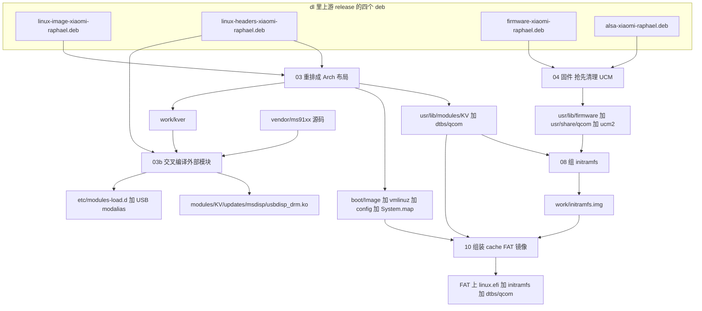
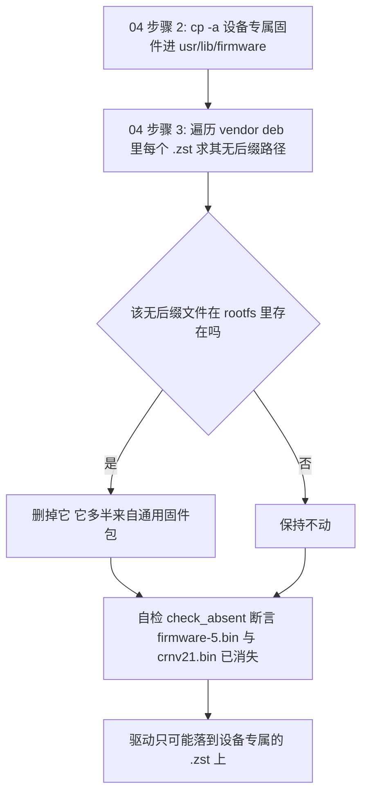

# 内核、设备树、固件与外部模块的交付

镜像里有一整类东西**不是发行版包管理器装出来的**：内核 Image 与模块树、设备树、设备专属固件、ALSA UCM 描述、一个外部交叉编译的投屏模块，以及 initramfs 里那几份必须在挂根前就位的小固件。它们全部来自 `dl/` 下的四个上游 deb（[`scripts/00-fetch.sh`](../../scripts/00-fetch.sh#L15-L19)）加一棵随仓库分发的驱动源码树（`vendor/ms91xx`），由阶段 03、03b、04、08 分别接手，最后经 09/10 固化进产物。本页讲这条链的**交付契约**：每个阶段把什么放到哪里、依据什么判断、换一版内核时要动哪些地方。分区的对应关系与引导链本身见[引导链与镜像/分区布局](boot-chain-and-image-layout.md)，各阶段的完整前置/产物矩阵见[构建流水线各阶段](build-pipeline-stages.md)。



上图：四个 deb 与一棵源码树到 rootfs 落点、再到 initramfs/FAT 的交付路径；`work/kver` 是 03 与 03b 之间唯一的版本契约。

## 贯穿全页的约束：同名固件只有一份能活下来

内核 firmware loader 按**文件名优先**查找：先找驱动请求的那个**无后缀**名字（在 `/lib/firmware` 及 `/lib/firmware/updates` 里），找不到才去试压缩变体（`.zst` 等）。这条规则在[阶段 08](#阶段-08哪些固件必须进-initramfs) 的注释里被写成硬约束（[`scripts/08-initramfs.sh`](../../scripts/08-initramfs.sh#L22-L30)），而[阶段 04](#阶段-04设备固件ucm-与哪份固件被真正加载) 的全部设计都是围着它转：

- 作者的**设备专属固件是 `.zst` 压缩**的，而 ALARM 的通用固件包里常常有**同名的未压缩文件**（典型两例：`ath10k/WCN3990/hw1.0/firmware-5.bin`、`qca/crnv21.bin`）。只要那份未压缩文件在树里，驱动就永远加载不到设备专属版本 —— Wi-Fi/蓝牙会静默用错固件（[`scripts/04-firmware.sh`](../../scripts/04-firmware.sh#L7-L13)）。
- 所以 04 的第 3 步是**删除**：遍历设备固件 deb 里每个 `.zst`，把 rootfs 中对应的无后缀路径删掉，并用 `check_absent` 断言这两条具体路径已经不在了（[`scripts/04-firmware.sh`](../../scripts/04-firmware.sh#L83-L95)、[`scripts/04-firmware.sh`](../../scripts/04-firmware.sh#L120-L134)）。



上图：04 保证「无后缀优先」这条规则不会把通用固件顶到前面的两步；它**不是**通用的同名去重，而是按 vendor deb 的 `.zst` 清单逐条删除。

规则的边界值得记住：它只覆盖「设备固件 deb 里存在 `.zst` 的那些路径」。设备固件 deb 里**未压缩**的文件是靠第 2 步的 `cp -a` 直接覆盖同名通用文件的（[`scripts/04-firmware.sh`](../../scripts/04-firmware.sh#L72-L81)），也就是说：同一路径永远只留一份，可能是压缩的、也可能是覆盖上去的未压缩版本。

同一条规则还以另外两种形式出现，全页都会用到：

- **路径层面**：rootfs 与 initramfs 都让 `/lib` 指向 `usr/lib`，因为 loader 只认 `/lib/firmware`（[`scripts/03-kernel.sh`](../../scripts/03-kernel.sh#L61-L63)、[`scripts/08-initramfs.sh`](../../scripts/08-initramfs.sh#L30)）。
- **运行时的第二次抢先**：`raphael-bt-firmware.service` 会把设备 `bluetooth` 分区里的**原厂 `crnv21.bin`（未压缩）**写进 `/lib/firmware/qca/`——按无后缀优先规则，它正好压过设备固件 deb 里的 `crnv21.bin.zst`，这正是想要的结果（[`scripts/06-config.sh`](../../scripts/06-config.sh#L758-L790)）。

另有一道**防覆盖的闸门**在阶段 02：目标系统的 `/etc/pacman.conf` 写入 `IgnorePkg = linux-firmware`，全量升级用 `--ignore linux-firmware`，避免设备上 `pacman -Syu` 时发行版固件包把设备专属固件换掉或拉进几个 GB 无关固件（[`scripts/02-pacman.sh`](../../scripts/02-pacman.sh#L68-L79)、[`scripts/02-pacman.sh`](../../scripts/02-pacman.sh#L158-L162)）。

## 阶段 03：内核 Image、模块与设备树

### 从 deb 到 Arch 布局

`03-kernel.sh` 用 `ar x` + `tar --zstd` 解包两个 deb（只解开 `data.tar.zst`，`control.tar.zst`/`debian-binary` 用完即删 —— Debian 的 `postinst` 与 kernel hook 在 Arch 上没有对应机制，[`notes/porting-checklist.md`](../../notes/porting-checklist.md#L1330-L1333)），然后把 Debian 路径重排成 Arch 约定（[`scripts/03-kernel.sh`](../../scripts/03-kernel.sh#L23-L31)）：

| 来源（deb 内） | 落点（`$ROOT` 内） | 谁消费 |
|:--|:--|:--|
| `lib/modules/<kver>/`（数百个模块 + `modules.*.bin`，清单见 [`notes/porting-checklist.md`](../../notes/porting-checklist.md#L1320-L1328)） | `/usr/lib/modules/<KV>/` | 设备运行时；08 从中挑模块进 initramfs；`/lib -> usr/lib` 软链保证路径可达 |
| `boot/vmlinuz-<kver>` | `/boot/Image`（EFI stub）**和** `/boot/vmlinuz-<KV>` | `/boot/Image` 是阶段 10 写 FAT `linux.efi` 的源（[`scripts/10-image-boot.sh`](../../scripts/10-image-boot.sh#L31)） |
| `boot/config-<kver>`、`boot/System.map-<kver>` | `/boot/config-<KV>`、`/boot/System.map-<KV>`（可选，缺失不报错） | `config-<KV>` 的唯一消费者是 04 的 zstd 能力检查（[`scripts/04-firmware.sh`](../../scripts/04-firmware.sh#L136-L138)） |
| `boot/dtbs/qcom/*.dtb` 或 `usr/lib/linux-image-<kver>/qcom/*.dtb` | `/usr/lib/modules/<KV>/dtbs/qcom/` | 03 断言 raphael 那份存在；10 把 `sm8150-xiaomi-raphael.dtb` 拷进 FAT |
| `usr/src/linux-headers-<KV>/` | `/usr/src/linux-headers-<KV>/`，并给 `/usr/lib/modules/<KV>/build` 建软链 | 03b 交叉编译外部模块（`build` 软链是 Arch 惯例，供用户后续自编模块） |

解包后 03 会用**宿主** `depmod -b "$ROOT" -a "$KV"` 重建 `modules.dep`（Debian 的 `.bin` 索引里写的是 `/lib/modules`，靠 `/lib` 软链兜住），失败只 warn 并沿用 deb 自带索引（[`scripts/03-kernel.sh`](../../scripts/03-kernel.sh#L111-L115)）。最后它把版本字符串写进 `work/kver`，这是它交给后续阶段的唯一契约（[`scripts/03-kernel.sh`](../../scripts/03-kernel.sh#L117-L119)）。

### `work/kver` 与 `KERNEL_VERSION` 不是一回事

真正的内核版本 `KV` 是**从 deb 里读出来的**：`ls "$TMP/image/lib/modules" | head -1`（[`scripts/03-kernel.sh`](../../scripts/03-kernel.sh#L33-L35)）。`config/build.conf` 里的 `KERNEL_VERSION="7.2"` 只参与两件事：拼出 release 标签 `KERNEL_TAG="kernel-v${KERNEL_VERSION}"`（进而决定 `KERNEL_DEB_BASE`）和打印阶段日志（[`config/build.conf`](../../config/build.conf#L14-L18)、[`scripts/03-kernel.sh`](../../scripts/03-kernel.sh#L18)）。因此：

- 改 `KERNEL_VERSION` 的作用是**换 release 标签**，不改镜像里那个长长的版本串；两者对不上（例如标签改成 `kernel-v7.3` 而 release 里仍是旧 deb）时构建不会报错，只是镜像里还是旧内核。
- 四个 deb 的文件名是固定的，`00-fetch.sh` 不做版本探测（[`scripts/00-fetch.sh`](../../scripts/00-fetch.sh#L15-L19)）；上游 release 换文件名就等于构建挂在下载步骤。
- `work/kver` 是**唯一权威**：01、03b、04、06、08、10 都按它选路径（[`scripts/01-rootfs.sh`](../../scripts/01-rootfs.sh#L69-L76)、[`scripts/03b-ms91xx.sh`](../../scripts/03b-ms91xx.sh#L31-L34)、[`scripts/04-firmware.sh`](../../scripts/04-firmware.sh#L115)、[`scripts/06-config.sh`](../../scripts/06-config.sh#L15)、[`scripts/08-initramfs.sh`](../../scripts/08-initramfs.sh#L15-L16)、[`scripts/10-image-boot.sh`](../../scripts/10-image-boot.sh#L18)）。

### 换版本时的显式清理

阶段之间不重置 `work/root`，而 03 下面的 `cp` **只覆盖同名目录**；所以换内核版本时上一版的模块（200 多 MB）与 `/boot` 残留必须显式删掉，否则镜像里会同时存在两套内核（[`scripts/03-kernel.sh`](../../scripts/03-kernel.sh#L37-L55)）：

- 删掉所有 `$ROOT/usr/lib/modules/*/` 里名字不等于当前 `KV` 的目录；
- 删掉 `/usr/src/linux-headers-*` 里不等于 `linux-headers-$KV` 的目录；
- `rm -f $ROOT/boot/vmlinuz-* config-* System.map-*`（注意 `/boot/Image` 不在删除列表里，它由紧随其后的 `cp -f` 覆盖）。

这些清理是**幂等**的：同版本重跑不会删掉自己要用的东西，因此 03 可以安全地反复执行。

### 设备树：两种打包布局、只挑 sm8150

上游 deb 换过一次打包布局，脚本必须同时认两种，否则 CI 会挂在「缺少 sm8150-xiaomi-raphael.dtb」（[`scripts/03-kernel.sh`](../../scripts/03-kernel.sh#L74-L99)）：

| 布局 | 路径 | 处理 |
|:--|:--|:--|
| 旧 | `boot/dtbs/qcom/*.dtb` | 只有 qcom 相关的少量 DTB，全拷 |
| 新 | `usr/lib/linux-image-<kver>/qcom/*.dtb` | 通用多平台内核，qcom 树有 42 MB；只挑 `sm8150-*.dtb`（11 个约 1.1 MB），全拷会把引导镜像撑大 40 多 MB |

第三种兜底是 `usr/lib/linux-image-*/qcom` 的 glob（版本目录名再变时用）。无论走哪条路，**最后都断言 `sm8150-xiaomi-raphael.dtb` 存在于目标目录**，否则 `die` 并提示来源目录；日志会打印实际用了哪个来源。`notes/porting-checklist.md` 里对同一份 deb 的清单印证了这两种布局确实并存（`boot/dtbs/qcom/` 与 `usr/lib/linux-image-<ver>/`，[`notes/porting-checklist.md`](../../notes/porting-checklist.md#L1320-L1347)）。

## 阶段 04：设备固件、UCM 与「哪份固件被真正加载」

### 先精简包，再装设备固件

04 的第一段是**包层面的取舍**，前提是 `work/pacman-build.conf` 存在（由阶段 02 生成，没有它这段静默跳过）（[`scripts/04-firmware.sh`](../../scripts/04-firmware.sh#L40-L64)）：

- 白名单 `KEEP_FW="linux-firmware-qcom linux-firmware-atheros linux-firmware-other linux-firmware-whence linux-firmware"`：缺哪个补装哪个。`atheros` 虽然不在 `config/build.conf` 的 `PKGS_FIRMWARE` 里，但脚本注释说它提供蓝牙 rampatch（`qca/crbtfw21.tlv`；同一文件在自检表里被归给 `linux-firmware-other`），所以 04 会把它装回来。
- 其余 `linux-firmware-*` 全部 `-Rdd` 卸载（手机用不到的 nvidia/amd/radeon 等，1 GB 级）。
- 顺序上，**补装 atheros 又引入了同名未压缩 Wi-Fi 固件**，所以「装包 → 拷设备固件 → 删抢先文件」这三步不可交换；这也是 `config/build.conf` 里那句「不装 linux-firmware-atheros，它的 WCN3990 未压缩固件会覆盖设备专属固件」注释需要配上 04 第 3 步才成立的原因（[`config/build.conf`](../../config/build.conf#L155-L158)）。

### 设备固件与 UCM 的落点

`firmware-xiaomi-raphael.deb` 与 `alsa-xiaomi-raphael.deb` 解开后按目录整棵拷进树（[`scripts/04-firmware.sh`](../../scripts/04-firmware.sh#L66-L110)）：

| 落点 | 内容 |
|:--|:--|
| `/usr/lib/firmware/` | Wi-Fi（`ath10k/WCN3990/hw1.0/firmware-5.bin.zst`）、蓝牙 NVM（`qca/crnv21.bin.zst`）、ADSP/CDSP/modem（`qcom/sm8150/Xiaomi/raphael/*.mbn`）、Adreno 640 zap 与 GPU 固件（`a640_zap.mbn`、`qcom/a640_gmu.bin`、`qcom/a630_sqe.fw`） |
| `/usr/share/qcom/` | 音频 acdb 与传感器数据 |
| `/usr/share/alsa/ucm2/` | 声卡 UCM 描述（阶段 06 还会在 `conf.d/` 下补四套声卡名，细节见[音频管线与路由](../integrations/audio-pipeline-and-routing.md)） |

这里有一条容易踩的物理事实：Adreno 640 与 630 **共用 `a630_sqe.fw`**，内核里并不存在 `a640_sqe.fw`（[`scripts/04-firmware.sh`](../../scripts/04-firmware.sh#L11-L12)）。

### 自检与 zstd 能力检查

第 5 段自检列出九项必需固件（含「ADSP/传感器」「调制解调器」「Adreno SQE/GMU」「WCN3990 Wi-Fi（设备专属）」）与两项 `check_absent`，缺一项 `FAIL+1`（[`scripts/04-firmware.sh`](../../scripts/04-firmware.sh#L112-L134)）。**但这一整套只是 warn 级**：`FAIL` 非零时只打印一行「固件自检有 N 项异常」，脚本照样成功退出。CI 的产物校验只检查 `out/` 与 FAT 内容，没有任何一步断言固件齐全（[`.github/workflows/build.yml`](../../.github/workflows/build.yml#L354-L367)）——所以「构建成功」不等于「Wi-Fi/蓝牙/GPU 固件到位」。

紧接着的一项检查依赖阶段 03 的产物：如果 `/boot/config-$KV` 里有 `CONFIG_FW_LOADER_COMPRESS_ZSTD=y` 就认可 `.zst` 固件；否则**就地解压全部 `.zst`**（`zstd -d --rm`）。这一步不会破坏前面建立的「无后缀优先」不变量，因为在它之前冲突的无后缀文件已经被删光了；代价是镜像里多出解压后的副本（[`scripts/04-firmware.sh`](../../scripts/04-firmware.sh#L136-L145)）。

### `regulatory.db`：故意删掉

上游 `wireless-regdb` 的签名不被 vendor 内核信任（`REQUIRE_SIGNED_REGDB=y`），加载必然失败，所以 04 **主动删除** `regulatory.db` 与 `regulatory.db.p7s`，退化成 world 域（[`scripts/04-firmware.sh`](../../scripts/04-firmware.sh#L96-L99)）。三个连带后果：

1. 5GHz 信道要靠引导命令行里的 `cfg80211.ieee80211_regdom=<WIFI_COUNTRY>` 才能按实际国家码放开，由阶段 10 写入（[`scripts/10-image-boot.sh`](../../scripts/10-image-boot.sh#L113-L114)）；
2. 阶段 08 那段「把 `regulatory.db` 拷进 initramfs」的循环在正常构建里**什么也不拷**（见下一节）；
3. 设备上 `Direct firmware load for regulatory.db failed` 这行 dmesg 是**预期**的，不用修（[`HANDOVER.md`](../../HANDOVER.md#L279-L284)）。

## 阶段 08：哪些固件必须进 initramfs

判据只有一条：**内建驱动在根文件系统挂上之前就会 `request_firmware()` 的固件**。08 自己拼一个极小 cpio（静态 busybox + 几个模块 + 少量固件 + `/init`），不依赖 mkinitcpio 执行环境（阶段 06 已经把发行版 preset 删掉，见下）（[`scripts/08-initramfs.sh`](../../scripts/08-initramfs.sh#L1-L9)、[`scripts/06-config.sh`](../../scripts/06-config.sh#L362-L374)）。

| 进 initramfs 的固件 | 为什么 | 证据 |
|:--|:--|:--|
| `qcom/a630_sqe.fw`、`a640_gmu.bin`、`a630_gmu.bin` | `msm_dpu`/`adreno` 是**内建**驱动，开机不到 1 秒就 probe；那时只有 initramfs 可读。缺 SQE 会让 GPU 在无固件状态下初始化，症状就是开机/熄屏瞬间花屏 | [`scripts/08-initramfs.sh`](../../scripts/08-initramfs.sh#L73-L85)、真机日志见 [`README.md`](../../README.md#L710-L742) |
| `qcom/sm8150/Xiaomi/raphael/a640_zap.mbn`、`ipa_fws.mbn` | remoteproc 早期固件（体积小，属于「早到无害」的类别） | [`scripts/08-initramfs.sh`](../../scripts/08-initramfs.sh#L65-L71) |
| `regulatory.db`、`regulatory.db.p7s` | 代码里有拷贝循环，但阶段 04 已删源文件，实际是空转；无线管制域只能靠引导参数 | [`scripts/08-initramfs.sh`](../../scripts/08-initramfs.sh#L86-L90) |

真机复现过的失败形态（也是 `initramfs` 里必须有 `/lib -> usr/lib` 软链的原因）是：

```text
[ 0.63s] msm_dpu: Direct firmware load for qcom/a630_sqe.fw failed with error -2
[10.0s]  msm_dpu: [drm:adreno_request_fw] loaded qcom/a630_sqe.fw from new location
```

0.63 秒那次才是 GPU 初始化用到的；10 秒后补上已经晚了（[`scripts/08-initramfs.sh`](../../scripts/08-initramfs.sh#L22-L30)、[`HANDOVER.md`](../../HANDOVER.md#L307-L319)）。修法是 initramfs 顶层建 `ln -sfn usr/lib "$IR/lib"`——少了它，特意塞进去的 `usr/lib/firmware/...` 等于没塞。

两个顺序依赖要记住：

- 08 的固件是**从 rootfs 树里取**的（`cp -f "$ROOT/usr/lib/firmware/qcom/$f"`），所以必须跑完 03/04 再跑 08；用 `--only 08` 重建时，它拷的是当前树里的固件，而不是「本次 04 应该产生」的固件（[`scripts/08-initramfs.sh`](../../scripts/08-initramfs.sh#L79-L85)）。
- 08 拷进去的五个模块（`phy-qcom-qmp-ufs`、`ufs-qcom`、`scsi_common`、`ext4`、`crc32c_generic`）在启动路径上**并没有被加载**：`/init` 全程不调用 `modprobe`，UFS/ext4 在内核里是内建的；`copy_mod` 对不存在的 `.ko` 静默跳过，所以实际数量取决于新内核把这些编成内建还是模块（[`scripts/08-initramfs.sh`](../../scripts/08-initramfs.sh#L50-L63)、[`scripts/08-initramfs.sh`](../../scripts/08-initramfs.sh#L93-L168)）。

## 阶段 03b：在 x86_64 上交叉编译外部模块

`03b-ms91xx.sh` 把 `vendor/ms91xx` 里的 MacroSilicon MS91xx（MS9132/MS9133/MS9135）USB 投屏驱动编成 aarch64 模块装进 rootfs；插上 USB→HDMI/VGA 转接器后系统多出一块屏（[`scripts/03b-ms91xx.sh`](../../scripts/03b-ms91xx.sh#L1-L24)）。

### 依赖 03 的中间产物，以及那个跳过开关

03b **不进 namespace**（纯宿主交叉编译，只在最后写 tree），它在最前面就检查两个硬前置：`work/kver` 与 `work/deb/headers/usr/src/linux-headers-$KV` 这棵头文件树——两者都是阶段 03 的中间产物，缺任一即 `die` 并提示先跑 03（[`scripts/03b-ms91xx.sh`](../../scripts/03b-ms91xx.sh#L25-L36)）。`SKIP_MS91XX=1` 会让它**什么都不做**地 `exit 0`（[`scripts/03b-ms91xx.sh`](../../scripts/03b-ms91xx.sh#L28-L29)）——所以想砍掉投屏能力不需要改脚本，构建产物里就没有这个模块，也没有对应的开机加载项。

### 让 kbuild 在 x86_64 上跑起来

Debian 的 headers 包是给 aarch64 用的，里面带了 **aarch64 的宿主工具**，在 x86_64 构建机上执行不了。03b 的处理是「先删、再自建、最后兜底」：

| 障碍 | 对策 | 证据 |
|:--|:--|:--|
| `scripts/sorttable`、`scripts/selinux/mdp/mdp`、`scripts/mod/modpost`、`scripts/kallsyms`、`scripts/basic/fixdep`、`scripts/asn1_compiler` 里带的是 aarch64 ELF | 用 `file` 逐个探测后删掉，让 kbuild 用宿主 cc 重编 | [`scripts/03b-ms91xx.sh`](../../scripts/03b-ms91xx.sh#L38-L46) |
| headers 包没有 Kconfig，kbuild 会去跑 `syncconfig` 并必然失败 | 伪造 `.config`（从 `include/config/auto.conf` 复制并把 mtime 设成 2024-01-01）与空的 `include/config/auto.conf.cmd` | [`scripts/03b-ms91xx.sh`](../../scripts/03b-ms91xx.sh#L48-L53) |
| `fixdep` 缺失 | `make -C "$KDIR" ARCH=arm64 LLVM=1 scripts`（忽略退出码，因为编完脚本工具后会因缺 `scripts/dtc` 报错），之后断言 `fixdep` 可执行 | [`scripts/03b-ms91xx.sh`](../../scripts/03b-ms91xx.sh#L55-L60) |
| `modpost` 缺失 | **优先用 headers 包自带源码在宿主编译器上自建**（`modpost.c file2alias.c sumversion.c symsearch.c`，不能带 `-I$KDIR/include`，否则内核的 `linux/types.h` 遮蔽系统头）；失败才回退借用宿主 `/lib/modules/*/build/scripts/mod/modpost` | [`scripts/03b-ms91xx.sh`](../../scripts/03b-ms91xx.sh#L62-L85) |

modpost 自建优先这一点是 CI 逼出来的：早期写法依赖宿主内核构建树，本地（装过内核头）永远看不出问题，GitHub runner 上必挂（[`scripts/03b-ms91xx.sh`](../../scripts/03b-ms91xx.sh#L64-L65)）。

### 编译、判定与落盘

编译命令是 `make -C "$KDIR" M="$SRC" MO="$MO" ARCH=arm64 LLVM=1 CONFIG_DRM_MS91XX=m modules`，其中 `MO=work/ms91xx-build` 把中间产物挡在 `vendor/` 之外（保持源码树干净）（[`scripts/03b-ms91xx.sh`](../../scripts/03b-ms91xx.sh#L87-L94)）。**`make` 的退出码被刻意忽略**：生成 modpost 之后 kbuild 会因缺 `scripts/dtc/Makefile`（编 dtc 用的，外部模块不需要）而中止。因此判定成功的唯一依据是 `work/ms91xx-build/drm/usbdisp_drm.ko` 是否生成，否则打印构建日志尾部并 `die`（[`scripts/03b-ms91xx.sh`](../../scripts/03b-ms91xx.sh#L94-L106)）。

真正被编出来的只有一个模块：`drm/Makefile` 把 19 个源文件合进 `usbdisp_drm.o`（`vendor/ms91xx/README.md` 里 DKMS 时代的 `usbdisp_usb.ko` 在这条构建路径上并不存在，USB 接口表与 `module_init` 都在同一个模块里）（[`vendor/ms91xx/drm/Makefile`](../../vendor/ms91xx/drm/Makefile#L9-L30)、[`vendor/ms91xx/drm/msdisp_usb_drv.c`](../../vendor/ms91xx/drm/msdisp_usb_drv.c#L284-L366)）。

落点是 `/usr/lib/modules/$KV/updates/msdisp/usbdisp_drm.ko`（外部模块的惯用位置），随后用宿主 `depmod -b "$ROOT" "$KV"` 刷新模块依赖与 alias 数据库；`depmod` 失败只 warn，并明确提示「插上转接器后可能需要手动 `modprobe usbdisp_drm`」（[`scripts/03b-ms91xx.sh`](../../scripts/03b-ms91xx.sh#L108-L122)）。

### 加载路径：`modules-load.d` + USB modalias 双保险

同一个模块有两条加载路径，互为保险，但都建立在同一个前提上（模块已装进 `/usr/lib/modules/$KV` 且 `depmod` 跑过）：

| 路径 | 机制 | 什么时候生效 |
|:--|:--|:--|
| `/etc/modules-load.d/raphael-msdisp.conf`（内容只有一行 `usbdisp_drm`） | `systemd-modules-load.service` 开机时显式 `modprobe` | 每次启动，**没有硬件也照加载**，只注册一个 DRM 驱动，无害 |
| USB modalias | 模块内含 `MODULE_DEVICE_TABLE(usb, id_table)`（`345f:9132`/`9133`/`9135` 与 mode-switch 后的 `534d:6021`），`depmod` 的 alias 数据库让内核在设备插入时自动加载 | 热插拔/开机时发现转接器 |

证据：[`scripts/03b-ms91xx.sh`](../../scripts/03b-ms91xx.sh#L96-L100)、[`vendor/ms91xx/drm/msdisp_usb_drv.c`](../../vendor/ms91xx/drm/msdisp_usb_drv.c#L284-L328)、[`README.md`](../../README.md#L894-L919)。真机验证是「模块加载成功、没有转接器时安静待机（`Cannot find any crtc or sizes`）」。

### 与 `modprobe.d` 里 blacklist 的关系（注意方向相反）

`modprobe.d` 的 `blacklist` 与 `modules-load.d`/modalias 是**两种相反的加载策略**，本项目按子系统分别选用：

- **投屏模块走自动**：`usbdisp_drm` 没有任何 blacklist，`modules-load.d` 与 USB modalias 随便哪条先到都能加载。
- **音频走手动**：`slim_qcom_ngd_ctrl` 与 `snd_soc_sm8150` 被写进 `/etc/modprobe.d/raphael-audio.conf` 的 `blacklist`，把自动/别名加载路径切断（它们要与 ADSP 做 ~1 秒窗口的 QMI 握手、要等 SLIMbus codec 枚举出来，抢跑会**永久失败**），改由 `raphael-audio-init.sh` 在 `pd-mapper` 与 codec 就绪后显式 `modprobe`（[`scripts/06-config.sh`](../../scripts/06-config.sh#L546-L596)）。细节与真机现象见[音频管线与路由](../integrations/audio-pipeline-and-routing.md)。
- 同样的分工还有两处直接写进 `modules-load.d`：`qcom_pd_mapper`（调制解调器启动早期就要 servreg 电源域映射，不能等 udev 异步 modalias，[`scripts/05-qcom.sh`](../../scripts/05-qcom.sh#L202-L215)）与 `leds-qcom-flash`（闪光灯，[`scripts/06-config.sh`](../../scripts/06-config.sh#L921-L929)）。

一个历史上的坑值得记：早期版本给 pd-mapper 写过 blacklist，会让 Wi-Fi 彻底不可用，05 现在还专门删除那个残留文件（[`scripts/05-qcom.sh`](../../scripts/05-qcom.sh#L227-L230)）。

### 落盘顺序上的一个缺口

`modules-load.d/raphael-msdisp.conf` 写在「`.ko` 是否生成」的检查**之前**（[`scripts/03b-ms91xx.sh`](../../scripts/03b-ms91xx.sh#L96-L106)）。所以：

- `SKIP_MS91XX=1`：在最前面 `exit 0`，树里**什么都不会**多出来，自洽。
- 编译失败：已经写下的自加载条目会留在树里，指向一个不存在的模块（开机时 `systemd-modules-load` 会报一条失败）。这时脚本是 `die` 的，构建会中断，但 `work/root` 已经被改动——重跑前值得留意。

维护面还有一层：驱动源码是 MacroSilicon 官方 GPL-2.0 代码的 modern-kernel fork（覆盖 6.8→7.0+），本项目又为 7.2 补了四处适配（`drm_helper_mode_fill_fb_struct()` 恢复 `info` 参数、原子钩子改收 `struct drm_atomic_commit`、`fb_create()` 多一个 `info`、`__kernel_write` 改 `kernel_write`），全部带 `LINUX_VERSION_CODE` 条件（[`scripts/03b-ms91xx.sh`](../../scripts/03b-ms91xx.sh#L9-L16)、[`vendor/ms91xx/README.md`](../../vendor/ms91xx/README.md#L76-L103)、[`README.md`](../../README.md#L904-L912)）。**换内核 = 这个模块必须重编并重新过一遍编译日志**，这是升级内核时最容易漏的一环。

## 升级内核时要连带检查什么

### `config/build.conf` 里固定的东西

| 变量 | 值 | 作用 |
|:--|:--|:--|
| `KERNEL_VERSION` | `7.2` | 只用于拼 `KERNEL_TAG` 与日志；**不是**镜像里的版本串 |
| `KERNEL_TAG` | `kernel-v${KERNEL_VERSION}` | 上游 release 的标签 |
| `KERNEL_REPO` / `KERNEL_DEB_BASE` | `GengWei1997/kernel-deb` / `…/releases/download/<tag>` | 四个 deb 的下载前缀，文件名在 `00-fetch.sh` 里写死 |

（[`config/build.conf`](../../config/build.conf#L14-L18)、[`scripts/00-fetch.sh`](../../scripts/00-fetch.sh#L15-L19)。）改版本号的同时必须确认上游 release 存在、且四个文件名没变，否则构建挂在 00。

### 连带清单

| 位置 | 要检查什么 | 不检查的后果 |
|:--|:--|:--|
| 01 | `KEEP_KVER`/`*sm8150*` 保留规则与 `/boot` 清理（[`scripts/01-rootfs.sh`](../../scripts/01-rootfs.sh#L66-L90)） | 树里留下发行版内核模块或上一版 `/boot/Image` |
| 03 | 三段清理循环、dtb 两种布局识别、`sm8150-xiaomi-raphael.dtb` 断言（[`scripts/03-kernel.sh`](../../scripts/03-kernel.sh#L37-L99)） | 两套内核固化进镜像，或 CI 挂在缺 DTB |
| 03b | 用新的 `work/kver` 重编模块；头文件树里的宿主工具与 Kconfig 缺失情况是否还成立（[`scripts/03b-ms91xx.sh`](../../scripts/03b-ms91xx.sh#L31-L85)） | 新内核里没有投屏模块（或模块 vermagic 与内核不匹配，加载失败） |
| 04 | `config-<KV>` 是否被拷进 `/boot`（zstd 能力检查的输入），`CONFIG_FW_LOADER_COMPRESS_ZSTD` 是否还开着（[`scripts/04-firmware.sh`](../../scripts/04-firmware.sh#L136-L145)） | 检查静默跳过；新内核若不再支持 zstd 固件，就会加载失败 |
| 05 | 上游 `rmtfs`/`pd-mapper` 单元的 `ConditionKernelVersion` 行被删掉——这类条件按发行版内核版本号判断，与本项目的 vendor 内核版本串对不上（[`scripts/05-qcom.sh`](../../scripts/05-qcom.sh#L202-L207)） | 调制解调器/音频依赖的守护进程被 systemd 跳过 |
| 06 | `modules-load.d/raphael-msdisp.conf` 指向的模块是否真的存在（条目由 03b 写入，[`scripts/03b-ms91xx.sh`](../../scripts/03b-ms91xx.sh#L96-L100)） | 每次开机一条失败单元 |
| 08 | initramfs 的模块与固件拷贝都按 `work/kver` 取件（[`scripts/08-initramfs.sh`](../../scripts/08-initramfs.sh#L15-L16)） | initramfs 里混进上一版模块，或 GPU 固件缺席 |
| 09/10 | 重跑 09 让 rootfs 带上新的模块树，重跑 10 让 FAT 带上新的 `linux.efi` 与 `dtbs/qcom/*` | 见下 |

### `/boot` 里的两份拷贝与「成套」要求

阶段 03/08 会把内核与 initramfs 也写进 **rootfs 的 `/boot`**（`Image`、`vmlinuz-<KV>`、`config-<KV>`、`System.map-<KV>`、`initramfs-raphael.img`），但设备上运行时 `cache` 分区被挂到 `/boot`，这些文件会被**挂载遮蔽**：真正生效的永远是 FAT 上由阶段 10 写下的 `linux.efi`、`initramfs`、`dtbs/qcom/*`（[`scripts/03-kernel.sh`](../../scripts/03-kernel.sh#L65-L72)、[`scripts/08-initramfs.sh`](../../scripts/08-initramfs.sh#L175-L177)、[`scripts/10-image-boot.sh`](../../scripts/10-image-boot.sh#L26-L33)）。两个推论：

- 树里的那几份是**宿主侧暂存/备份**，其中只有 `/boot/Image`（10 的源）与 `/boot/config-<KV>`（04 的输入）有脚本消费者；`vmlinuz-<KV>`/`System.map-<KV>` 属于留档。
- 内核与模块**分别住在两个地方**：内核/DTB 在 FAT（`cache`），模块树在 rootfs（`userdata`）。所以换内核时既要重跑 03→10 重造 `boot-cache.img`，也要让 rootfs 里出现新版的 `/usr/lib/modules/<KV>`——**两者必须成套**，只换一边的结果是「新内核找不到模块」或「模块与运行内核不匹配」。免刷机地把 `linux.efi`/`initramfs`/`dtb` 丢进设备 `/boot` 只能验证 FAT 那一半，模块仍要重新成像（[`HANDOVER.md`](../../HANDOVER.md#L405-L414)、[`README.md`](../../README.md#L710-L742)）。

顺带两个不起眼但会绊人的点：

- `01-rootfs.sh` 的 rootfs 清理、`06-config.sh` 对 `mkinitcpio` preset 与 `/boot/initramfs-linux*.img` 的删除，都是为了让树里不积攒发行版内核残留；`initramfs-raphael.img` 不在删除名单里，由 08 每次覆盖（[`scripts/06-config.sh`](../../scripts/06-config.sh#L362-L374)）。
- `lib.sh` 里有一行按 `^7\.` 匹配的 `KVER` 变量（[`scripts/lib.sh`](../../scripts/lib.sh#L168)），但仓库里没有任何消费者。它是死代码：内核版本真的跨到 8.x 时不要指望它，路径一律以 `work/kver` 为准。

## 失败与验证入口

| 症状 | 最可能的交付环节 | 怎么确认 |
|:--|:--|:--|
| 开机/熄屏瞬间花屏 | initramfs 缺 GPU 固件或缺 `/lib` 软链 | `dmesg \| grep -c "failed to load a630_sqe"` 应为 0，且 1 秒内就出现 `loaded qcom/a630_sqe.fw` |
| Wi-Fi 扫不到 AP | 加载到了通用 WCN3990 固件（未压缩抢先文件没删干净），或缺 `tqftpserv`/固件服务 | `dmesg \| grep -i ath10k`；`qrtr-lookup` 里应有 `ATH10k WLAN firmware service` |
| 蓝牙不可用 | 用了发行版 `qca/crnv21.bin` 而非原厂 NVM，或缺设备树 `local-bd-address` | `btmgmt info` 不应报 `Invalid Index`；`raphael-bt-firmware.service` 是否装过原厂 NVM |
| 5GHz 连不上 | 04 删掉了 `regulatory.db` 但引导参数没有 `cfg80211.ieee80211_regdom` | 看阶段 10 日志里的 `root 参数` 行（[`scripts/10-image-boot.sh`](../../scripts/10-image-boot.sh#L111-L118)） |
| 插上投屏器没有第二块屏 | 03b 没跑/被 `SKIP_MS91XX` 跳过、编译失败，或 `depmod` 没成功 | `lsmod \| grep usbdisp_drm`、`lsusb` 看 `345f:9132`，必要时手动 `modprobe usbdisp_drm` |
| 构建日志说 04「完成」但固件不全 | 04 的自检是 warn 级 | 在日志里搜 `固件自检` 与 `✗` 行（[`scripts/04-firmware.sh`](../../scripts/04-firmware.sh#L112-L148)） |

## 相关页面

- [引导链与镜像/分区布局](boot-chain-and-image-layout.md) —— `linux.efi`、`initramfs`、DTB 最终落在哪个分区，以及免刷机迭代的边界。
- [构建流水线各阶段](build-pipeline-stages.md) —— 03/03b/04/08 的前置、产物与失败语义矩阵。
- [构建配置模型](../concepts/configuration-model.md) —— `KERNEL_VERSION` 等 `config/build.conf` 变量、阶段级环境开关与覆盖优先级。
- [音频管线与路由](../integrations/audio-pipeline-and-routing.md) —— UCM、`modprobe.d` blacklist 与 `raphael-audio-init.sh` 的时机关系。
- [Qualcomm remoteproc 与用户态](../integrations/qualcomm-remoteproc-and-userspace.md) —— `rmtfs`/`pd-mapper`/`tqftpserv` 与 `qcom_pd_mapper` 模块如何喂养 ADSP/CDSP 固件加载。
- [硬件支持与能力边界](../concepts/hardware-support-and-limits.md) —— 哪些固件/驱动让 Wi-Fi、蓝牙、GPU、调制解调器可用。
- [rootfs 布局与 fstab](../concepts/rootfs-layout-and-fstab.md) —— `/boot` 挂载点与 `cache` 分区的关系。
- [失败模式与不变量](../concepts/failure-modes-and-invariants.md) —— 「构建成功 ≠ 镜像可用」这类判据的全局视角，以及 04 自检只告警等已登记的缺口。
- [无 root 构建运行时](rootless-build-runtime.md) —— 03/04 在 namespace 内操作目标树的机制与代价。
- [刷机与恢复](../workflows/flash-a-device.md) —— 成套刷写 `boot`/`cache`/`userdata` 的顺序。
