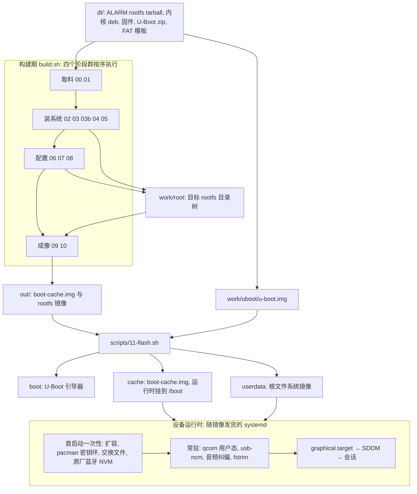

# 架构总览：构建侧与运行时侧的四个阶段群

这个仓库不是一个"在手机上安装的系统"，而是两半拼起来的东西：

- **构建侧**：一条宿主侧离线装配流水线。它**不编译内核、也不编译 U-Boot**，而是把上游产物（Arch Linux ARM aarch64 rootfs tarball、`GengWei1997/kernel-deb` 的 7.2 内核 deb、作者固件 deb、U-Boot zip、cache 分区的 FAT 模板）重排成能刷进一台 raphael 的三份镜像。
- **运行时侧**：一层随镜像发货的设备定制 —— 设备树、固件、精简 UCM、脚本与 `raphael-*` 单元、音频路由、qcom 用户态，全部在设备开机后由 systemd 拉起。

两个入口：宿主上 `./build.sh`（`--from` / `--only` / `--list`，阶段脚本在 `scripts/`）；设备侧 `./scripts/11-flash.sh --flash` 把产物写进分区。`dl/`、`work/`、`out/` 是生成物不是源码（见 [仓库布局与入口点](repository-layout-and-entrypoints.md)）。

构建默认**不需要 root**：需要 chroot 的阶段都用 `lib.sh` 的 `require_ns` 把自己重入 user namespace，只有还没有 rootfs 的 `00-fetch.sh` 与纯宿主交叉编译的 `03b-ms91xx.sh` 不这样做（机制与代价见 [无 root 构建运行时](rootless-build-runtime.md)）。

## 四个阶段群

[`build.sh`](../../build.sh#L26-L39) 的 `STAGES` 数组给出全部 12 个阶段项（阶段号 `00`–`10`，其中 `03b-ms91xx.sh` 是唯一带字母后缀的阶段），并按数组顺序逐个 `bash scripts/<阶段>.sh`、把输出 `tee` 进 `logs/build.log`，任一阶段失败立即中止。`11-flash.sh` 不在流水线里（只在 `--list` 时被补印一行），`99-make-release.sh` 更是另一条通道。

上图：四个阶段群怎样把 `dl/` 的上游产物变成三份镜像，镜像落到哪些分区，以及分区里的内容开机后由谁跑。

| 阶段群 | 阶段 | 负责什么 |
|:--|:--|:--|
| 取料 | `00` `01` | 下载并缓存上游产物到 `dl/`（ALARM rootfs tarball、内核与固件 deb、U-Boot zip、FAT 模板），再把 ALARM rootfs 解包成 `work/root` 目录树并校正权限 |
| 装系统 | `02` `03` `03b` `04` `05` | 用宿主 pacman 以 `--arch aarch64 --noscriptlet` 把基础系统与所选桌面装进树里、并对齐仓库快照；把作者内核 deb 重排成 Arch 布局；在宿主上交叉编译 MS91xx USB 投屏驱动模块；铺设备固件与精简 UCM；交叉编译 qcom 用户态（`rmtfs`/`pd-mapper`/`tqftpserv`/`qrtr`） |
| 配置 | `06` `07` `08` | 系统级配置（locale、fstab、用户、USB NCM、电源、zram、音频路由、全部 `raphael-*` 单元）；桌面/会话配置（SDDM、字体、输入法）；手工组装 initramfs |
| 成像 | `09` `10` | 造根文件系统镜像（含 `img2simg` 的 sparse 版）；造 cache 分区的 FAT32 引导镜像并注入蓝牙地址 |

阶段 02 的做法决定了后面很多事情的形态：它**不在 chroot 里跑 aarch64 程序**，而是让宿主 x86_64 的 pacman 直接往 `$ROOT` 装包并一律 `--noscriptlet`，装完列表后再用 `-Su --noscriptlet --ignore linux-firmware` 把整个 rootfs 对齐到仓库快照（忽略 `linux-firmware` 是刻意的：设备固件来自作者 deb，升级它只会连带拉进几个 GB 的无关固件）。因此**发行版的 scriptlet 与 preset 从未执行过**，所有 enable 动作（连用户级的 `pipewire.socket` / `wireplumber.service`）都必须由阶段脚本自己完成 —— 漏掉的症状是"系统里有声音选项但一个输出设备都没有"。逐阶段的前置条件、输入输出与"哪些只告警不失败"，见 [构建流水线各阶段](build-pipeline-stages.md)。

布局则是另一处跨阶段契约：根文件系统形态由 `lib.sh:rootfs_layout()` 单点决定（`ext4` / `btrfs-subvol` / `btrfs-flat`，结果缓存在 `work/rootfs-layout`），阶段 06 按它写 fstab、阶段 09 按它造镜像（loop 挂载失败回退 flat 时**先重写 fstab 再 `mkfs -r`**）、阶段 10 按它生成 `rootfstype=` 与 `rootflags=subvol=...`。细节与历史事故见 [rootfs 布局、fstab 与扩容](../concepts/rootfs-layout-and-fstab.md)。

## 产物清单与目标分区

最终产物只有三样，各自对应一个设备分区：

| 产物 | 产出阶段 | 落到哪个分区 | 里面是什么 |
|:--|:--|:--|:--|
| `work/uboot/u-boot.img` | `00`（从上游 release 的 zip 里解出，仓库不编译引导器） | `boot` | 引导器本体 |
| `out/boot-cache.img` | `10`（以上游 256 MiB FAT32 模板原地改写） | `cache` | systemd-boot、内核 `linux.efi`、`initramfs`、dtb、三个 systemd-boot 条目；运行时挂到 `/boot` |
| `out/rootfs.img` / `out/rootfs.sparse.img` | `09` | `userdata` | Arch Linux ARM 根文件系统（默认 btrfs，可能是 `@`/`@home`/`@swap` 子卷布局，也可能是单子卷） |
| —— | —— | `dtbo` | **没有产物**：刷机时被 `fastboot erase dtbo` 清掉 |

设备侧的启动链是 U-Boot（`boot` 分区）→ cache 分区上的 `EFI/BOOT/BOOTAA64.EFI`（systemd-boot）→ 条目指定的内核 `linux.efi` 与 `initramfs` → `userdata` 上的根文件系统（内核命令行 `root=UUID` / `rootfstype` / `rootflags`）→ systemd → SDDM 会话。

刷机顺序是固定的：先 `erase dtbo boot cache userdata`，再依次 `flash boot`（U-Boot）、`flash cache`、`flash userdata`，最后 `reboot`；三份产物缺任何一份脚本直接失败（[`scripts/11-flash.sh`](../../scripts/11-flash.sh#L84-L117)、[`scripts/99-make-release.sh`](../../scripts/99-make-release.sh#L37-L45)）。

几件必须知道的事：

- **`cache` 就是运行时的 `/boot`**（fstab 用 `PARTLABEL=cache` 挂 vfat 到 `/boot`，`umask=0077`）。所以换内核、initramfs、设备树**不用重新刷机**：`scp` 覆盖 `/boot` 下的文件再重启即可 —— 这是本仓库迭代最快的路径。引导链与 cache 分区里每个文件的来源见 [引导链与镜像/分区布局](boot-chain-and-image-layout.md)。
- **`dtbo` 被擦掉会带走每台设备唯一的蓝牙地址**（产线值写在厂商设备树里，`persist`/`bluetooth` 分区没有明文）。公开镜像不携带地址：构建期可用 `config/local.conf` 的 `BT_MAC`（或环境变量 `RAPHAEL_BT_MAC`）注入，刷机时可用 `11-flash.sh --bt-mac`（或 `scripts/bt-mac.sh`）直接改 FAT 镜像里的设备树；写法是设备树的小端字节序，和 `bluetoothctl` 显示的值相反，格式错误只 WARN 不失败。见 [刷机、备份与救援](../operations/flashing-and-recovery.md)。
- **镜像大小只上不下**：`IMAGE_SIZE`（默认 8G）是下限，阶段 09 按内容自动放大，首启动再由 fstab 的 `x-systemd.growfs` 把根撑满 `userdata` 分区。
- **cache 镜像里的三个条目是有意的容错设计**：`arch.conf` 正常带 initramfs 启动；`arch-direct.conf` 不带 initrd、由内核直接挂根（initramfs 出问题时的救援项）；`arch-debug.conf` 带 initramfs 并加 `loglevel=7` 与 `systemd.log_level=debug`。三者的 `devicetree` 行只在仓库自带 `dtb/raphael-redmi-k20pro.dtb` 存在时写入，指向它；根参数由同一个 `$ROOTOPTS` 生成，所以三个条目不会各说各话。
- `out/boot-cache.img` **不是从零生成**：阶段 10 以上游 release 的 256 MiB FAT32 引导镜像为模板，用宿主 `mtools` 原地替换/新增文件（不需要 root，也不需要挂载）。

## 构建期与运行时的分界

构建期只做两件事：**把静态文件写进 rootfs 目录树**，以及**离线改单元启停状态**（`systemctl --root=/ enable|mask`，在无 dbus 的 chroot 里失败则退回手工建 `*.wants` 软链或指向 `/dev/null` 的 mask 软链）。设备上真正发生的事一律留给随镜像发货的 systemd。

| 事项 | 构建期（阶段脚本） | 设备运行时 |
|:--|:--|:--|
| 文件落地 | 决定 rootfs 里有哪些文件、fstab 怎么写、引导项参数是什么 | —— |
| 单元启停 | 离线 `enable`/`mask`（`lib.sh:enable_unit` / `mask_unit`，经 qemu 在 chroot 内执行，不需要 dbus） | systemd 按 `*.wants` 软链启动 |
| 根扩容 | 把 `x-systemd.growfs` 写进 fstab（systemd 没提供 `systemd-growfs@` 时退回自建 `raphael-growfs.service`） | 首次开机把根撑满 `userdata` |
| 首启动一次性动作 | 只放脚本 + 条件（`ConditionPathExists=…`），不执行 | `raphael-firstboot.service` 初始化 pacman keyring（含 archlinuxcn）、`raphael-swapfile.service` 在 `@swap` 建 nocow 交换文件并写进 fstab、`raphael-bt-firmware.service` 从 `bluetooth` 分区把原厂 NVM/固件装到 `/lib/firmware/qca` |
| 音频 | 把作者 deb 的 UCM 裁成只留能工作的扬声器通路并补到实际声卡名对应目录（`Raphael` / `sm8150` / `sm8150_raphael` / `xiaomi-XiaomiRedmiK20Pro` —— 声卡名会随内核构建变化，只要有一个打不开的 PCM，PipeWire 的 ACP 就会放弃整个 UCM）、写 WirePlumber 格式规则、blacklist `slim_qcom_ngd_ctrl` 与 `snd_soc_sm8150` | `raphael-audio-init.timer` 开机 12 秒后重启 `pd-mapper`、手动加载 slim-ngd、等 codec 就绪再 `modprobe` 声卡、以用户身份重启 WirePlumber 并把 profile 从 `pro-audio` 切到 `HiFi` 或 `output:stereo-fallback`、写 Q6 mixer；`raphael-audio-routing.timer` 从 25 秒起每 20 秒重设这批 mixer，并把掉回 `pro-audio`/`off` 的 profile 切回来（ACP 激活 profile 时会复位路由与 profile） |
| qcom 用户态 | `rmtfs`/`pd-mapper`/`tqftpserv`/`qrtr` 在 ALARM 仓库里不存在，阶段 05 用宿主 clang 交叉编译进镜像，阶段 06 再显式 `enable` | 常驻，给 ADSP/CDSP/MSS 提供固件、电源域（servreg）与 EFS 服务；没跑就没有 Wi-Fi（WLFW）与声音 |
| 网络 | 禁用并 mask ALARM 默认启用的 `systemd-networkd`/`systemd-resolved`，改用 NetworkManager（阶段 09 还会硬检查残留软链），并写入 USB NCM gadget 脚本 | `usb-ncm.service` 等 UDC 出现后绑 gadget，设备侧固定 `172.16.42.1` 供 SSH 直连 |
| 桌面 | 写 `sddm.conf.d/10-raphael.conf`（会话、自动登录、合成器、主题）并 `set-default graphical.target` | SDDM 起登录界面 → 会话 |
| 其它 | `fstrim.timer`、`zram-generator`、`raphael-snapper-setup.service`、`raphael-display-nopm.service`、非 KDE 时的 `raphael-power-key.service` | 各自在上线后执行 |

几处"故意屏蔽"同属运行语义：`sleep`/`suspend`/`hibernate`/`hybrid-sleep` 目标被 mask（SM8150 只有 s2idle 且不稳定，用熄屏代替），`logind` 的 `HandlePowerKey` 等设成 `ignore` 把电源键交给桌面或自研守护，`systemd-firstboot.service` 被 mask 以免交互式首启卡住无人值守启动。逐单元的所有权表与启动时序见 [设备启动时序、服务所有权与首启动初始化](../runtime/boot-sequence-and-service-ownership.md)。

跨阶段的所有权只剩一处分歧：`05-qcom.sh` 明确把用户态 `pd-mapper` 保持禁用（真机验证内核 `qcom_pd_mapper` 已覆盖必需的电源域映射），但随后运行的 `06-config.sh` 6b 段又把它 `enable` 回来，所以镜像里最终是**启用**状态 —— 要改 qcom 服务启停，两个阶段都得看。

## 哪些是 raphael 专属，哪些是可迁移机制

这是本仓库最容易让新读者误判的地方：**通用机制**（阶段骨架、无 root 构建、systemd-boot 引导项、btrfs + `x-systemd.growfs`、单元 enable/mask）与**设备专属配置**（内核、设备树、固件、声卡名、分区名）混在同一个脚本目录里。

| 层面 | raphael / SM8150 专属 | 可迁移的 Arch/ALARM 机制 |
|:--|:--|:--|
| 引导与内核 | 上游 `linux-xiaomi-raphael-uboot` 的 U-Boot；`GengWei1997/kernel-deb` 的 7.2 内核 deb；`dtb/raphael-redmi-k20pro.dtb`；`erase dtbo` 与每机唯一的蓝牙地址 | systemd-boot 的 `loader.conf` + `loader/entries/*.conf`；`root=`/`rootfstype=`/`rootflags=` 引导参数 |
| 分区 | `boot`/`cache`/`userdata` 这套 Android 分区名，`cache` 当 `/boot` | FAT32 镜像用 `mtools` 无 root 读写；`mke2fs -d` / `mkfs.btrfs -r` |
| 根文件系统 | —— | ALARM aarch64 rootfs tarball；btrfs 子卷 + `compress=zstd:3`；`x-systemd.growfs` |
| 软件来源 | 设备固件与 UCM 来自作者 deb（且阶段 04 会**故意删掉** `regulatory.db*`：内核要求签名管制数据库而这个包的签名不被 vendor 内核信任，无线管制域只能靠引导参数 `cfg80211.ieee80211_regdom` 设置）；qcom 用户态要自己交叉编译；`vendor/ms91xx` 的投屏驱动 | 宿主 pacman `--arch aarch64` 装 ALARM/archlinuxcn 包；`--noscriptlet` + qemu 补跑 |
| 硬件服务 | `tqftpserv`/`rmtfs`/`pd-mapper`、蓝牙原厂 NVM、精简 UCM + amixer 路由 + WirePlumber 规则、USB NCM gadget | systemd 单元的 enable/mask、`tmpfiles.d`、`logind.conf.d`、`zram-generator`、`fstrim.timer` |
| 桌面 | 这台设备没有实体键盘，触屏键盘与电源键策略按形态切换（`DESKTOPS` 派生 `HAVE_*`/`PRIMARY_SESSION`；含 KDE 时用 `kwin_wayland` 当登录界面合成器，否则用 `weston --shell=kiosk`；留空 = 纯命令行，不装显示管理器并 `set-default multi-user.target`） | SDDM 会话机制、`graphical.target` |
| 构建环境 | —— | user namespace 无 root 构建；qemu 垫片；CI 里的 privileged 容器 + loop 设备 |

设备专属的耦合点集中且可数：`config/build.conf` 的上游 URL 与内核版本、`dtb/` 与 `BT_DT_NODE` 那棵设备树路径、`raphael-*` 单元与服务脚本名、UCM 的声卡名目录列表、以及分区名。换成另一台设备时，改这些点即可，阶段骨架与构建运行时可以照搬；反过来，看到 `raphael-` 前缀请不要以为整条流水线都是设备专用的。

## 入口、配置与扩展点

- **构建**：`./build.sh`（全量）、`--from 03`（从某阶段起）、`--only 06 07 08 09 10`（只跑指定阶段，改配置后的重打包常用）、`--list`。跳过哪些阶段会留下陈旧状态见 [改动与重建回路](../workflows/build-and-rebuild-loop.md)。
- **调参**：`config/build.conf` 是唯一调参入口（镜像大小、根文件系统类型、包列表与桌面、账户、locale/时区、内核版本与上游 URL、无线管制域）；本机私密值放已 gitignore 的 `config/local.conf`。见 [配置模型](../concepts/configuration-model.md)。
- **加一个阶段**：写 `scripts/NN-name.sh`（`source lib.sh` + 需要时 `require_ns`）并加进 `build.sh` 的 `STAGES` 数组 —— 阶段号就是脚本名前缀。
- **加一个运行时单元**：在 `06`（系统级）或 `07`（桌面相关）里写脚本 + unit，然后 `enable_unit`，它会自动处理"无 dbus 的 chroot"这条路径。
- **云端构建**：CI 在 Arch 容器里以 `--privileged` 跑同一套 `build.sh`，输入/Secret/产物通道见 [CI 构建与发布运维](../operations/release-and-ci-publishing.md)。

## 相关页面

- [Quickstart — 按任务路由的阅读地图](../quickstart.md) —— 不知道该看哪页时从这里出发。
- [构建流水线各阶段](build-pipeline-stages.md) —— 每个阶段的前置条件、产出与失败点。
- [引导链与镜像/分区布局](boot-chain-and-image-layout.md) —— 上电到 systemd 的链路、cache 分区文件清单。
- [仓库布局与入口点](repository-layout-and-entrypoints.md) —— 源码路径 vs 生成目录（`dl/` `work/` `out/`）。
- [无 root 构建运行时](rootless-build-runtime.md) —— userns、qemu 垫片、mtools。
- [设备启动时序、服务所有权与首启动初始化](../runtime/boot-sequence-and-service-ownership.md) —— 运行时侧的单元清单与等待关系。
- [失败模式与不变量](../concepts/failure-modes-and-invariants.md) —— "做错了会开不了机/静默残废"的规则索引。
- [硬件使能矩阵](../runtime/hardware-enablement-matrix.md) —— 每个外设靠什么才能工作、当前状态与缺口。
- [刷机、备份与救援](../operations/flashing-and-recovery.md) —— 把产物落到设备上的完整操作面。
