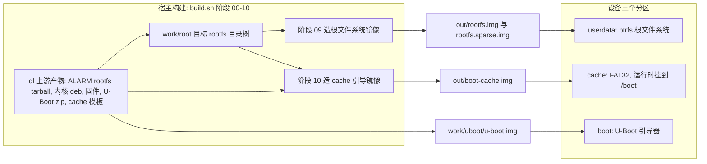
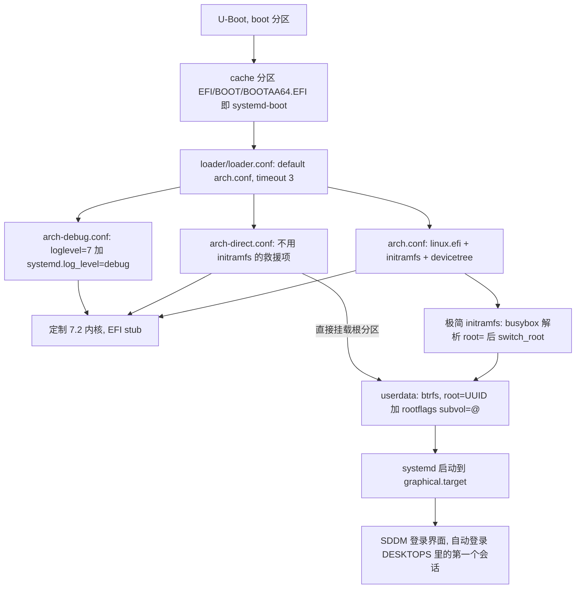
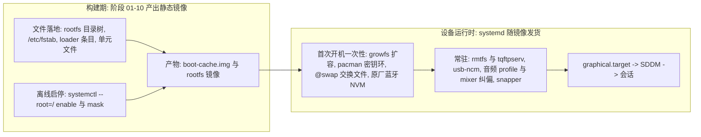

# 系统总览：宿主构建流水线与设备运行时

这个仓库不是一个"在设备上安装的系统"，而是一条**宿主侧离线组装流水线**加一层**随镜像发货的设备运行时服务**。
构建期决定"镜像里有什么文件、哪些单元被 enable、引导参数怎么写"；设备运行时负责首次开机的一次性动作（扩容、密钥环、交换文件、原厂蓝牙 NVM）以及此后常驻的服务（qcom 用户态、音频路由兜底、USB 网络共享、SDDM 会话）。

两个入口：

- 构建：`./build.sh`（`--from` / `--only` / `--list`），阶段脚本在 `scripts/`；[`STAGES`](../../build.sh#L26-L39) 里有 12 个阶段项（阶段号 `00`–`10`，含 `03b-ms91xx.sh`），凡需要 chroot 的阶段都用 `require_ns` 把自己重入 user namespace，所以默认**不需要 root**——唯二例外是还没有 rootfs 的 `00-fetch.sh` 与纯宿主交叉编译的 `03b-ms91xx.sh`。
- 设备：`./scripts/11-flash.sh --flash` 把产物写进三个分区；之后所有调整都走 `/boot`（就是 cache 分区）或 SSH。

本页只给全景与契约；逐步流程见 [构建流水线各阶段](../workflows/build-pipeline-stages.md)，成像细节见 [镜像打包与引导链](../workflows/image-packaging-and-boot-chain.md)，目录与入口用法见 [仓库结构与入口](repository-layout-and-entrypoints.md)。

## 产物与三个目标分区

构建的最终产物只有三样，各自对应一个设备分区；刷机时 `dtbo` 分区会被擦除（这也是每台设备的蓝牙地址会丢的原因）。

| 产物 | 来源 | 落到哪个分区 | 运行时角色 |
|:--|:--|:--|:--|
| `work/uboot/u-boot.img` | 阶段 00 从上游 release 的 zip 里解出，仓库不编译引导器 | `boot` | 引导器本体，开机先跑它 |
| `out/boot-cache.img` | 阶段 10，基于上游 256 MiB FAT32 模板用 mtools 原地改 | `cache` | 就是系统里的 `/boot`：systemd-boot + 内核 + initramfs + dtb + 引导项 |
| `out/rootfs.img` / `out/rootfs.sparse.img` | 阶段 09，`btrfs` 或 `ext4` 根文件系统 | `userdata` | Arch Linux ARM 根文件系统 |

上图是"构建产物 → 目标分区"的对应关系；`dtbo` 不在产物之列，刷机时被 erase。

三条 `fastboot` 写入命令和它们的顺序在刷机脚本里是固定的：先 `erase dtbo/boot/cache/userdata`，再 `flash boot`、`flash cache`、`flash userdata`，最后 `reboot`（[11-flash.sh](../../scripts/11-flash.sh)）。发布打包（`scripts/99-make-release.sh`）会把这三样都收进去——`u-boot.img` 缺失时**硬失败**，因为刷机说明里让用户刷它，少一个文件用户就卡住。

因为 `/boot` 就是 cache 分区（fstab 里 `PARTLABEL=cache /boot vfat`，见 [lib.sh](../../scripts/lib.sh)），换内核、initramfs、设备树**不需要重新刷机**：`scp` 覆盖 `/boot` 下的文件再重启即可。这是本仓库迭代最快的路径。

## 引导链

上图是设备从冷启动到桌面会话的完整链条，以及三个引导项各自走的路。

关键点：

- `bootaa64.efi` 用的是 **rootfs 内那份 systemd-boot**（与镜像里的 systemd 同版本），模板自带的厂商引导器被备份成 `/efi/boot/bootaa64-vendor.efi` 保留；模板里那个必然失败的上游条目（`ubuntu.conf`）被删掉。
- 内核以 `linux.efi` 命名放在 FAT 根目录，**三个条目都带** `devicetree /dtbs/qcom/raphael-redmi-k20pro.dtb`，指向**打过补丁的设备树**（[10-image-boot.sh](../../scripts/10-image-boot.sh) 里对 `dtb/raphael-redmi-k20pro.dtb` 的描述：删掉会把整块声卡拖进 `EPROBE_DEFER` 的 SLIMbus dai-link、删掉会让 ASoC 注册失败的路由、补上 `bluetooth/local-bd-address`）。
- 三个条目是**有意的容错设计**：`arch.conf` 正常启动；`arch-direct.conf` 不加载 initramfs、由内核直接挂根（UFS/btrfs/ext4 都内建），initramfs 出问题时的救命项；`arch-debug.conf` 给详细日志 + 单用户救援。
- initramfs 是手工拼的而不是 mkinitcpio：静态 busybox + 少量模块（UFS/ext4 其实都已内建）+ 早期固件（Adreno 的 `a630_sqe.fw`/`a630_gmu.bin`/`a640_gmu.bin`、`a640_zap.mbn`、`ipa_fws.mbn`），挂根失败时给一个救援 shell。里面的 `lib -> usr/lib` 软链是必须的——内核 firmware loader 只认 `/lib/firmware`，少了它 GPU 会在没有 SQE 固件的情况下 probe，表现为开机/熄屏瞬间花屏。
- 引导参数里没有 `regulatory.db` 这条路：阶段 04 会**故意删掉** `wireless-regdb` 的两个文件（内核 `CONFIG_CFG80211_REQUIRE_SIGNED_REGDB=y`，而这个包的签名不被 vendor 内核信任），所以阶段 08 的"早期固件"拷贝循环根本找不到它们。无线管制域只能靠阶段 10 写进 `options` 的 `cfg80211.ieee80211_regdom=$WIFI_COUNTRY` 设置。

## 构建侧：四个阶段群

`build.sh` 按 `STAGES` 数组顺序执行 `bash scripts/<阶段>.sh`，把输出 `tee` 进 `logs/build.log`，任一阶段失败立即退出（`set -euo pipefail` + `|| exit 1`）。阶段号由脚本名 `NN-` 前缀决定，`--from` / `--only` 只是筛掉不跑的阶段。

| 群 | 阶段 | 做什么 |
|:--|:--|:--|
| 取料 | `00` `01` | 下载上游产物（ALARM rootfs tarball、内核/固件 deb、U-Boot zip、FAT 模板），解包 ALARM rootfs 到 `work/root` |
| 装系统 | `02` `03` `03b` `04` `05` | 用宿主 pacman `--arch aarch64` 装包与所选桌面；铺定制内核（`Image` + 模块 + dtb）；用 `vendor/ms91xx` 交叉编译 MS91xx USB 投屏驱动模块；铺设备固件与 UCM；交叉编译 qcom 用户态（`rmtfs`/`pd-mapper`/`tqftpserv`/`qrtr`） |
| 配置 | `06` `07` `08` | 系统基础配置（locale、fstab、用户、USB NCM、电源、zram、音频路由、各 `raphael-*` 单元）；桌面/会话配置（SDDM、字体、输入法）；手工组装 initramfs |
| 成像 | `09` `10` | 造根文件系统镜像（含 sparse 版）；造 cache 分区 FAT32 引导镜像并注入蓝牙地址 |

阶段 02 的做法决定了后面很多事情的形态：它**不用 chroot 跑 aarch64 程序**，而是让宿主 x86_64 的 pacman 以 `--arch aarch64` 直接装进 `$ROOT`，并一律 `--noscriptlet`；装完列表后再用 `-Su --noscriptlet --ignore linux-firmware` 把整个 rootfs 对齐到仓库快照（否则 ALARM tarball 自带的旧包会和新装包形成"半升级"）；需要 aarch64 执行环境的后置步骤（`ldconfig`、`sysusers`、字体缓存、GSettings schema）再由 qemu 垫片显式补跑。因此**发行版的 preset / scriptlet 没有跑过**，所有 enable 动作（连用户级的 `pipewire.socket` / `wireplumber.service`）都必须由阶段脚本自己做——漏掉的症状是"系统里有声音选项但一个输出设备都没有"。

阶段脚本共享 `scripts/lib.sh`：日志、`require_ns`（自举 user namespace）、`ns_mount`（bind 出 proc/dev）、qemu 垫片、mtools 包装、`rootfs_layout`、`write_root_fstab`、`enable_unit`/`mask_unit`、`normalize_ownership`、蓝牙地址注入。它是"构建期契约"的单一出处。

## 构建期与运行时的分界

上图是两侧的分工：构建期只把静态文件与 enable 软链写进镜像，一次性的首启动动作与后来的"持续纠偏"都在设备侧。

同一个功能往往一半在构建期、一半在运行时，这条分界是本仓库最容易看错的地方：

| 事项 | 构建期（阶段脚本） | 设备运行时 |
|:--|:--|:--|
| 文件落地 | 决定 rootfs 里有哪些文件、fstab 怎么写、引导项参数 | —— |
| 单元启停 | 离线 `systemctl --root=/ enable/mask`（chroot 内经 qemu，不需要 dbus） | systemd 按软链启动 |
| 根扩容 | 写 `x-systemd.growfs` 到 fstab（`systemd-growfs@` 缺失时退回自建 `raphael-growfs.service`） | 首次开机把根撑满 userdata |
| 首启动动作 | 只放脚本与条件（`ConditionPathExists`） | `raphael-firstboot.service` 初始化 pacman keyring（含 archlinuxcn）、`raphael-swapfile.service` 在 `@swap` 建 nocow 交换文件、`raphael-bt-firmware.service` 从 `bluetooth` 分区拷原厂 NVM |
| 音频 | 精简 UCM（`HiFi.conf` 只留 TFA9874 扬声器通路，并复制到 4 个可能的声卡名目录）、WirePlumber 格式规则、`blacklist slim_qcom_ngd_ctrl` | `raphael-audio-init.timer` 开机 12 秒后重启 `pd-mapper`、手动 `modprobe` slim-ngd、把声卡从 `pro-audio` 切到 HiFi/立体声并写 Q6 mixer；`raphael-audio-routing.timer` 从 25 秒起每 20 秒重设 mixer，并把掉回 `pro-audio` 的 profile 再切回来 |
| qcom 用户态 | 交叉编译并 `enable_unit` `rmtfs` / `tqftpserv`（以及 `pd-mapper`，见下方注意） | 常驻，给 ADSP/CDSP 提供固件与电源域服务、给 MSS 提供 EFS |
| 网络 | 关掉并 mask `systemd-networkd`/`systemd-resolved`，启用 NetworkManager，装 USB NCM gadget 脚本 | `usb-ncm.service` 等 UDC 出现后绑 gadget，设备侧 `172.16.42.1` |
| 桌面 | 写 `sddm.conf.d/10-raphael.conf`（会话、自动登录、合成器、主题）并 `set-default graphical.target` | SDDM 起登录界面 → 会话 |
| 其它 | `fstrim.timer`、`raphael-snapper-setup.service`、`raphael-display-nopm.service`、非 KDE 时的 `raphael-power-key.service` | 各自在上线后执行 |

几处"故意不启用/故意屏蔽"同属运行语义：`sleep`/`suspend`/`hibernate`/`hybrid-sleep` 被 mask（SM8150 只有 s2idle 且不稳定，用熄屏代替），`systemd-firstboot.service` 被 mask（交互式首启会卡住无人值守启动），`logind` 的 `HandlePowerKey` 设成 ignore 交给桌面或自研守护。

注意 qcom 用户态里有一处**跨阶段的启停分歧**：`05-qcom.sh` 明确把用户态 `pd-mapper` 保持禁用（真机验证内核 `qcom_pd_mapper` 已覆盖必需的电源域映射），但随后运行的 `06-config.sh` 6b 段又把它 `enable` 回来，并写着"pd-mapper 必须开机自启"。因为 06 在 05 之后执行，镜像里最终是**启用**状态。要改 qcom 服务启停，两个阶段都得看，否则会被后一个阶段悄悄改回去。

## 不变量与失败语义

这条流水线的设计核心是**让几种容易做出"开不了机镜像"的分歧在构建期就暴露**：

- **布局三处一致**：`lib.sh:rootfs_layout()` 统一决定 `ext4` / `btrfs-subvol` / `btrfs-flat` 并缓存到 `work/rootfs-layout`；阶段 06 按它写 fstab，阶段 09 按它造镜像、在 loop 挂载失败回退到 flat 时**先重写 fstab 再 `mkfs -r`**，阶段 10 按它生成 `rootfstype=` 与 `rootflags=subvol=...`。三者不会各说各话。fstab 的唯一生成点是 `lib.sh:write_root_fstab()`：根用 `UUID=`（不依赖分区标签），subvol 布局下另有 `/home`（`nofail`）与 `/swap`（`nodatacow,compress=no`）两行，`/boot` 用 `PARTLABEL=cache` 且带 `nofail`。
- **UUID 同源**：root 的 UUID 由 `rootfs_uuid()` 生成并持久化在 `work/rootfs.uuid`，阶段 09 用它建文件系统、阶段 10 用它写 `root=UUID=`，所以引导参数必定指向真实文件系统。
- **属主归一化**：成像前 `normalize_ownership()` 把整树 chown 回 `0:0`、恢复 setuid 清单、并断言 `/usr/bin/mount` 是 `0:0 4755`。非真 root（userns）构建时它只能告警并继续——产出的镜像里 setuid 程序会失效，`mount`/`sudo`/`sshd` 全挂。
- **硬失败而非静默降级**：阶段 09 在灌镜像前检查 `*.wants/` 下是否还有 `systemd-networkd*`/`systemd-resolved*` 软链，有就 `die`（阶段 06 的 disable+mask 失效过一次，症状是每次开机多一个 failed 单元）；阶段 05 缺 `rmtfs`/`tqftpserv`/`libqrtr.so.1` 直接失败（否则会静默产出没 Wi-Fi/没声音的镜像）；阶段 02 末尾对关键程序做 qemu 实跑烟雾测试。
- **镜像大小只上不下**：`IMAGE_SIZE`（默认 8G）是**下限**；阶段 09 按 `内容 × 1.15 + 512 MB` 估算，内容超了就自动放大，首启动再由 `x-systemd.growfs` 扩到 userdata 分区实际大小。
- **蓝牙地址是每台设备的唯一值**，公开镜像不带：构建期可用 `config/local.conf` 的 `BT_MAC`（或环境变量 `RAPHAEL_BT_MAC`）注入，之后可用 `scripts/bt-mac.sh` 或 `11-flash.sh --bt-mac` 直接改 FAT 镜像里的设备树；格式错误只 WARN 不报错，所以要去看日志里那行"已注入"。
- **`cache` 镜像大小要对得上分区**：阶段 10 校验 `boot-cache.img` 是否仍是 256 MiB（`BOOTFAT_SIZE_MB`），不一致只 warn，但 cache 分区不够大就刷不进去。

## 哪些是 raphael/SM8150 专属，哪些是通用机制

| 层面 | raphael/SM8150 专属 | 通用 Arch/ALARM 机制 |
|:--|:--|:--|
| 引导与内核 | 上游 `linux-xiaomi-raphael-uboot` 的 U-Boot；`GengWei1997/kernel-deb` 的 7.2 内核 deb；`dtb/raphael-redmi-k20pro.dtb` 的三处修改；`erase dtbo` 与蓝牙地址 | systemd-boot 的 `loader.conf` + `loader/entries/*.conf`；`root=`/`rootfstype=`/`rootflags=` 传参 |
| 分区 | `boot`/`cache`/`userdata` 这套 Android 分区名，`cache` 当 `/boot` | FAT32 镜像用 mtools 无 root 读写；`mke2fs -d` / `mkfs.btrfs -r` |
| 根文件系统 | —— | ALARM aarch64 rootfs tarball；`btrfs` + `@`/`@home`/`@swap` 子卷 + `compress=zstd:3`；`x-systemd.growfs` |
| 软件来源 | 设备固件与 UCM 来自作者 deb；qcom 用户态仓库里没有，需自己交叉编译；`vendor/ms91xx` 的 USB 投屏驱动模块（阶段 03b）按本项目内核适配 | 宿主 pacman `--arch aarch64` 装 ALARM/archlinuxcn 包；`--noscriptlet` + qemu 补跑 |
| 硬件服务 | `tqftpserv`/`rmtfs`、内核 `qcom_pd_mapper`（servreg 电源域映射）、`ath10k_core skip_otp=y`、蓝牙原厂 NVM、精简 UCM（HiFi）+ amixer 路由 + WirePlumber 格式规则、USB NCM gadget、显示控制器不 runtime-suspend | systemd 单元的 enable/mask、`tmpfiles.d`、`logind.conf.d`、`zram-generator`、`fstrim.timer` |
| 桌面 | 触屏键盘选择与电源键策略按形态切换 | SDDM 会话机制（`/usr/share/wayland-sessions/*.desktop`、`[Autologin]`）、`wayland.target`/`graphical.target` |
| 构建环境 | —— | user namespace 无 root 构建；qemu 垫片；`normalize_ownership`；CI 里的 privileged 容器 + loop 设备 |

桌面选择本身是**构建期决策**：`config/build.conf` 的 `DESKTOPS` 空格/逗号分隔、可多选、**顺序即自动登录优先级**，空值等于纯命令行（不装显示管理器、`set-default multi-user.target`，并清掉增量重建留下的 SDDM 软链）。派生出的 `HAVE_*` 标志与 `PRIMARY_SESSION` 是阶段脚本唯一该读的接口，不要在脚本里重新解析字符串。

## 配置与扩展点

- **`config/build.conf` 是唯一调参入口**：镜像大小、根文件系统类型、包列表与桌面、用户名/密码、自动登录、locale/时区、内核版本与上游 URL、无线管制域（不设就掉进"世界域"，很多 5GHz 信道被禁；它只通过引导参数 `cfg80211.ieee80211_regdom` 生效，因为 `regulatory.db` 已被阶段 04 删掉）。
- **私密值放 `config/local.conf`**（已 gitignore）：目前主要是 `BT_MAC`。CI 侧对应仓库 Secret 与 workflow 输入。
- **加一个运行时单元**：在 06（系统级、与桌面无关）或 07（桌面相关）里写脚本 + unit，然后 `enable_unit` —— 它内部先试 `systemctl --root=/ enable`，失败再手工建 `*.wants` 软链，两条路都保证在无 dbus 的 chroot 里可用。
- **加一个构建阶段**：写 `scripts/NN-name.sh`（`source lib.sh` + `require_ns`）并加进 `build.sh` 的 `STAGES` 数组；阶段号就是脚本名前缀。
- **发布**：`scripts/99-make-release.sh` 把产物 zstd 压缩、按 1900 MiB 分卷、生成 `SHA256SUMS` 与刷机说明；CI 工作流（`.github/workflows/build.yml`）在 Arch 容器里以 `--privileged` 跑同一套 `build.sh`，产物分"Actions 产物"和"GitHub Release"两种去处。
- **改完构建脚本务必跑一次 CI**：`-lqrtr` 软链与半升级这两类问题都表现为"本地能过、CI 全挂"，因为本地 `work/root` 是增量的、CI 每次都是干净环境。

## 相关页面

- [仓库结构与入口](repository-layout-and-entrypoints.md) —— 目录职责与 `build.sh` 的用法。
- [构建流水线各阶段](../workflows/build-pipeline-stages.md) —— 每个阶段做什么、失败点在哪。
- [rootfs 布局与 fstab](../concepts/rootfs-layout-and-fstab.md) —— 「布局三处一致」这条不变量的机制、失败路径与历史事故。
- [镜像打包与引导链](../workflows/image-packaging-and-boot-chain.md) —— 阶段 09/10 的成像细节与 `fastboot` 流程。
- [配置模型](../concepts/configuration-model.md) —— `build.conf` / 环境变量 / 派生标志。
- [运行时服务清单](../runtime/service-inventory.md) —— 镜像里启用的单元与它们的关系。
- [刷机与首次开机](../operations/flashing-and-first-boot.md) —— 刷机命令、首启动动作与恢复路径。
