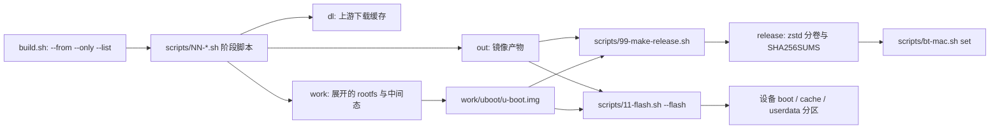
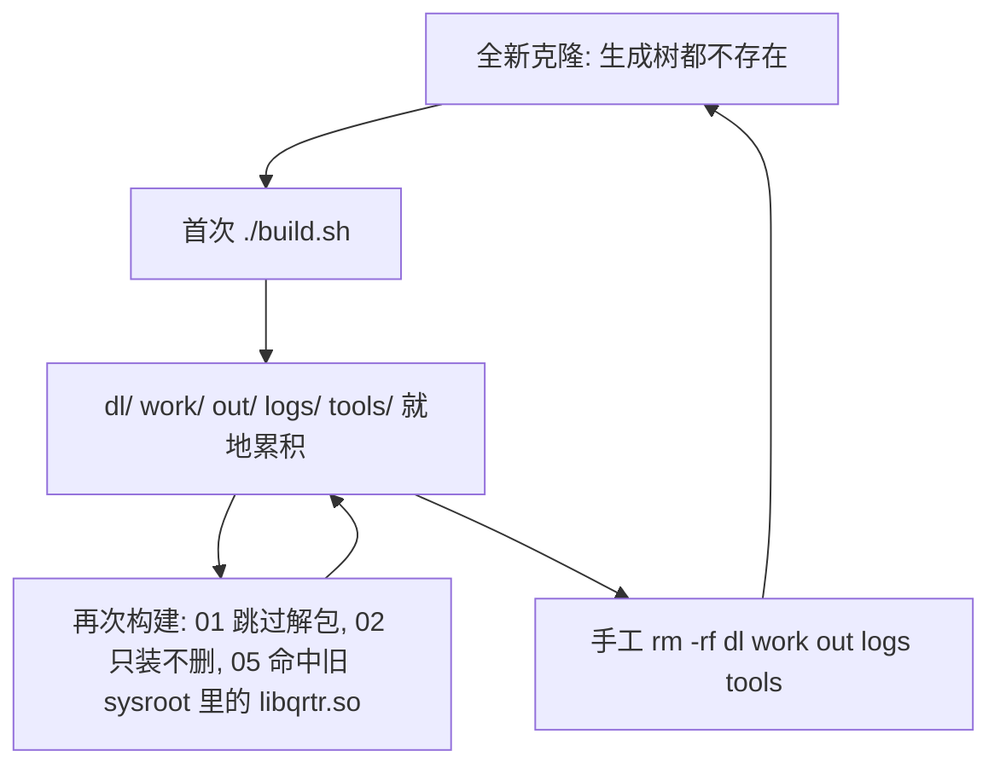

# 仓库布局与入口点

这个仓库里的"源码"只有三类：一个构建入口 [`build.sh`](../../build.sh)、参数化的阶段脚本集合 `scripts/`、以及随仓库分发的输入资源（`config/`、`dtb/`、`vendor/`、`notes/`、`pkgs/`、`.github/workflows/`）。顶层其余目录（`dl/`、`work/`、`out/`、`logs/`、`tools/`、`release/`、`_recon/`）都是构建或调研过程中在本机生成的，删掉它们不会丢任何东西。

判断一个路径属于哪一类，最可靠的依据是 [`.gitignore`](../../.gitignore)：它列出了被排除的产物树与私密配置，除此之外的顶层内容（外加 `openwiki/` 这个"生成但被提交"的目录）才是仓库的真实内容。反过来说，"被 git 跟踪"并不等于"必须保留"（`release/` 没被忽略，却完全是生成物），"被忽略"也不等于"能重建"（`_recon/`、`config/local.conf` 是本机资料）。

有两条陷阱值得在本页开头就点明，它们是这个仓库改动时最容易踩的坑：

- **生成目录绝不能当成源码读。** 读 `work/root/...` 里的文件、把某个 `out/*.img` 当成"系统的一部分"，等于把某一次本地构建的残留当成设计。真正的系统行为只在 `scripts/` 与 `config/` 里。
- **`work/` 里的残留会改变下一次构建行为。** 阶段 01 在 `work/root` 看起来"像样"时会整段跳过，阶段 02 只装不删，`dl/` 与 `work/pkgcache` 又是"命中即复用"。所以同一份 `build.sh` 在同一台机器上的第二次运行，和 CI 上的第一次运行，走的不是同一条路径（详见下文"生成目录的生命周期"一节）。

## 跟踪的源 vs 生成物

### 跟踪的源（改这些才改变系统行为）

| 路径 | 性质 | 说明 |
|:--|:--|:--|
| `build.sh` | 入口 | 唯一的构建入口，用 `STAGES` 数组驱动阶段 |
| `scripts/*.sh` | 入口 | 阶段脚本与三个工具入口，共享 `scripts/lib.sh` 契约层 |
| `.github/workflows/build.yml` | 入口 | 在 Arch 容器里跑同一条 `build.sh`（+ 打包/发布） |
| `config/build.conf` | 可执行配置 | 会被 source 执行的一段 bash，是唯一调参入口 |
| `config/local.conf.example` | 模板 | 脱敏写法示例；真正生效的 `config/local.conf` 被忽略 |
| `dtb/` | 输入资源 | 唯一随源码分发的设备树 |
| `vendor/ms91xx/` | 输入资源（源码树） | 被跟踪的 MS91xx 驱动源码，由阶段 03b 编译 |
| `pkgs/` | 参考配方 | 6 个 PKGBUILD；**构建流水线当前完全不引用** |
| `notes/` | 调研文档 | 踩坑与取舍的证据链 |
| `README.md` / `HANDOVER.md` | 文档 | 使用/交付文档与接手说明 |
| `AGENTS.md` | 文档 | 仓库约定的**手写部分**；其中 `<!-- OPENWIKI:START -->`…`<!-- OPENWIKI:END -->` 区块由自动流程维护 |
| `.gitignore` | 清单 | 跟踪/生成物的分界依据 |

### 生成物 / 未跟踪（多数可删，删后按需重建）

| 路径 | 谁写 | CI 软链到大磁盘 | 能删吗 |
|:--|:--|:--|:--|
| `dl/` | `lib.sh` 建目录，任何阶段的 `fetch()` 填充 | 是 | 能（但所有下载重来；缓存同时被 CI 的 `actions/cache` 持久化） |
| `work/` | `lib.sh` 与各阶段 | 是 | 能（增量构建的历史全在这里；`work/pkgcache` 也被 CI 缓存） |
| `out/` | `lib.sh` 建目录，阶段 09/10 与 `11-flash.sh --backup` 写 | 是 | 能（最终镜像会丢） |
| `logs/` | `lib.sh`（**不是** `build.sh`） | 是 | 能 |
| `tools/` | `lib.sh:setup_mtools`（惰性） | 是 | 能（下次构建重下 mtools） |
| `release/` | `99-make-release.sh`（每次先清空） | 是 | 能（下次打包重生成） |
| `_recon/` | 人工 | 是（占位） | 能，但**删了就自备不了**——上游侦察材料不可重建 |
| `config/local.conf` | 人工 | 否（不在 CI 的软链清单里） | 能，但**删了就丢本机私密值**（照 `.example` 重写） |
| `vendor/**/*.o`、`*.ko`、`*.mod*`、`modules.order`、`Module.symvers` | `03b-ms91xx.sh` | — | 能（正常输出在 `work/ms91xx-build`） |
| `openwiki/` | `.github/workflows/openwiki-update.yml` | 否 | **已提交、不能手工改**：整棵树都是生成内容（见下） |

CI 的软链动作发生在 checkout 之后、构建之前：`mkdir -p` 之后把 `dl work out tools logs release _recon` 全部指向 runner 的大磁盘（[L212-L220](../../.github/workflows/build.yml#L212-L220)），因为仓库所在分区放不下镜像。这也解释了为什么本地全新克隆要先自己建 `logs/`（见下），而 CI 不需要。

关于自动生成的内容，有两条"别手改"的清单：

- `openwiki/` 整棵树，以及 `AGENTS.md` 里的 `<!-- OPENWIKI:START -->`…`<!-- OPENWIKI:END -->` 区块：由 `openwiki-update.yml` 每天定时（或手动）跑 `openwiki code --update` 后开 PR 提交，PR 的 `add-paths` 是 `openwiki`、`AGENTS.md`、该工作流本身（存在 `CLAUDE.md` 时也含它）。要改这些内容，应改源码/文档让自动流程重生成，而不是直接编辑页面。
- `release/`：虽然不在 `.gitignore` 里，但每次 `99-make-release.sh` 都会先清空重建，手工编辑没有意义。

## 入口总览

| 入口 | 用法 | 做什么 | 依赖的生成树 |
|:--|:--|:--|:--|
| `./build.sh` | `[--from NN]` `[--only NN...]` `[--list]` | 唯一构建入口，按 `STAGES` 数组跑阶段 00→10 | `dl/` `work/` `out/` `logs/` `tools/` |
| `./scripts/11-flash.sh` | `--flash`（可配 `--dry-run`、`--bt-mac "<地址>"`）或 `--backup` | 把产物刷进 `boot`/`cache`/`userdata` 三个分区（先擦 `dtbo`），或先用 TWRP 备份 | 读 `out/`、`work/uboot/`、`dl/`（TWRP 镜像）；`--bt-mac` 写 `work/boot-cache-<地址>.img`；`--backup` 写 `out/backup/` |
| `./scripts/bt-mac.sh` | `show ` / `set  "<地址>"` | 就地给"从 Release 下载来的"`boot-cache.img` 里的设备树补本机蓝牙地址（`set` 先备份为 `.bak`） | 只改传入的镜像文件；`mrun` 依赖 `tools/mtools` |
| `./scripts/99-make-release.sh` | `[tag]` `[--upload]`（`--upload` 只在**第二个位置参数**上被识别） | zstd 压缩 + 按 1900 MiB 分卷 + 生成 `SHA256SUMS`/刷机说明，可直发 Release | 读 `out/`、`work/uboot/`；写 `release/` |
| `.github/workflows/build.yml` | push 到 `main` 且改动 `scripts/**`、`config/**`、`dtb/**`、`build.sh` 或本工作流，或手动 dispatch | 在 Arch 容器里跑同一条 `build.sh`（+ 打包），云端出镜像 | 与本地同一组生成树，软链到大磁盘 |
| `.github/workflows/openwiki-update.yml` | 每日定时 / 手动 | 重生成并提交 `openwiki/` 与 `AGENTS.md` 的 OpenWiki 区块 | 只改 `openwiki/`、`AGENTS.md`、工作流本身 |



上图是各入口与生成树之间的读写关系：只有 `build.sh`（及其调用的阶段脚本）生产产物，`11-flash.sh`、`99-make-release.sh`、`bt-mac.sh` 都只消费产物。

## build.sh：唯一的构建入口

```bash
./build.sh                  # 完整构建 (00 -> 10)
./build.sh --from 03        # 从指定阶段开始
./build.sh --only 06 07     # 只跑指定阶段
./build.sh --list           # 列出阶段
```

要点（全部来自 [build.sh](../../build.sh) 的源码）：

- **阶段清单就是 `STAGES` 数组**（[L26-L39](../../build.sh#L26-L39)），每项写成 `脚本名:一句话说明`。`build.sh` 只遍历这个数组，`scripts/` 目录里未被列进去的文件永远不会被它执行——新增阶段必须同时改数组（见下文"扩展点"）。
- 阶段号不是独立字段，而是**脚本名里第一个 `-` 之前的前缀**（`03b-ms91xx.sh` → `03b`），过滤就是拿这个字符串比较（[L90-L93](../../build.sh#L90-L93)）。
- `--only` 一旦给出就**完全接管**过滤逻辑（可跟多个值，遇到下一个 `--` 开头的参数为止，且要求阶段号精确匹配）；否则 `--from` 用来跑"阶段号大于等于它"的阶段。比较是**字典序而非数字**，而阶段号是零填充的，所以 `--from 03` 会连 `03b` 一起跑；反过来写成 `--from 3` 这种非补零形式就会一个阶段都不跑（脚本不校验参数有效性，也不会提示）。
- `-h`/`--help` 打印的是本文件头部注释（`sed -n '2,20p'`）；`--list` 除了 `STAGES` 还会手工补一行 `11-flash.sh`——`99-make-release.sh` 不在列表里，它是独立的发布工具，不属于构建阶段。
- 每个阶段都以 `bash scripts/<脚本名>` 在**仓库根目录**执行（由 `build.sh` 开头的 `cd "$PROJ"` 保证，脚本自己不做路径切换），并接 `2>&1 | tee -a logs/build.log`；任一阶段失败即打印"阶段失败，详见 logs/build.log"并 `exit 1`（脚本本身 `set -euo pipefail`）。日志是**追加**的，不是每次覆盖。
- 它自己**不创建** `logs/`：该目录由阶段脚本 source 的 `scripts/lib.sh` 创建。因此在从未构建过的克隆里，第一次运行前应先确保 `logs/` 存在，否则第一步的 `tee` 就无处可写。
- 开头先 `. config/build.conf` 只是为了两件事：让写错的 `DESKTOPS` 立刻报错（`build.conf` 会直接 `exit 1`，因为是被 source 的，等于退出 `build.sh`），以及把"这次装哪些桌面"打印到构建横幅里。

## scripts/：阶段脚本与调用契约

| 脚本 | 一句话职责 |
|:--|:--|
| `00-fetch.sh` | 下载上游产物（ALARM rootfs tarball、内核/固件 deb、U-Boot zip 并解出 `work/uboot/u-boot.img`、cache 分区 FAT 模板），并取回宿主 mtools |
| `01-rootfs.sh` | 在 user namespace 内解包 ALARM rootfs 并校正 setuid/权限位 |
| `02-pacman.sh` | 用宿主 pacman `--arch aarch64 --noscriptlet` 装基础系统与所选桌面，末尾用 qemu 补跑关键 scriptlet |
| `03-kernel.sh` | 安装定制内核（`Image` + 模块 + dtb）并记录版本到 `work/kver` |
| `03b-ms91xx.sh` | 用 `vendor/ms91xx` 交叉编译 MS91xx USB 投屏驱动模块 |
| `04-firmware.sh` | 装设备固件 + ALSA UCM，删掉同名通用固件与无关大固件 |
| `05-qcom.sh` | 交叉编译 qcom 用户态（`qrtr`/`rmtfs`/`pd-mapper`/`tqftpserv`）并落地单元文件 |
| `06-config.sh` | 系统基础配置（locale/fstab/用户/USB NCM/电源/zram/音频路由/自研单元） |
| `07-desktop.sh` | 桌面与会话配置（SDDM、字体、各桌面预置；纯命令行时反向清理旧残留） |
| `08-initramfs.sh` | 手工组装极简 initramfs（静态 busybox + 模块 + 早期固件） |
| `09-image-rootfs.sh` | 造 `out/rootfs.img` 与 `out/rootfs.sparse.img`，并写回实际布局与 UUID |
| `10-image-boot.sh` | 以 256 MiB FAT 模板造 `out/boot-cache.img`（systemd-boot + 内核 + initramfs + 打过补丁的 dtb）并注入蓝牙地址 |

另外三个脚本不是构建阶段，而是"只消费产物"的工具入口：`11-flash.sh`（刷机/备份）、`bt-mac.sh`（改下载来的引导镜像里的蓝牙地址）、`99-make-release.sh`（打包发布）。

各阶段内部做什么、失败点在哪里，见[构建流水线各阶段](build-pipeline-stages.md)；这里只固定它们的**共同契约**：

- `#!/bin/bash` + `set -euo pipefail` + `source "$(dirname ...)/lib.sh"` + `confirm_stage "..."`。路径基于 `BASH_SOURCE` 解析，所以脚本从任意工作目录调用都能找到库；但依赖历史产物的阶段（如 `03b` 用 `$PWD/vendor/ms91xx`）实际按"从仓库根运行"工作，`build.sh` 已经保证了这一点。
- **不接收命令行参数**：`build.sh` 传空参；`--from`/`--only` 只是决定跑不跑，不会把阶段号当参数传进去。
- 凡需要 chroot 的阶段调用 `require_ns`（把自身重入到 `unshare` 出来的 namespace，用 `RAPHAEL_NS=1` 做哨兵，并导出 `PROJ`）再 `ns_mount`。例外只有两个：`00-fetch.sh`（此时还没有 rootfs）与 `03b-ms91xx.sh`（纯宿主交叉编译）；`08-initramfs.sh` 只用 `require_ns`、不挂 `ns_mount`。
- 共享状态一律通过 `work/` 里的文件传，而不是命令行：`work/kver`、`work/rootfs-layout`、`work/rootfs.uuid`、`work/bootstage`、`work/initramfs`。这正是"跨阶段契约"的存放处。

[`scripts/lib.sh`](../../scripts/lib.sh) 是所有阶段与辅助脚本（`11-flash.sh`、`bt-mac.sh`、`99-make-release.sh`）共用的契约层：基于 `BASH_SOURCE` 定位仓库根、source `config/build.conf`、定义并创建 `WORK`/`DL`/`OUT`/`LOGS`/`TOOLS` 等路径（[L11-L25](../../scripts/lib.sh#L11-L25)），并提供日志、带缓存与重试的 `fetch`、`require_ns`/`ns_mount`、qemu 垫片、mtools 包装、`rootfs_layout`/`write_root_fstab`、`enable_unit`/`mask_unit`、`normalize_ownership` 与蓝牙地址注入。改构建行为时先看它，不要在各阶段里重复实现。

## config/：唯一调参入口

| 文件 | 性质 | 说明 |
|:--|:--|:--|
| [`config/build.conf`](../../config/build.conf) | 跟踪、**可执行的 bash** | 全部可调参数：镜像大小与根文件系统类型、包列表与桌面选择、用户名/密码、locale/时区、上游 URL 与内核版本、无线管制域 |
| [`config/local.conf.example`](../../config/local.conf.example) | 跟踪 | 脱敏模板，演示 `BT_MAC="aa bb cc dd ee ff"` 这类本机私有值该写成什么样 |
| `config/local.conf` | **已被忽略**（本地文件，不在 CI 软链清单里） | 真正生效的私密值（目前主要是 `BT_MAC`）；CI 侧改用仓库 Secret 注入环境变量 |

`build.conf` 不是被解析的键值清单，而是会被 `source` 执行的一段 bash：里面有 `case`/`if`、`de_has`/`drop_pkgs`/`de_session_name` 等函数、组合标志（`HAVE_*`、`ALL_PKGS`、`DE_SUMMARY`、`PRIMARY_SESSION`）的推导，以及"桌面名不认识就直接 `exit 1`"的校验。因此：改它等于改构建逻辑，`bash -n config/build.conf` 之类的检查比当配置文件看更有意义；而参数化覆盖走环境变量（如 `DESKTOPS`、`RAPHAEL_ALARM_MIRROR_PRIMARY`、`RAPHAEL_ROOTFS_TYPE`、`RAPHAEL_BT_MAC`），不要改文件本身。

`local.conf` **不是被 source 的**：阶段 10 用 `sed` 从里面抠 `BT_MAC`（[L54-L59](../../scripts/10-image-boot.sh#L54-L59)），环境变量 `RAPHAEL_BT_MAC` 优先于该文件，两者都没有就只 WARN（镜像蓝牙不可用）。地址写的是设备树字节序（小端），格式归一化接受 `11:22:33:44:55:66`、`11-22-33-44-55-66`、`112233445566`、`"11 22 33 44 55 66"` 四种写法。公开仓库里绝不能出现真实地址——CI 用的是仓库 Secret，本地用 `config/local.conf`，两者都不进版本库。

**蓝牙地址两端各有一个入口，别搞混**：

- 自己构建时，地址在**阶段 10 就写进镜像**（`config/local.conf` 或 `RAPHAEL_BT_MAC`）。
- 只在刷机时补（镜像来自别人/来自 Release，或本地构建时没给地址）用 `11-flash.sh --bt-mac "<地址>"`：它把 `out/boot-cache.img` 复制成 `work/boot-cache-<地址>.img` 再注入，**不动 `out/` 原文件**。
- 根本不跑构建、只想改一个已下载的 `boot-cache.img`，用 `bt-mac.sh set  "<地址>"`：**原地改写**该文件（先留 `.bak`），`bt-mac.sh show ` 是核对镜像里当前地址的最小手段。

## 随仓库分发的输入资源

| 路径 | 作用 |
|:--|:--|
| [`dtb/raphael-redmi-k20pro.dtb`](../../dtb/raphael-redmi-k20pro.dtb) | 唯一随源码分发的设备树：从设备导出的 U-Boot DT + 本项目三处修改。阶段 10 把它复制成镜像里的 `dtbs/qcom/raphael-redmi-k20pro.dtb`，再把 `devicetree /dtbs/qcom/raphael-redmi-k20pro.dtb` 写进三个 systemd-boot 条目——**条目真正加载的就是这一份**（内核 deb 自带的 `sm8150-xiaomi-raphael.dtb` 也会被拷进镜像，但没有任何条目引用它）。文件缺失只 WARN：此时条目不写 `devicetree` 行，内核只能用 U-Boot 现场提供的那份 DT，蓝牙地址注入也一并跳过（症状是蓝牙与麦克风不可用） |
| [`vendor/ms91xx/`](../../vendor/ms91xx/README.md) | 被跟踪的内核模块源码树（`drm/` 驱动、`Makefile`、`dkms.conf`）。`03b-ms91xx.sh` 用阶段 03 留下的 `work/kver` 与头文件树交叉编译；`.gitignore` 只忽略这棵树里的 in-tree 构建产物（`*.o`/`*.ko`/`*.mod*`/`modules.order`…），正常情况下输出在 `work/ms91xx-build` |
| [`pkgs/`](../../pkgs/qbootctl/PKGBUILD) | 6 个 PKGBUILD（`qrtr`/`rmtfs`/`pd-mapper`/`tqftpserv`/`qbootctl`/`hexagonrpc`）与配套 `.install`：native Arch 打包的**参考配方**（含"哪个单元该 enable"的说明）。**当前 `build.sh` 完全不引用这个目录**——阶段 05 直接从 `linux-msm` 上游拉 tarball、用 clang 交叉编译进 rootfs（[L55-L63](../../scripts/05-qcom.sh#L55-L63)）。想用这些配方得自己 `makepkg`，改流水线不会碰它们 |
| [`notes/`](../../notes/) | 按主题归档的深度调研（桌面环境多选、qcom 用户态、移植清单、蓝牙、相机、麦克风、上游对齐）；踩坑与取舍的证据链主要在这里 |
| [`README.md`](../../README.md) / [`HANDOVER.md`](../../HANDOVER.md) / [`AGENTS.md`](../../AGENTS.md) | 使用与交付文档（README 在开头就把 HANDOVER 标为接手必读）/ 接手说明 / 给编码代理的仓库约定（其中 OpenWiki 区块由自动流程维护，不要手改） |

`_recon/` 特殊一点：它在文件系统里和 `notes/` 并列，但**不是随仓库分发的输入**，而是早期侦察时从上游与设备里扒出来的材料——[`_recon/README-winter.md`](../../_recon/README-winter.md) 是另一个 Raphael 项目的 README，`_recon/upstream-scripts/` 是别人写的构建脚本，`_recon/dl/x-image/`、`x-fw/`、`x-alsa/` 是拆开的 deb/镜像内容。整个目录已被 `.gitignore` 排除，[`notes/porting-checklist.md`](../../notes/porting-checklist.md) 与 `notes/qcom-userspace.md` 大量以它为"Source of truth"引用。因此照 `notes/` 里的线索去查证时要注意：那些路径只在原作者机器上存在，新克隆里没有，别把它们当成仓库的一部分（CI 只是给它占了个软链空目录）。

## 生成与未跟踪目录：绝不能当成源码

| 目录/文件 | 谁创建 | 内容与语义 | CI 软链 |
|:--|:--|:--|:--|
| `dl/` | `lib.sh` 建目录（[L25](../../scripts/lib.sh#L25)），任何阶段的 `fetch()` 填充 | 上游下载缓存。除阶段 00 的 rootfs/deb/U-Boot 之外，阶段 05 的 ALARM gcc 包、阶段 06 的霞鹜文楷字体、阶段 07 的 Konsole 配色也落在这里。`fetch()` 只要目标文件非空就跳过下载（命中即复用，**不校验内容**），所以怀疑缓存损坏时要手工删掉那个文件 | 是 |
| `work/` | `lib.sh` | 展开的目标 rootfs（`work/root`）与所有中间态：`kver`、`rootfs-layout`、`rootfs.uuid`、`bootstage`、`initramfs`、`pkgcache`、`uboot/u-boot.img`、编译日志；`11-flash.sh --bt-mac` 注入用的镜像副本也写在这里 | 是 |
| `out/` | `lib.sh` | 最终镜像：`boot-cache.img`、`rootfs.img`、`rootfs.sparse.img`；`11-flash.sh --backup` 另写 `out/backup/` | 是 |
| `logs/` | `lib.sh`（**不是** `build.sh`） | `build.sh` 追加写的 `build.log`、CI 的 `ci-build.log`，以及阶段 05 按组件拆的 `build-<组件>.log`；`work/logs/` 下另有阶段内的小日志（如 `tar-warnings.txt`） | 是 |
| `tools/` | `lib.sh:setup_mtools` | 从 Arch x86_64 仓库取来的宿主 mtools（`tools/mtools/usr/bin/*`），用于无 root 读写 FAT 镜像。惰性填充：阶段 00 与阶段 10 会调用 `setup_mtools`，蓝牙注入辅助内部也会调用；而 `bt-mac.sh show` 直接用 `mrun` 执行 `tools/mtools/usr/bin/mcopy`，所以它要求 `tools/mtools` 已经在位（至少跑过一次阶段 00） | 是 |
| `release/` | `99-make-release.sh`（每次先清空） | zstd 分卷、`SHA256SUMS`、`刷机说明.txt`、`upload.sh` | 是 |
| `_recon/` | 人工 | 上游/设备侦察材料（他项目 README、`upstream-scripts/`、拆开的镜像与固件），**已被忽略**，只在原作者机器上 | 是（占位空目录） |
| `config/local.conf` | 人工 | 本机私密值（`BT_MAC`），**已被忽略**。CI 用仓库 Secret 注入 `RAPHAEL_BT_MAC`，不读这个文件 | 否 |
| `vendor/**/*.o`、`*.ko`、`*.mod*`、`modules.order`、`Module.symvers` | `03b-ms91xx.sh` | 驱动源码树里的构建残留（正常输出在 `work/ms91xx-build`），已被忽略 | — |

`release/` 值得单独提一句：它**不在 `.gitignore` 里**（忽略规则只覆盖 `*.img`、`*.img.zst`、`*.img.xz`、`*.deb`、`*.tar.gz` 等模式，而分卷名是 `*.img.zst.part00` 这类）。它依然是纯粹的生成目录——每次运行 `99-make-release.sh` 都会先 `rm -f "$REL"/*` 重建，所以不要手工编辑，也不要提交。

## 生成目录的生命周期：没有 clean 入口

上面这些树不只是"git 管不管"的问题，还关系到"它们什么时候出现、谁能写、残留会带来什么"：

- **全新克隆里这些目录都不存在**。目录由 `lib.sh` 的 `mkdir -p`（以及阶段 00 的 `setup_mtools`、`99-make-release.sh` 自己建的 `release/`）在第一次运行时创建。这也解释了上一节的注意事项：第一次跑 `build.sh` 需要 `logs/` 已经存在，否则第一步的 `tee` 就失败（CI 之所以没事，是因为它先用 `mkdir -p` + 软链把 `dl work out tools logs release _recon` 都准备好了）。
- **仓库没有 clean/reset 入口**：`build.sh` 只认 `--from`/`--only`/`--list`/`-h|--help`，其余参数一律"未知参数"报错退出；`scripts/` 里也没有清理脚本。要回到干净状态就是手工删掉这些树（`release/` 由 `99-make-release.sh` 每次自清，`_recon/` 与 `config/local.conf` 是本机资料，不属于"重建得出来的东西"）。



上图：生成目录没有 clean 入口，只能手工删除；只要不删，上一轮构建的残留就是下一轮构建的输入。

### work/root 残留会改变下一次构建行为

这是本仓库"本地能过、CI 全挂"类问题的根源，值得单独列出来：

- **阶段 01 会整段跳过解包**：若 `work/root/usr/bin/bash` 与 `work/root/usr/bin/pacman` 都在，就打印"rootfs 已存在, 跳过解包"（[L19-L21](../../scripts/01-rootfs.sh#L19-L21)）；脚本注释里还记着"本地因为走了『已存在』分支才没暴露"的解包清理 bug（[L24-L28](../../scripts/01-rootfs.sh#L24-L28)）与"`setup_qemu_shim` 有存在性守卫、不会自动重建"的踩坑（[L98-L100](../../scripts/01-rootfs.sh#L98-L100)）。于是 `work/root` 会带着任意多轮构建的历史存活下去，直到有人手工 `rm -rf work/root`。
- **阶段 02 只装不删，且用 `work/pkgcache` 做增量缓存**：脚本自己写着"增量构建时 02 只装不删, 上次构建装进去的会一直留着"，所以被 `drop_pkgs` 下架的包必须显式 `-Rdd` 删（[L173-L183](../../scripts/02-pacman.sh#L173-L183)）；`work/pkgcache` 又是半升级事故（新装的 `nftables` 对着旧 `libnftnl`）的温床（[L150-L162](../../scripts/02-pacman.sh#L150-L162)）。
- **残留会掩盖真实的链接/依赖错误**：阶段 05 的 `libqrtr.so` 软链只在它自己生成的目录里补，本地构建时 rootfs 里"上一次装好的 `/usr/lib/libqrtr.so`"会被 clang 的 sysroot 搜索路径兜住，所以 `-lqrtr` 缺失这个坑只在全新 rootfs（CI）上暴露——一旦暴露，后面一串组件全部链接失败（[L85-L92](../../scripts/05-qcom.sh#L85-L92)）。
- **脚本自己得动手清残留，正说明残留是真的**：`03-kernel.sh` 显式删掉上一版内核模块与头文件（`cp` 只覆盖同名目录，[L37-L55](../../scripts/03-kernel.sh#L37-L55)）；`07-desktop.sh` 的"撤销 Shorin 个性化"整段对所有形态都跑，作用就是清理增量重建留下的上一版配置文件（[L971-L985](../../scripts/07-desktop.sh#L971-L985)）；`09-image-rootfs.sh` 在灌镜像前清掉 `.raphael-build`（qemu 垫片）、pacman 包缓存、`machine-id`、宿主 ssh host key，并把 `resolv.conf` 换成兜底 DNS（[L23-L41](../../scripts/09-image-rootfs.sh#L23-L41)）——这些都是"不该进镜像的构建残留"。
- **`work/` 里还存在脚本从不引用的手工文件**：因为整棵树被 `.gitignore` 忽略，随手写下的实验脚本、临时备份、笔记都会留在里面，没有任何机制保证它们与实际行为一致。遇到一个没有任何阶段脚本引用的 `work/...` 文件，默认应当把它当作本机残留。
- **契约文件一旦与实际不符就是开机事故**：`work/kver`、`work/rootfs-layout`（`ext4`/`btrfs-subvol`/`btrfs-flat`）、`work/rootfs.uuid` 被阶段 03/03b/10、06/09/10 分别共享。`rootfs-layout` 缓存说 `btrfs-subvol` 而实际成像回退成 flat，就是启动挂不上根的事故（见 [rootfs 布局、fstab 与扩容](../concepts/rootfs-layout-and-fstab.md)）。

结论很简单：**"重启一次干净构建"不等于删掉 `out/`**。想要与 CI 等价的起点，得手工删掉 `work/`（以及 `dl/`、`tools/`、`logs/`、`out/`，视怀疑对象而定），代价是所有下载与编译重来一遍；也正因如此，`--from`/`--only` 的增量重建是常态，而"本地增量和 CI 全新环境行为不同"是必须接受的既成事实。

## 产物位置与"三样齐不齐"

最终可刷写产物有三个，但**位置是分裂的**：

- `out/boot-cache.img`（阶段 10）→ 刷 `cache` 分区；
- `out/rootfs.img` / `out/rootfs.sparse.img`（阶段 09）→ 刷 `userdata` 分区；
- `work/uboot/u-boot.img`（阶段 00 从上游 zip 解出，**不在 `out/`**）→ 刷 `boot` 分区。

[`99-make-release.sh`](../../scripts/99-make-release.sh) 三样都要收，并且在 `work/uboot/u-boot.img` 缺失时**硬失败**而不是"有几个打几个"——因为生成的刷机说明里让用户 `fastboot flash boot u-boot.img`，少这个文件用户会卡在第一步（CI 上真发生过：全新环境里阶段 00 只下载没解压）。

它的第二个易错点是参数位置：`--upload` 只被当作**第二个位置参数**识别（[L20-L22](../../scripts/99-make-release.sh#L20-L22)），正确写法是 `./scripts/99-make-release.sh v1.0.0 --upload`；写成 `--upload v1.0.0` 会把 `--upload` 当成版本号。上传也不是直接调 `gh`，而是先写一份 `release/upload.sh`（内含 `gh release create`），仓库名按 `GH_REPO` → `GITHUB_REPOSITORY` → `git remote` 的顺序推断——在 CI 里 `release/` 是软链、物理路径不在 checkout 内，不显式给 `GH_REPO` 就会因"不在 git 仓库里"发布失败。压缩级别用 `RAPHAEL_RELEASE_ZSTD_LEVEL` 覆盖（本地默认 `-19`，CI 用 `-6` 省时间），分卷阈值固定在 1900 MiB。

[`11-flash.sh`](../../scripts/11-flash.sh) 是这条链的终点，也是唯一的刷机入口：必须显式给 `--flash` 或 `--backup`（否则打印用法并退出 1）；`--flash` 在交互输入 `yes` 之后依次擦掉 `dtbo`/`boot`/`cache`/`userdata`，再按上面的映射刷入三个产物（rootfs 优先用 sparse 版，缺失时回退 `out/rootfs.img`）并 `fastboot reboot`。`--dry-run` 与 `--bt-mac` 都是修饰开关：单独给 `--dry-run` 会被当成"没有模式"而只打印用法，必须写成 `--flash --dry-run`。`--bt-mac` 不会改 `out/`，而是把引导镜像复制成 `work/boot-cache-<地址>.img` 后再注入地址；`--backup` 需要 `dl/twrp-3.7.1_12-1-raphael.img`（阶段 00 **不会**下载它，得自己准备），会把 `boot`/`dtbo`/`cache` 备份到 `out/backup/`。对下载来的镜像想做同样的事、又不想跑整个构建，用 [`bt-mac.sh`](../../scripts/bt-mac.sh)（`show` 读当前地址，`set` 就地改写并留 `.bak`）。

## 不变量与失败语义

- **`STAGES` 数组是权威**：脚本是否会被构建执行，只取决于它在不在数组里；阶段号必须与脚本名前缀一致，否则 `--only`/`--from` 永远选不中它。
- **过滤是字符串比较且不做校验**：阶段号写错（漏零、写错前缀）不会报错，只会静默地少跑或不跑；判断"到底跑了哪些阶段"要看 `>>> [NN] ...` 那几行横幅与 `logs/build.log`。
- **`dl/` 的"存在即可信"**：半截文件一旦以最终文件名落盘就会被后续构建反复复用，删除文件是唯一的失效手段。
- **`work/` 残留是隐式输入**：阶段 01 的跳过分支、阶段 02 的只装不删、`tools/` 与 `work/pkgcache` 的复用，都让"跑过哪些阶段"成为下一次行为的决定因素之一。
- **`work/` 里的契约文件一旦与实际不符就是开机事故**：`rootfs-layout` 与 `rootfs.uuid` 被 `06`（fstab）、`09`（成像并在回退时重写 fstab）、`10`（引导参数）三处共享——详见[构建流水线各阶段](build-pipeline-stages.md)与[系统总览](overview.md)。
- **重启一次干净构建不等于可复现**：`dl/`、`work/`、`tools/` 都是有状态的，本地增量的 `work/root` 与 CI 的全新环境行为可能不同。
- **秘密只能待在被忽略的位置**：`config/local.conf`、环境变量、仓库 Secret；`config/build.conf` 里的默认密码只是公开的默认值，CI 会在 runner 上就地改写它并用 `::add-mask::` 打码，不落回仓库。
- **自动生成的目录与区块只读**：`openwiki/`、`AGENTS.md` 的 OpenWiki 区块由 `openwiki-update.yml` 维护；`release/` 每次打包先清空。手改这些内容会被下一次自动运行或下一次打包覆盖。

## 扩展点

- **加一个构建阶段**：写 `scripts/NN-name.sh`（遵守上面的契约），再把 `"NN-name.sh:说明"` 加进 `build.sh` 的 `STAGES` 数组。阶段号就是文件名前缀，`--list` 与过滤逻辑自动生效；如果是像 `11-flash.sh` 那样"不该进自动流水线"的工具，就加到 `list_stages()` 的补充输出里。
- **加一个可调参数**：在 `config/build.conf` 里加变量，或包装成 `${RAPHAEL_...:-默认值}` 形式的环境变量覆盖；派生标志应集中在 `build.conf` 算好，阶段脚本只读 `HAVE_*` 这类结果，不要重新解析字符串。
- **加一个私密值**：放进 `config/local.conf`（会 `source` 的文件都不要碰），并在 `config/local.conf.example` 里补脱敏写法；CI 侧对应仓库 Secret。
- **加一个 CI 输入**：在 `.github/workflows/build.yml` 的 `workflow_dispatch.inputs` 里加，然后决定它如何映射到环境变量（如 `DESKTOPS` 走 `$GITHUB_ENV`）或 `build.sh --only`。
- **改文档或 wiki**：编辑仓库里的 `README.md`、`notes/`、`AGENTS.md` 的手写部分，让 `openwiki-update.yml` 重生成 `openwiki/`；不要直接改 `openwiki/` 下的页面。

## 验证面

仓库没有独立的单元/集成测试目录；"测试"体现为 CI 的产物校验步骤与阶段内自检：

- CI 在构建后执行 `sha256sum -c release/SHA256SUMS`，并用 mtools 的 `mdir` 列出 `out/boot-cache.img` 的根目录、`::/dtbs/qcom`、`::/loader/entries/arch.conf`，确认引导镜像分区内容与引导项真的写进去了；失败时上传 `logs/` 作为产物。
- CI 在构建前先自检工具链（`unshare`、`mount`、`chroot`、`ar`、`depmod`、`img2simg`、`7z`、`cpio`、`qemu-aarch64`、`mkfs.btrfs`…）并探测能否 loop 挂载 btrfs（决定 `@`/`@home` 子卷布局是否可用）。
- 阶段内的硬失败即断言：`05-qcom.sh` 缺 `rmtfs`/`tqftpserv`（或 `libqrtr.so.1`）直接失败（否则静默产出没 Wi-Fi/没声音的镜像）、`lib.sh:verify_qemu` 失败即中止、`normalize_ownership` 断言关键 setuid 程序是 `0:0` 且带 s 位、阶段 09 灌镜像前检查是否残留 `systemd-networkd*`/`systemd-resolved*` 软链。
- 对下载来的镜像，`./scripts/bt-mac.sh show ` 是核对设备树是否已有蓝牙地址的最小手段。

## 相关页面

- [系统总览：构建侧与运行时侧的四个阶段群](overview.md) —— 构建期与运行时的分界、产物与分区的对应关系。
- [构建流水线各阶段](build-pipeline-stages.md) —— 每个阶段做什么、失败点在哪、`work/` 里的状态如何流转。
- [无 root 构建运行时](rootless-build-runtime.md) —— `require_ns`/qemu 垫片/mtools 这套"不需要 root"的机制。
- [引导链与镜像/分区布局](boot-chain-and-image-layout.md) —— `out/boot-cache.img`、`work/uboot/u-boot.img` 与各分区的关系。
- [配置模型](../concepts/configuration-model.md) —— `build.conf`、环境变量与派生标志。
- [失败模式与不变量](../concepts/failure-modes-and-invariants.md) —— 增量构建、缓存与并发带来的失效方式。
- [rootfs 布局、fstab 与扩容](../concepts/rootfs-layout-and-fstab.md) —— `work/rootfs-layout` 这个契约文件的去处。
- [CI 构建工作流](../operations/ci-build-workflow.md) —— 云端如何准备生成树、注入账号密码并校验/发布产物。
