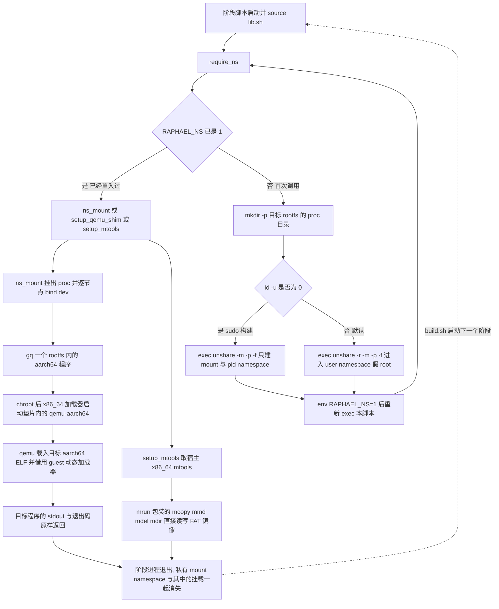
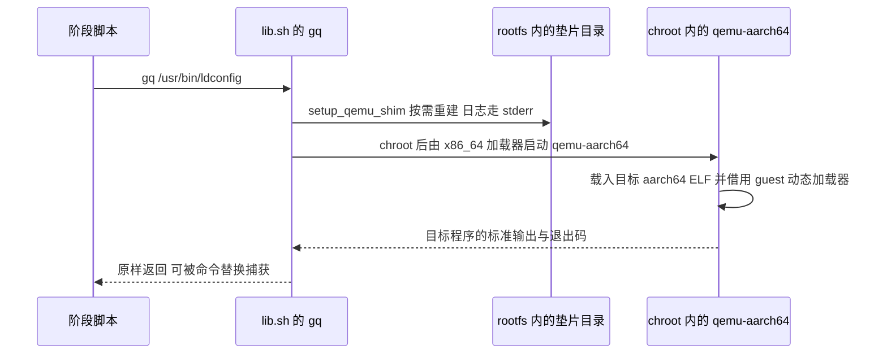

# 无 root 构建运行时：userns、qemu 垫片与 mtools

这套构建**默认不需要 root**：阶段脚本在一个 user namespace 里以"假 root"身份运行，aarch64 二进制通过宿主 x86_64 的 qemu-user **显式调用**执行（不依赖 `binfmt_misc`），FAT 引导镜像用下载来的宿主 mtools 原地读写。

设计约束的单一出处是 [`scripts/lib.sh`](../../scripts/lib.sh#L4-L8) 的文件头注释；面向使用者的同一份摘要写在 [`README.md`](../../README.md#L308-L324) 的"重新构建 → 不需要 root"一节。本页回答四个问题：每个 helper 到底补上了哪条内核能力限制、它们的调用顺序与生命周期、真 root（`sudo ./build.sh`）与 userns 两条路径的行为差异及**各自产物的可信度**、以及这套机制的运行前提与调试开关。

## 入口契约：build.sh 怎么启动阶段，require_ns 怎么重入

[`build.sh`](../../build.sh#L26-L39) 把 12 个阶段项硬编码在 `STAGES` 里，先 `cd "$PROJ"`，再逐个以 `bash "scripts/$name" 2>&1 | tee -a logs/build.log` 启动（[`build.sh`](../../build.sh#L89-L101)）。这决定了阶段脚本的写法：

- 阶段脚本按**脚本路径**被 `bash` 调用，**不接收命令行参数**；跨阶段状态一律走 `work/` 下的文件（`work/kver`、`work/rootfs-layout`、`work/initramfs.img`…）。
- 每个阶段（以及 `lib.sh` 的所有使用者）都遵守同一段头部骨架：

```bash
set -euo pipefail
source "$(dirname "${BASH_SOURCE[0]}")/lib.sh"
require_ns
ns_mount                # 或 setup_qemu_shim / setup_mtools
```

- `require_ns()` 用 `RAPHAEL_NS=1` 作哨兵把**当前脚本重入一遍**：第一次调用时执行 `exec unshare … env RAPHAEL_NS=1 PROJ="$PROJ" bash "$0" "$@"`，第二次（已在命名空间内）直接返回（[`scripts/lib.sh`](../../scripts/lib.sh#L44-L59)）。重入靠的是 `$0` 与哨兵：`lib.sh` 会从 `BASH_SOURCE[0]` 重新推导 `PROJ`（顺带传进去的 `PROJ=` 不是必需），因此阶段脚本必须能按相对当前工作目录的 `$0` 找到自己——这正是 `build.sh` 先 `cd` 到仓库根、并以相对路径启动阶段的原因。`exec` 替换的是管道里那个 `bash` 进程，所以重入后的输出仍然进 `logs/build.log`。
- 由此产生一条必须遵守的规则：**`require_ns` 之前的语句会在宿主上真实执行一次**（那次执行还会再进命名空间重跑一遍），写在那里只能是幂等动作。`lib.sh` 自己就利用了这一点——进命名空间前先 `mkdir -p "$ROOT/proc"`，因为 `--mount-proc` 的目标路径必须先在父命名空间里存在。
- 同一条规则也管着 `lib.sh` 的**顶层代码**：`PROJ` 推导、`source config/build.conf`、`mkdir -p "$WORK" "$DL" "$OUT" "$LOGS" "$TOOLS" "$WORK/logs" "$WORK/empty-hooks"`、以及 `KVER="$(ls "$ROOT/usr/lib/modules" …)"` 都在 `source` 的那一刻执行（[`scripts/lib.sh`](../../scripts/lib.sh#L11-L25)、[`scripts/lib.sh`](../../scripts/lib.sh#L168)），也就是在**没有 root 的宿主那一遍**就已经跑过（此时 `KVER` 通常为空，因为 `work/root` 还没解包或还是上一轮的树）；改这些顶层语句时同样要保证幂等。
- `exec unshare … env RAPHAEL_NS=1 PROJ="$PROJ" bash "$0" "$@"` 是**追加**这两个变量而不是净化环境（`env` 不带 `-i`），其余环境变量原样继承：`DESKTOPS="plasma-mobile" ./build.sh`、`RAPHAEL_FORCE_LAYOUT=…`、`RAPHAEL_BT_MAC=…` 这类覆盖在命名空间内的那一遍照旧生效（[`config/build.conf`](../../config/build.conf#L8-L11) 里的 `${RAPHAEL_…:-默认值}` 就是这么读的）。
- 反向的坑：`RAPHAEL_NS` 是全局哨兵，外部环境里预设 `RAPHAEL_NS=1` 会让 `require_ns()` 直接返回而不自举，阶段随即在宿主环境里跑 `ns_mount()`——第一句 `mount --bind "$ROOT" "$ROOT"` 就会以非零退出、被 `set -e` 中止。这个变量只应存在于 `require_ns()` 内部。

## 速查：helper 与它补上的能力

| helper | 补的是什么 | 谁在用 |
|:--|:--|:--|
| `require_ns()` | 把阶段脚本重入到 `unshare` 出来的命名空间，得到"假 root" | `build.sh` 的 12 个阶段里除 `00-fetch.sh`、`03b-ms91xx.sh` 外的 10 个；阶段序列之外的 `11-flash.sh`、`99-make-release.sh`、`bt-mac.sh` 不调用 |
| `ns_mount()` / `ns_dev_mount()` / `ns_umount()` | 在目标 rootfs 上拼出 `chroot` 可用的 `/proc` 与设备节点 | `01`–`07` `09` `10`（`08` 只 `require_ns`）；`ns_umount()` 无人调用 |
| `setup_qemu_shim()` / `gq()` / `verify_qemu()` | 在没有 `binfmt_misc` 的前提下执行 aarch64 程序 | `01` `02` `05` `06` `07`，以及 `lib.sh` 的 `enable_unit`/`mask_unit` |
| `setup_mtools()` / `mrun` / `mtools_*` | 不挂载就读写 FAT 镜像（cache 分区） | `00` `10`、`bt-mac.sh`，以及 `lib.sh:inject_bt_mac_into_boot_img()` |
| `fetch()` | 下载缓存 + 断点续传 + 重试 | `00`（全部上游产物）、`05`（源码与 ALARM gcc 包）、`06`/`07`（字体与配色）、`setup_mtools()` |
| `enable_unit()` / `mask_unit()` | 离线（无 dbus）启停 systemd 单元，失败时手工建软链 | `05` `06` `07` |
| `normalize_ownership()` / `is_real_root()` | 成像前把整树属主与 setuid 位修回 `root:root` | `09` |

## 能力缺口 → 补偿

| 缺口 | 直接后果 | 补偿手段 |
|:--|:--|:--|
| 非特权 userns 里 `chown 0:0` 只是映射回宿主 uid（宿主视角是空操作），`chown` 到非 0 uid（如家目录 `1000:1000`）直接失败 | 树无法在构建期修回 `root:root`，`/home/<user>` 也拿不到 `1000:1000` | `normalize_ownership()` 只在真 root 下工作并断言关键 setuid 程序；家目录属主改由**设备首启动**的 `tmpfiles.d` 与 `raphael-firstboot` 兜底（[`scripts/06-config.sh`](../../scripts/06-config.sh#L866-L889)） |
| 解包可能丢 setuid/setgid 位 | `sudo`/`passwd`/`su` 不可用 | 阶段 01 直接从 tarball 元数据读出 `mode & 0o6000` 的文件并逐个 `chmod` 恢复（[`scripts/01-rootfs.sh`](../../scripts/01-rootfs.sh#L44-L64)） |
| 宿主 systemd 把 `/proc` `/sys` `/dev` 标成 locked mount，非特权 userns 不能 bind 这些挂载点 | 拼不出可用的 chroot | `/proc` 交给 `unshare --mount-proc="$ROOT/proc"`；`/dev` 里的设备节点**逐个单文件 bind**（单文件 bind 不受 locked 限制） |
| 没有 `binfmt_misc` | 内核不能直接执行 aarch64 ELF，也不能执行 shebang 指向 aarch64 `/bin/sh` 的脚本 | `setup_qemu_shim()` 把 x86_64 的 qemu 与加载器搬进 rootfs，`gq()` 在 chroot 内显式启动它，且只跑"一次 `exec` 能完成"的命令 |
| 不能 loop 挂载文件、不能建 btrfs 子卷 | 只能得到单子卷布局 | `rootfs_layout()` 依据 uid 与 loop 探测结果决定 `ext4` / `btrfs-subvol` / `btrfs-flat`（详见[布局与 fstab 一致性](../concepts/rootfs-layout-and-fstab.md)） |
| 不能挂载那 256 MiB 的 FAT 引导镜像 | 阶段 10 无法改引导分区 | `setup_mtools()` + `mrun` 以文件方式直接读写 FAT |
| 没有可用的 aarch64 执行环境跑完整 scriptlet / pacman hook | 装包后的 post-install 步骤与 hook 都不会自动执行 | 宿主 pacman `--arch aarch64 -r "$ROOT" --noscriptlet` + `HookDir` 指向空目录装包，末尾用 `gq` 补跑关键步骤；qcom 用户态改用 clang 交叉编译 |
| chroot 里没有运行中的 systemd / dbus | `systemctl enable` 不能在线跑 | `gq /usr/bin/systemctl --root=/ …` 的**离线模式** + 手工建单元软链的兜底 |

把这八条合起来看，默认策略是**尽量用宿主 x86_64 工具直接作用于目标树**，只在确实需要 aarch64 执行时才走 `gq()`：`pacman --arch aarch64 -r … --noscriptlet`（配置里还关掉了 pacman 自己的沙箱：`DownloadUser = root`、`DisableSandboxFilesystem`、`DisableSandboxSyscalls`，并把 `HookDir` 指到 `$WORK/empty-hooks/` 这个空目录，使 hook 也被彻底停用，[`scripts/02-pacman.sh`](../../scripts/02-pacman.sh#L23-L47)）、`depmod -b "$ROOT"`（源码注释直言"与架构无关"）、`mke2fs -d` / `mkfs.btrfs -r`、mtools、clang 交叉编译。这条策略的一个直接后果是**没有任何 scriptlet / pacman hook / preset 跑过**——所以所有 enable 动作都必须由阶段脚本自己发起，这正是 `enable_unit`/`mask_unit` 存在的原因。

## require_ns：两个分支，以及它与 chroot/qemu 的先后关系



上图：一次阶段脚本的生命周期——宿主上启动、`require_ns` 的 `RAPHAEL_NS` 哨兵分支与重入、进入命名空间后的 `ns_mount`、两条主要执行路径（`gq` 走 chroot+qemu，mtools 纯宿主），以及阶段退出时挂载随私有 mount namespace 一起消失、下一个阶段从零开始。

- **真 root 分支**（`id -u` 为 0，即 `sudo ./build.sh`）：只建 mount + pid namespace，**不再套一层 user namespace**。源码注释给出了实测原因：user namespace 内挂载 procfs 受限，`unshare -r` 会直接报 `挂载 .../work/root/proc 失败: 权限不够`，因此真 root 下用 `unshare -m -p -f`。
- **userns 分支**：`unshare -r -m -p -f`，在里面是 uid 0 的"假 root"（`/proc/self/uid_map` 只有一条 `0 <宿主 uid> 1` 的映射）。

两个分支都带 `--mount-proc="$ROOT/proc"` 与 `--propagation private`：前者让新 pid namespace 拿到属于自己的 procfs（`-f` 先 fork 是 `--pid` 生效的前提），后者保证这次挂载不会传播回宿主。

几处**有意**的偏离（各阶段真正需要的能力不同，不是遗忘）：

- `00-fetch.sh` 不调用 `require_ns`——此时还没有目标 rootfs，它只需要 `setup_mtools`。
- `03b-ms91xx.sh` 不调用 `require_ns`——它是纯宿主的 clang 交叉编译。
- `08-initramfs.sh` 只 `require_ns`、**不** `ns_mount`：它不碰 chroot，检查 rootfs 内 busybox 的 applet 时直接用宿主的 `/usr/bin/qemu-aarch64` 跑那个二进制（能这么干是因为 `$ROOT/usr/bin/busybox` 是静态链接的，不需要 guest 动态加载器，[`scripts/08-initramfs.sh`](../../scripts/08-initramfs.sh#L35-L41)）。
- `11-flash.sh`、`99-make-release.sh`、`bt-mac.sh` 都不属于 `build.sh` 的阶段序列，也从不在命名空间里跑：刷机要访问 USB、打包只做压缩分卷、`bt-mac.sh set` 只改引导镜像里的设备树（[`scripts/11-flash.sh`](../../scripts/11-flash.sh#L15-L17)、[`scripts/99-make-release.sh`](../../scripts/99-make-release.sh#L17-L18)、[`scripts/bt-mac.sh`](../../scripts/bt-mac.sh#L20-L21)）。

## ns_mount / ns_dev_mount：拼出 chroot

`ns_mount()` 在目标 rootfs 上做四件事，缺一即 `chroot` 不可用或行为不对（[`scripts/lib.sh`](../../scripts/lib.sh#L65-L72)）：

1. 建出 `proc` `sys` `dev` `dev/pts` `tmp` `run` 目录骨架；`$ROOT` 不存在直接 `die`。
2. `mount --bind "$ROOT" "$ROOT"` 把目标树自身变成挂载点——后续 `find "$ROOT" -xdev` 不会从宿主根一路走下去，收尾时也才能整体 detach。
3. 检查 `/proc` 是否已挂载；没有就 `warn`（提示"请确认通过 `unshare --mount-proc` 启动"）。
4. 从宿主拷 `/etc/resolv.conf` 进 rootfs（`gq /usr/bin/flatpak remote-add …` 这类需要 DNS 的步骤依赖它；阶段 09 会在成像前用兜底 DNS 覆盖掉它，避免把宿主的 tailscale 之类地址带进镜像）。

需要留意的是，`ns_mount()` **只**解决 `/proc` 与那几个设备节点：`$ROOT/sys`（以及 `run`、`tmp`）永远只是一只空目录，sysfs 从不挂进 chroot。因此 `gq` 派发的命令必须能在没有 sysfs 的情况下跑完——现有用法（`ldconfig`、`systemctl --root=/`、`fc-cache`、`locale-gen`、`dconf update`、`chsh`）都是单次执行、只读写文件系统的工具。要在 chroot 里加一条读 `/sys` 的步骤，得先改 `ns_mount()`。

`ns_dev_mount()` 只处理 `null` `zero` `full` `random` `urandom` `tty` 这几个设备节点：目标不存在时先用 `: >` 造一个普通文件占位（bind 的目标必须存在），然后**单文件** `mount --bind`，已经是挂载点就跳过，失败也不致命（`|| true`）。宿主缺这个节点时直接跳过。不整体 bind `/proc` `/sys` `/dev` 的原因写在源码注释里：它们是被宿主标成 locked 的挂载点。

挂载点带来的两个**阶段内**硬约束（都踩过）：

- 阶段 01 解包前**不能**整体 `rm -rf "$ROOT"`：那样会因为挂载点 busy 而失败（干净环境 / CI 上必现，本地因为走了"rootfs 已存在"分支才没暴露）。正确做法是只删 `proc` `sys` `dev` 之外的内容（[`scripts/01-rootfs.sh`](../../scripts/01-rootfs.sh#L23-L36)）。
- 阶段 09 在 `mke2fs -d` / `mkfs.btrfs -r` 之前必须**先卸载** `$ROOT/proc`、`$ROOT/sys`、`$ROOT/dev`（`umount -R` 加逐个设备文件），否则宿主机的 proc/dev 内容会被整份拷进镜像（体积膨胀 + 泄露宿主信息）。

生命周期上要记住：**挂载只活在该阶段进程自己的私有 mount namespace 里**。阶段进程退出，命名空间随之消失，下一个阶段重新 `ns_mount`。`ns_umount()` 只是同进程内的收尾工具（`umount -l` 设备节点与 `$ROOT` 本身），当前没有任何阶段调用它。

## qemu 垫片与 gq()：没有 binfmt 也能跑 aarch64

`setup_qemu_shim()` 把宿主 x86_64 的 qemu 及其依赖搬进 rootfs 内的 `/.raphael-build`（`QDIR_IN_ROOT`）：拷 `/usr/bin/qemu-aarch64`、用 `ldd` 定位 `ld-linux-x86-64.so.2`、把绝对路径的依赖库一并拷进 `$QDIR/lib`，最后 `chmod -R a+rX`。函数自带存在性守卫（两个关键文件都在就直接返回），所以可以反复调用（[`scripts/lib.sh`](../../scripts/lib.sh#L96-L109)）。

`gq()` 则在 chroot 里**显式**启动它：

```bash
chroot "$ROOT" "$QDIR_IN_ROOT/ld-linux-x86-64.so.2" \
  --library-path "$QDIR_IN_ROOT/lib" "$QDIR_IN_ROOT/qemu-aarch64" "$@"
```

之所以能工作，是因为垫片里的 qemu 与加载器都是 **x86_64**，chroot 之后宿主内核可以直接 `exec` 它们；而 aarch64 程序在没有 `binfmt_misc` 时只能作为 qemu 的参数被显式执行。由这条限制派生出三条使用约定：

- **只能直接 exec ELF，不能依赖 shell 脚本**：chroot 内的 `/bin/sh` 是 aarch64，脚本的 shebang 由内核处理，没有 binfmt 就起不来。要跑脚本必须把脚本当成 aarch64 解释器的参数，例如 `gq /usr/bin/bash /usr/bin/locale-gen`。
- **不要指望 aarch64 子进程**：源码给出的理由是"qemu-user 无法在无 binfmt 的情况下执行子进程"，所以本项目把 `gq` 的用法限制在**一条命令干完**的范围内。这也是阶段 05 宁可用 clang 交叉编译、也不在 qemu 里原生编译 qcom 用户态的原因（[`scripts/05-qcom.sh`](../../scripts/05-qcom.sh#L13-L16)）；`02` 的补跑清单因此都是"一条命令干完"的程序（`ldconfig`、`systemd-sysusers`、`systemd-tmpfiles --create`、`glib-compile-schemas`、`fc-cache`、`gtk-update-icon-cache`），而 `systemctl --root=/ …`、`dconf update` 这类同样只读一次输入、只写文件系统的命令被直接交给 `gq`。
  - 需要留意的证据出处：[`README.md`](../../README.md#L323-L324) 说明这不是硬性限制——装上 `qemu-user-binfmt`（`sudo pacman -S qemu-user-binfmt && sudo systemctl restart systemd-binfmt`）之后构建会更快、也能跑完整 scriptlet；而 [`notes/qcom-userspace.md`](../../notes/qcom-userspace.md#L486-L491) 记录的宿主实测显示，`qemu-aarch64 -L <rootfs> <rootfs>/usr/bin/bash -c '…'` 这种入口**能**嵌套 `execve`（没有 binfmt 时裸执行 aarch64 二进制才会 `Exec format error`）。也就是说"不能跑子进程"是本运行时这条调用路径的约束，不是 qemu-user 的绝对限制；真要依赖子进程，先按 notes 的方式实测。
- 参数一律写成 **rootfs 内的绝对路径**（如 `/usr/bin/ldconfig`），因为 `chroot` 之后路径都相对 `$ROOT` 解析。

另外两个容易忽略的契约：

- **`gq` 的 stdout 是返回值**。`gq` 内部先 `setup_qemu_shim >&2`，把垫片安装日志全部赶到 stderr，因为它常被命令替换或文件重定向捕获：`out="$(gq /usr/bin/uname -m 2>&1)"`、`gq /usr/bin/gdk-pixbuf-query-loaders > "$d/loaders.cache"`。
- **垫片不进镜像**。阶段 09 成像前 `rm -rf "$ROOT/.raphael-build"`；阶段 05 因此在开头显式重新 `setup_qemu_shim`（注释指出 09 删过它，不补的话后面的 `enable_unit` / `ldconfig` 会**静默失败**）；`gq` 自身也每次按需重建，所以正常路径下只是一次 `[ -x ]` 判断。



上图是一次 `gq` 调用的执行链：阶段脚本 → 垫片 → chroot 内的 qemu → 目标 aarch64 程序。

## mtools：不挂载就读写 FAT

`setup_mtools()` 从 Arch **x86_64** 仓库取一份 mtools 到 `tools/mtools/`（先抓镜像目录里 `mtools-…-x86_64.pkg.tar.zst` 的文件名，再用 `fetch` 下载、`tar --zstd` 解包），得到的是可在宿主直接运行的宿主工具，与目标 rootfs 无关。之后的调用统一走包装（[`scripts/lib.sh`](../../scripts/lib.sh#L146-L154)）：

- `mrun` 固定注入 `MTOOLS_SKIP_CHECK=1`（容忍模板镜像的 FAT 几何/BPB 写法）和 `MTOOLSRC=/dev/null`（不去读宿主的 `~/.mtoolsrc`，保证行为与调用者环境无关）。
- `mtools_copy` 包 `mcopy -o -i`，**是硬失败**：阶段 10 靠它把 `linux.efi`、`initramfs`、`loader.conf`、`arch*.conf`、dtb 与 `bootaa64.efi` 写进镜像，写不进去就让整个阶段失败（[`scripts/10-image-boot.sh`](../../scripts/10-image-boot.sh#L175-L188)）。
- `mtools_mkdir` / `mtools_del` / `mtools_list` 分别包 `mmd`、`mdel`、`mdir`，都显式带 `-i <镜像>`，且**吞掉错误**（`2>/dev/null || true`）——"目录已存在"或"上游条目本来就没有"都属正常，不能当失败。

两个代表性用法：

- 阶段 10 直接 `cp` 一份 256 MiB 模板到 `out/boot-cache.img`，然后用 `mtools_mkdir/del/copy` 原地增删文件（`loader/`、`linux.efi`、`initramfs`、dtb、`bootaa64.efi`），全程没有一个挂载点。
- `inject_bt_mac_into_boot_img()` 改 FAT 里的设备树时没法用 `fdtput` 直接改镜像内容，于是走**读-改-写**：`mcopy` 把 dtb 抽到临时目录 → `fdtput -t bx` 写入蓝牙地址 → `mcopy` 覆盖回去。`bt-mac.sh set` 复用同一条路径（[`scripts/lib.sh`](../../scripts/lib.sh#L377-L393)）。

## fetch：缓存、续传、重试

`fetch <url> <dest>` 的语义很窄但很关键（[`scripts/lib.sh`](../../scripts/lib.sh#L33-L40)）：

- 目标文件**非空即视为已缓存**，直接返回，不重新下载也**不校验内容**——怀疑缓存损坏时要手工删掉那个文件。
- 否则 `curl -fL --retry 3 --retry-delay 2 --connect-timeout 20 -C - -o "$dest.part"`，成功后再 `mv` 成正式文件名。`.part` + `mv` 让"非空即命中"的判定成立：正式文件只在完整下载后出现，而中断留下的 `.part` 又能被 `-C -` 续传。
- 失败即 `die`（阶段脚本 `set -e`，所以下载失败会让整个阶段停下，而不是留下半个产物）。

## enable_unit / mask_unit：没有 dbus 也能 enable

这两个 helper 是两级策略，顺序固定（[`scripts/lib.sh`](../../scripts/lib.sh#L173-L194)）：

1. 先试 `gq /usr/bin/systemctl --root=/ enable|mask "$u"`。`--root=/` 是 systemd 的**离线模式**，在 chroot 里改的是 `$ROOT`，不需要 dbus、不需要运行中的 systemd——正合"离线组装"的场景。
2. 失败就手工造软链：
   - `enable`：从单元文件里 `grep -rl "^WantedBy="` 解析目标（找不到就用 `multi-user.target`），`mkdir -p "$ROOT/etc/systemd/system/$wants.wants"`，再 `ln -sfn "/usr/lib/systemd/system/$u" …`。这等于手工复刻 `systemctl enable` 的效果。
   - `mask`：`ln -sfn /dev/null "$ROOT/etc/systemd/system/$u"`。

这条兜底路径有一个**边界**：它把软链目标固定写成 `/usr/lib/systemd/system/$u`，而本项目自研的 `raphael-*` 单元全部写在 `/etc/systemd/system/`（`06-config.sh` 与 `07-desktop.sh` 里 `cat >` 的那些），`enable_unit` 也照样被调用。也就是说，**只有发行版自带单元**（`sshd`、`NetworkManager`、`sddm`、`bluetooth`…）走兜底才正确；自研单元一旦落到兜底分支，得到的是一条悬空软链。

与之配套的是"disable 不够，还要 mask"的做法：ALARM tarball 里 `systemd-networkd` / `systemd-resolved` 本来就是 enable 状态，而 enable 只是一堆 `*.wants` 软链，任何一步重新应用 preset 就会让它们回来（CI 上确实复现过：日志打了 disable，镜像里软链却还在）。所以阶段 06 对这批单元是 `systemctl --root=/ disable` + 删残留软链 + `mask_unit` 三连，阶段 09 再在灌镜像前做一次**硬检查**：`$ROOT/etc/systemd/system` 下若还存在 `systemd-networkd*` / `systemd-resolved*` 的 `*.wants` 软链就 `die`，拒绝产出会多一个 failed 单元的镜像。

## 真 root 与 userns：行为差异与产物可信度

同一个脚本在两种模式下跑，行为并不等价。判定"真 root"的函数是 `is_real_root()`：`id -u` 为 0 **且** `/proc/self/uid_map` 首行是 `0 0`（即真的映射到宿主 root，而不是 userns 里的假 root，[`scripts/lib.sh`](../../scripts/lib.sh#L257-L260)）。

| 事项 | `sudo ./build.sh`（真 root） | 默认（userns） |
|:--|:--|:--|
| `require_ns` 走哪个分支 | mount + pid namespace，不套 userns | `unshare -r -m -p -f`，假 root |
| `chown 0:0` | 生效，宿主属主真的变成 root | **空操作**：只是映射回宿主 uid，从宿主角度看没变 |
| `chown` 到非 0 uid（如家目录 `1000:1000`） | 生效 | 该 uid 不在 uid_map 里，命令失败——调用点几乎都写成 `2>/dev/null || true`，所以是**静默**失败（`07-desktop.sh` 里有多处 `chown -R 1000:1000`，[`scripts/07-desktop.sh`](../../scripts/07-desktop.sh#L344)） |
| `normalize_ownership()` | 整树归一化 + 恢复 setuid 清单 + 断言 `/usr/bin/mount` 是 `0:0` 且带 s 位，失败即 `die` | 直接告警并返回 1；阶段 09 只 `warn` 后继续，**这条保险不生效** |
| loop 挂载与 btrfs 子卷 | 可探测 loop（宿主机缺 `/dev/loop*` 时还会 `mknod` 补节点）→ 可能得到 `btrfs-subvol`（`@` / `@home` / `@swap`，并带 `compress` 挂载灌数据） | loop 挂载不可用 → 退化成 `btrfs-flat`（`mkfs.btrfs -r` 单子卷），或按配置走 `ext4` |
| 家目录属主 | 构建期可修（但代码仍然依赖设备首启动的 `tmpfiles.d`） | 只能靠设备首启动：`Z /home/<user> - 1000 1000 -` 加 `raphael-firstboot.sh` 里的 `chown -R` 兜底 |
| 构建环境前提 | 需要真 root；`unshare`/`mount` 仍需不被 seccomp 拦 | 需要可用的非特权 userns |

`normalize_ownership()` 在真 root 下的完整动作是：先记下所有 setuid/setgid 文件及其完整模式（`chown` 可能清掉 s 位）→ `find … -xdev` 整树 `chown -h 0:0` → 家目录还给目标用户 → 逐条恢复 setuid 位 → 恢复硬编码的少数"组属主"文件（`/usr/bin/wall:tty`、`/usr/lib/dbus-daemon-launch-helper:dbus`、`/var/log/journal:systemd-journal` 等）→ **断言**关键程序是 `0:0` 且带 s 位，不符合就 `die`（这样的镜像刷进去开不了机，[`scripts/lib.sh`](../../scripts/lib.sh#L262-L305)）。

### 产物可信度：userns 构建"成功"不等于镜像可用

非真 root 时，上面那条硬闸门整条缺席（只打印一段醒目告警并 `return 1`），阶段 09 捕获后只 `warn` 继续（[`scripts/09-image-rootfs.sh`](../../scripts/09-image-rootfs.sh#L79-L84)）。因此：

- **userns 产物没有构建期断言**。默认（无 `sudo`）跑一遍得到的 `rootfs.img` / `rootfs.sparse.img` 不会因为属主问题而失败。
- 源码里对这个后果有**两种视角**，值得区分而不是简单信任其一：`lib.sh` 的事故复盘说"userns 里生成/改动的文件在宿主上属主是 uid 1000，带进镜像会让 setuid 程序失效"（[`scripts/lib.sh`](../../scripts/lib.sh#L241-L249)）；阶段 09 的头部注释则说"在 user namespace 内执行 `mke2fs -d`，这样镜像里的文件属主是 uid 0（namespace 内所有文件都映射为 root）"（[`scripts/09-image-rootfs.sh`](../../scripts/09-image-rootfs.sh#L5-L12)）。两者描述的其实是不同环节：镜像里最终记下的 uid 取决于**树里文件在宿主侧的属主**与**mkfs 当时所处的命名空间**——宿主 uid 1000 的文件在命名空间里看起来就是 0，而命名空间里没有被映射的属主（例如曾经被真 root 跑过一遍留下的 `root` 文件）会以 overflow uid 的形式落进镜像。
- 操作结论：**要发布的镜像用 `sudo ./build.sh` 重新构建**（那条路径有断言，错了会 `die`），或者挂载产物自己检查 `stat -c '%u:%g %a' usr/bin/mount` 之类。别用"构建日志没报错"推断属主正确。可用的构建期自检手段（`verify_qemu`、阶段 02 的烟雾测试、CI 的 `mdir` 与 `sha256sum -c` 复核）见[构建期校验与烟雾测试](../testing/build-validation-and-smoke-tests.md)；"日志正常但镜像不可用"这一整类陷阱的归类见[故障模式与不变量](../concepts/failure-modes-and-invariants.md)。
- 顺带记住：`normalize_ownership`、`rootfs_layout` 的布局退化、阶段 09 用兜底 DNS 覆盖宿主的 `/etc/resolv.conf` 等，都会在日志里留显式提示——**"构建成功"≠"镜像可用"**，这几行提示必须看。

一个操作层面的推论：**CI 跑的是真 root 模式**。GitHub Actions 的容器步骤以 root 执行（工作流里 `pacman -Syu` 直接调用、没有 `sudo`），`--privileged` 又放开了 `unshare`/`mount` 的 seccomp 限制，所以 `require_ns` 走 `id -u = 0` 分支、`normalize_ownership()` 真的生效、阶段 09 的 loop 探测也能成功（工作流甚至专门 `mknod` 补 `/dev/loop*` 并自检一次 loop 挂载）。换句话说，"userns 下 setuid 失效"这类坑是**本地默认构建**才会遇到的，CI 不会替你暴露。

## 运行前提与调试开关

这套机制不是"任何环境都能跑"，它依赖三项宿主前提（前两项不满足时连第一个阶段的 `require_ns` 都过不去，第三项会在用到对应工具的阶段暴露）：

- **非特权 user namespace 可用**：宿主内核得允许 `unshare -r -m -p -f`（`user.max_user_namespaces` 不为 0；作者的机器上实测为 126794，见 [`notes/qcom-userspace.md`](../../notes/qcom-userspace.md#L482-L491)）。
- **`unshare` / `mount` 不被 seccomp 拦掉**：默认配置的容器（Docker 默认 seccomp profile）就会拦，此时连 `require_ns` 都进不去——CI 之所以用 `--privileged` 的 `archlinux` 容器，原因就在这里。
- **宿主要有这套宿主工具链**：这一策略把大量工作交给宿主工具，也就把宿主的包管理器变成了构建前提——装包靠宿主 `pacman --arch aarch64`（阶段 02）、`gq` 靠宿主 `/usr/bin/qemu-aarch64`、成像靠 `mke2fs` / `mkfs.btrfs` / `img2simg`、解 deb 与 initramfs 靠 `ar` / `7z` / `cpio`。所以构建机实际是 Arch 系：CI 用 `archlinux:latest` 容器而不是 ubuntu runner，理由就写在[`.github/workflows/build.yml`](../../.github/workflows/build.yml#L4-L9) 的头部注释里（"宿主必须是 Arch（pacman 语义 + 包缓存），ubuntu runner 直接跑不了"），依赖清单见[CI 构建工作流](../operations/ci-build-workflow.md)。

几个环境变量与开关值得记住：

- `RAPHAEL_NS=1`：`require_ns()` 的内部哨兵，**不要手工设置**（见下节"不变量"）。
- `RAPHAEL_FORCE_LAYOUT=ext4|btrfs-subvol|btrfs-flat` 直接跳过 `rootfs_layout()` 的探测，用来复现某条成像路径；它会被写回缓存。
- 探测结果缓存在 `work/rootfs-layout`：阶段 06（fstab）、09（成像）与 10（引导参数）读的都是这同一份（`write_root_fstab` 的默认参数也取自它）；只有删掉这个文件才会重新探测，阶段 09 的 loop 回退也会把它改写（细节见[布局与 fstab 一致性](../concepts/rootfs-layout-and-fstab.md)）。
- 想要更快的构建（以及能跑完整 scriptlet），可选装 `qemu-user-binfmt`；不装是默认路径。

## 不变量与失败语义

- **`require_ns` 之前的代码在宿主上真跑一次**：那一段必须幂等（例如 `mkdir -p`）；`lib.sh` 的顶层语句（`PROJ`、`source config`、`mkdir`、`KVER`）同理，它们同样先在没有 root 的宿主上执行。
- **环境变量跨重入是继承的**：`exec … env` 只追加 `RAPHAEL_NS=1` 与 `PROJ`，所以在调用 `build.sh` 时设的覆盖（`DESKTOPS`、`RAPHAEL_FORCE_LAYOUT`、`RAPHAEL_BT_MAC`…）在命名空间内的那一遍依然有效。
- **`RAPHAEL_NS` 只属于 `require_ns` 内部**：外部预设它等于跳过自举，阶段会在宿主环境里跑 `ns_mount` 并因 `mount --bind` 失败而中止。
- **挂载内容不进镜像**：成像前必须卸载 `proc`/`sys`/`dev`，镜像里只留空目录。
- **垫片不进镜像**：`$ROOT/.raphael-build` 在阶段 09 被删掉；重跑更早的阶段时要重新 `setup_qemu_shim`。
- **属主归一化是硬闸门（仅真 root 下）**：断言不过直接 `die`，理由是"setuid 程序属主不对，这样的镜像刷进去开不了机"；userns 下这条闸门缺席，只留告警。
- **enable/mask 的残留是硬闸门**：阶段 09 灌数据前发现 networkd/resolved 的 `*.wants` 软链就 `die`。
- **写引导镜像的 mtools 调用分两级**：`mtools_copy` 失败即中止，`mkdir`/`del`/`list` 失败只当无事发生。
- **`fetch` 不校验缓存**：非空即命中，怀疑损坏要手工删。
- **失败不要降级成 warn 的地方**：阶段 02 的关键程序烟雾测试、阶段 05 对 `rmtfs`/`tqftpserv`/`libqrtr.so.1` 的缺失检查（以前只 `warn`，结果静默产出了没 Wi-Fi、没声音的镜像），都属于"防止静默产出残废镜像"的保险。

## 自检与验证入口

- `verify_qemu()`：用 `gq /usr/bin/uname -m` 自检垫片，输出不是 `aarch64` 只告警；阶段 01 在解包之后才安装垫片，并在末尾调用它（解包前的清理会把 `$ROOT` 里的东西删光，垫片有"已存在就跳过"的守卫，不会自动重建）。
- 阶段 02 的两道：`run_if` 用 `gq` 补跑关键 scriptlet（成功/失败只记日志，不中断），以及 `smoke` 对 `bash` / `dnsmasq` / `nft` / `nmcli` / `iw` / `wpa_supplicant` 做**真实执行**的烟雾测试——只有命中"动态库缺失 / 符号版本 not found"这类输出才计数，任一命中即 `die`。
- CI 侧：构建前检查 `unshare mount chroot ar depmod curl zstd mke2fs img2simg 7z cpio qemu-aarch64 python3 make clang mkfs.btrfs btrfs` 是否齐全（并特意说明 mcopy/mmd/mdir **不在**清单里，因为阶段 00 的 `setup_mtools` 会自带一份），构建后用 `mdir`（优先系统自带的，没有才回退到 `tools/mtools/usr/bin/mdir`）复核引导镜像内容与 `loader/entries/arch.conf` 的 `devicetree` 行，并对 `release/SHA256SUMS` 做 `sha256sum -c`。

更完整的失败点清单见[故障模式与不变量](../concepts/failure-modes-and-invariants.md)与[构建期校验与烟雾测试](../testing/build-validation-and-smoke-tests.md)。

## 相关页面

- [仓库结构与入口](repository-layout-and-entrypoints.md) —— `lib.sh` 在仓库里的位置，以及 `dl/` `work/` `out/` `tools/` 这些生成目录的语义。
- [系统总览](overview.md) —— 构建期与运行时的分工，以及"哪些步骤必须在构建期完成"的成因。
- [rootfs 布局决策与 fstab/引导参数一致性](../concepts/rootfs-layout-and-fstab.md) —— `rootfs_layout()` 的三选一、缓存粘性，以及 loop 回退时三处对齐的不变量。
- [构建流水线各阶段](build-pipeline-stages.md) —— 每个阶段做什么、失败点在哪。
- [内核、设备树、固件与外部模块的交付](firmware-kernel-and-module-delivery.md) —— 阶段 03 的 `depmod -b`、03b 的宿主 clang 交叉编译等"宿主工具直作用于目标树"的具体做法。
- [CI 构建工作流](../operations/ci-build-workflow.md) —— privileged 容器、大磁盘软链与产物归档。
- [故障模式与不变量](../concepts/failure-modes-and-invariants.md) —— 静默降级类陷阱的汇总。
- [构建期校验与烟雾测试](../testing/build-validation-and-smoke-tests.md) —— `verify_qemu`、烟雾测试与 CI 校验步骤。
