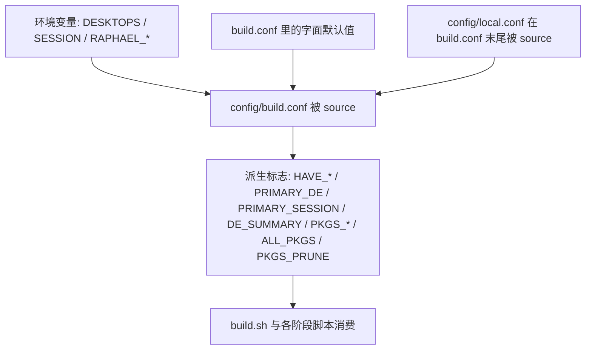
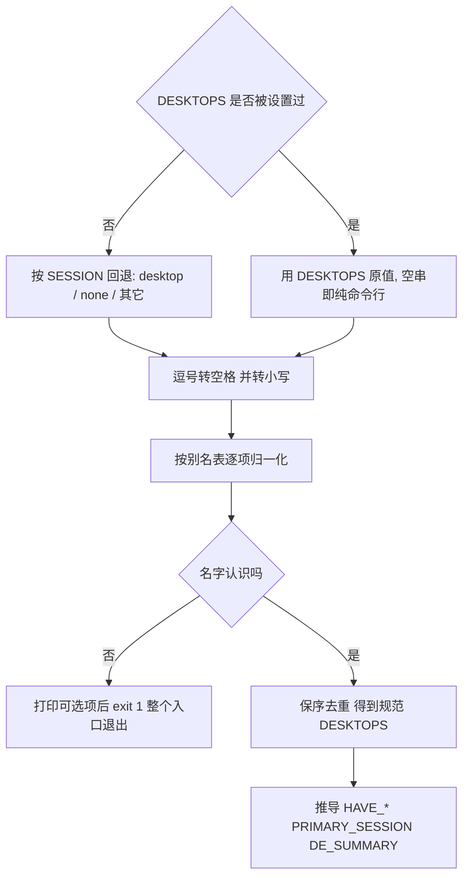

# 配置模型：build.conf、派生标志与环境变量

这个仓库**没有配置解析器**。全部"可调参数"写在 [`config/build.conf`](../../config/build.conf) 里，而它是一段会被 `source` 执行的 bash：里面有 `if` / `case`、函数定义、循环、`sed` 改包列表，还有 `exit 1`。所以它的正确心智模型是"构建逻辑的最前面一层"，而不是一张 INI 表：

- 把它当键值文件改，可能得到静默错位（例如把 `DESKTOPS` 写成不存在的桌面）；
- 想让同一个仓库产出不同镜像，优先走**环境变量**，而不是改文件；
- 读它的时候要当代码读：`bash -n config/build.conf` 这类检查比"看配置项"更有意义。

## 谁读它、什么时候读

| 读取方 | 位置 | 为什么在那里读 |
|:--|:--|:--|
| `build.sh` 顶层 | [`build.sh`](../../build.sh#L18-L24) | 只为两件事：提前校验 `DESKTOPS`、拿 `DE_SUMMARY` 打印表头。它在**解析命令行参数之前**执行 |
| `scripts/lib.sh` | [`scripts/lib.sh`](../../scripts/lib.sh#L11-L13) | 每个阶段脚本第一行都 `source lib.sh`，lib.sh 再 source `build.conf`；于是配置在一次完整构建里被**求值十几次**：`build.sh` 一次，外加 12 个阶段各一次（`03b` 也算一个阶段） |

由此产生三条读者必须知道的后果：

1. **写错桌面名 = 整个构建入口退出**。`build.conf` 的校验分支直接 `exit 1`（[`config/build.conf`](../../config/build.conf#L79-L86)），而它是被 `source` 进 `build.sh` 的，所以 `exit` 结束的是 `build.sh` 自己 —— 一个阶段都不会跑。`./build.sh --list` / `--help` 也救不了，因为参数解析排在 source 之后（[`build.sh`](../../build.sh#L41-L61)）。阶段脚本里同理：那一次阶段运行整体退出。
2. **环境变量会自然传播**。`build.sh` 用 `bash "scripts/$name"` 起阶段脚本（[`build.sh`](../../build.sh#L89-L102)），所以 `DESKTOPS="plasma-mobile phosh" ./build.sh` 里的赋值、以及 CI 写进 `$GITHUB_ENV` 的值，对所有阶段都生效，不需要写进文件。
3. **每次 source 都会重算派生标志**。归一化 `DESKTOPS`、推导 `HAVE_*`、拼装 `ALL_PKGS` 这些工作不是一次性的，而是每个阶段各做一遍；因此任何阶段看到的 `ALL_PKGS` / `PKGS_PRUNE` 都与之独立算出的结果一致（前提是环境变量在各阶段之间没被改）。

## 值的来源与优先级

上图：一次求值里的合并顺序 —— `local.conf` 最后被 source，所以它的赋值压过文件里所有默认值；而 `RAPHAEL_*` 这类"可覆盖默认值"只在变量未设时生效。

三种覆盖手段的性质完全不同：

| 手段 | 生效方式 | 作用范围 | 典型用途 |
|:--|:--|:--|:--|
| 环境变量 `RAPHAEL_*` | build.conf 里写成 `${RAPHAEL_X:-默认}`（[`config/build.conf`](../../config/build.conf#L7-L42)） | 一次构建（或一次 CI job） | CI 海外换官方源、临时改压缩级别、注入私密值 |
| 环境变量 `DESKTOPS` | build.conf 用 `${DESKTOPS+x}` 判断"是否**被设置过**"（[`config/build.conf`](../../config/build.conf#L68-L77)） | 一次构建 | 同一份代码切桌面形态，不碰文件 |
| `config/local.conf` | build.conf 末尾整体 `source`（[`config/build.conf`](../../config/build.conf#L340-L347)） | 本机所有构建 | 本机唯一的私密值（蓝牙地址、密码） |

`DESKTOPS` 的判定必须用 `${DESKTOPS+x}` 而不能用 `${DESKTOPS:-默认}`：CI 在"纯命令行"时会把 `DESKTOPS=` 写成**空串**（[`.github/workflows/build.yml`](../../.github/workflows/build.yml#L291-L312)），只有"存在性"判断才能把它与"完全没给"区分开，从而让空串短路掉旧的 `SESSION` 回退逻辑。

## DESKTOPS：归一化、校验与顺序语义

`DESKTOPS` 是唯一一个"字符串会被真正解析"的配置项，处理链全在 [`config/build.conf`](../../config/build.conf#L50-L114)：

1. **只在完全没设置时才看旧写法**：`SESSION=mobile|desktop|none`（`desktop` → `plasma-desktop`，`none`/`cli`/空 → 空，其它 → `plasma-mobile`）。
2. **归一化**：逗号转空格、`tr 'A-Z' 'a-z'` 转小写、按别名表逐项映射（`mobile`/`kde-mobile`/`plasma_mobile` → `plasma-mobile`；`desktop`/`plasma`/`kde`/`plasma_desktop` → `plasma-desktop`；`gnome-desktop` → `gnome`）、**保序去重**。
3. **校验**：不认识的名字打印可选项到 stderr 后 `exit 1`。
4. **顺序即语义**：规范化的第一个桌面就是自动登录目标（`PRIMARY_DE`），登录界面里仍可切其它已装会话。

上图：`DESKTOPS` 从"用户写法"到"阶段脚本可用的规范形式"的全部变换 —— 唯一的失败出口在最中间的校验分支。

因为顺序承载"自动登录谁"这一语义，所以"想让 Phosh 当默认会话"的做法不是加开关，而是把它写在 `DESKTOPS` 的第一个（[`scripts/07-desktop.sh`](../../scripts/07-desktop.sh#L52-L119)）。

## 派生标志：定义位置与消费者

阶段脚本原则上**不再解析 `DESKTOPS` 字符串**，而是读下面这些标志（唯一的例外是 `07` 用 `case "$DESKTOPS" in *" "*)` 判断"是不是装了多个桌面"来打印提示，[L114-L119](../../scripts/07-desktop.sh#L114-L119)）：

| 标志 | 定义位置 | 语义 | 谁读它 |
|:--|:--|:--|:--|
| `HAVE_PLASMA_MOBILE` / `HAVE_PLASMA_DESKTOP` / `HAVE_PHOSH` / `HAVE_GNOME` | [`build.conf` L104-L107](../../config/build.conf#L104-L107) | 单个桌面是否被选中（由 `de_has` 生成） | `02` 的关键包校验（[L126-L139](../../scripts/02-pacman.sh#L126-L139)）、`07` 的桌面专属配置段 |
| `HAVE_KDE` | [`build.conf` L108](../../config/build.conf#L108) | 有 Plasma Mobile 或 Plasma 桌面 | `02`、`07`（SDDM 合成器/主题、Plasma 默认配置，多处） |
| `HAVE_MOBILE_SHELL` | [`build.conf` L110](../../config/build.conf#L110) | Plasma Mobile 或 Phosh（"手机形态"） | **只被 build.conf 自己的选包逻辑用**，阶段脚本不读它 |
| `HAVE_ANY_DE` | [`build.conf` L111](../../config/build.conf#L111) | `DESKTOPS` 非空 | `02`、`06`（是否装霞鹜文楷字体，[L1056](../../scripts/06-config.sh#L1056)）、`07`（SDDM 段 vs 纯命令行段）、`99`（刷机说明文本） |
| `PRIMARY_DE` / `PRIMARY_SESSION` | [`build.conf` L113-L114](../../config/build.conf#L113-L114) + `de_session_name` [L96-L103](../../config/build.conf#L96-L103) | 第一个桌面 / 对应 `wayland-sessions` 名（`plasma-desktop` → `plasma`） | `07` 写 SDDM `[Autologin] Session=`、`build.sh`/`99` 打印提示 |
| `DE_SUMMARY` | [`build.conf` L116-L127](../../config/build.conf#L116-L127) | 人话摘要（`Plasma Mobile + Phosh`），空选择显示 `纯命令行` | `build.sh` 表头、`02` 日志、`07` 日志、`10` 引导项 `title`、`99` 发布说明 |
| `PKGS_PRUNE` | [`build.conf` L293-L315](../../config/build.conf#L293-L315)（`drop_pkgs`） | "同功能只留一个"时被去掉的包名 | `02` 用 `-Rdd` 显式从树里删掉（增量重建残留，[L173-L183](../../scripts/02-pacman.sh#L173-L183)） |
| `ALL_PKGS` | [`build.conf` L332-L338](../../config/build.conf#L332-L338) | 所有 `PKGS_*` 组按 `HAVE_*` 拼装，再用 `awk '!seen[$0]++'` 去重 | `02` 的**唯一**安装清单（[L109-L145](../../scripts/02-pacman.sh#L109-L145)） |
| `PKGS_DEDUPED` | [`build.conf` L299-L315](../../config/build.conf#L299-L315) | 去重动作的人话说明 | 目前没有消费者（只供人看/调试），改它不会影响构建 |

几个容易踩的点：

- **不是所有标志都有消费者**。`HAVE_MOBILE_SHELL` 和 `PKGS_DEDUPED` 只在 `build.conf` 内部使用；想让某个阶段区分"手机形态"，要么读 `HAVE_*`，要么在 `build.conf` 里新增一个阶段会读的标志。
- **包列表是条件化生成的结果，不是静态清单**。非手机形态会用 `sed` 把 `flatpak`/`kdeconnect` 从 `PKGS_BASE` 里抠掉、对"有桌面"的形态再抠掉 `man-pages`/`vim` 并换掉 AUR 助手组（[`config/build.conf`](../../config/build.conf#L265-L281)）；中文输入法 `PKGS_IME` 只在装了 Plasma 桌面时才非空（[L317-L330](../../config/build.conf#L317-L330)）。
- **选中的桌面缺关键包会让构建硬失败**：`02` 在包校验里为选中的桌面构造 `DE_CRIT`（`sddm`、`plasma-desktop`+`plasma-keyboard`、`plasma-mobile`、`phosh`+`phoc`+`squeekboard`、`gnome-shell`+`gnome-session`+`nautilus`），命中缺失就直接 `die`，拒绝产出"能刷但进不去桌面"的镜像（[`scripts/02-pacman.sh`](../../scripts/02-pacman.sh#L126-L139)）。而普通包名写错只 `WARN` 跳过。

## 环境变量覆盖清单

| 变量 | 读取位置 | 默认值 | 影响 |
|:--|:--|:--|:--|
| `RAPHAEL_ALARM_MIRROR_PRIMARY` / `RAPHAEL_ALARM_MIRROR_FALLBACK` | [`build.conf` L10-L11](../../config/build.conf#L10-L11) | USTC / 清华 TUNA | `02` 的仓库 URL（宿主 pacman 配置 + 写进目标 rootfs 的 `mirrorlist`） |
| `RAPHAEL_ROOTFS_TYPE` | [`build.conf` L32](../../config/build.conf#L32) | `btrfs` | 经 `rootfs_layout()` 决定 `ext4` / `btrfs-subvol` / `btrfs-flat` |
| `RAPHAEL_BTRFS_COMPRESS` | [`build.conf` L33](../../config/build.conf#L33) | `zstd:3` | `fstab`、`mkfs` 挂载选项、内核 `rootflags` 里的 `compress=` |
| `RAPHAEL_BTRFS_SWAP_SIZE` | [`build.conf` L38](../../config/build.conf#L38) | `4G` | 首启动交换文件大小；`0` = 不生成该服务 |
| `RAPHAEL_WIFI_COUNTRY` | [`build.conf` L42](../../config/build.conf#L42) | `CN` | `10` 写进引导项的内核参数 `cfg80211.ieee80211_regdom=`（决定 5 GHz 能否用） |
| `RAPHAEL_FORCE_LAYOUT` | [`lib.sh` L316-L324](../../scripts/lib.sh#L316-L324) | 空 | 直接指定布局，跳过探测；结果会**写回缓存** |
| `RAPHAEL_RELEASE_ZSTD_LEVEL` | [`99-make-release.sh` L26-L28](../../scripts/99-make-release.sh#L26-L28) | `19` | 发布包压缩级别（CI 用 `6` 换时间） |
| `RAPHAEL_BT_MAC` | [`10-image-boot.sh` L55-L78](../../scripts/10-image-boot.sh#L55-L78)、[`11-flash.sh` L88-L104](../../scripts/11-flash.sh#L88-L104) | 空 | 构建/刷机时注入的蓝牙地址（见下节） |
| `RAPHAEL_NS` | [`lib.sh` L44-L58](../../scripts/lib.sh#L44-L58) | `0` | **内部重入标记**：`require_ns()` 用它判断"是否已经进过 namespace"。手动设置会跳过 namespace 自举，会得到一份 setuid 全坏的镜像 |
| `DESKTOPS` / `SESSION` | [`build.conf` L68-L77](../../config/build.conf#L68-L77) | `plasma-mobile` | 桌面形态与自动登录顺序 |

`RAPHAEL_USER` 不是构建开关：它是 `07` 写进 systemd 单元 `Environment=` 的运行时变量（[`scripts/07-desktop.sh`](../../scripts/07-desktop.sh#L523-L533)），别与上面这批混用。

## 私密值：三种注入路径与优先级

### 蓝牙地址 `BT_MAC`

蓝牙地址是**每台设备唯一**的（产线写在 dtbo 分区，刷机会清掉），公开镜像不带任何人的真实地址。三条路径，优先级从高到低：

1. **构建期环境变量 `RAPHAEL_BT_MAC`** —— 阶段 10 第一句就是 `BT_MAC="${RAPHAEL_BT_MAC:-}"`（[L57](../../scripts/10-image-boot.sh#L57)）。CI 用仓库 Secret `IMAGE_BT_MAC` 喂它（[`.github/workflows/build.yml`](../../.github/workflows/build.yml#L122-L124)）。
2. **构建期 `config/local.conf` 的 `BT_MAC="aa bb cc dd ee ff"`** —— 阶段 10 用 `sed -n 's/^BT_MAC="\(.*\)".*/\1/p'` 抽取（[L58-L59](../../scripts/10-image-boot.sh#L58-L59)）。**格式约束来自这条 sed**：必须顶格、双引号形式；写成单引号或无引号会抽不到，构建不失败，只是镜像蓝牙不可用（WARN）。示例文件 [`config/local.conf.example`](../../config/local.conf.example) 里就是这行假值。
3. **刷机/后处理期注入** —— `scripts/11-flash.sh --bt-mac '11 22 33 44 55 66'` 会把公开镜像复制一份、把地址写进其中的设备树再刷（[L91-L104](../../scripts/11-flash.sh#L91-L104)）；`scripts/bt-mac.sh set <boot-cache.img> <地址>` 用于同一目的（[`scripts/bt-mac.sh`](../../scripts/bt-mac.sh#L11-L18)）。这条路径不需要重新构建，也不需要任何 secret。

地址接受 `11:22:33:44:55:66`、`11-22-33-44-55-66`、`112233445566`、`"11 22 33 44 55 66"` 四种写法，归一化会剔除其它字符（CI 上就踩过 Secret 里混进引号/冒号的情况，[`lib.sh`](../../scripts/lib.sh#L366-L374)）。写法是**设备树字节序**，与 `bluetoothctl` 显示的相反。

### 账号与密码

`USERNAME` / `USER_PASSWORD` / `ROOT_PASSWORD` 的三条路径：

1. **CI Secrets** `IMAGE_USERNAME` / `IMAGE_USER_PASSWORD` / `IMAGE_ROOT_PASSWORD`（最高）；
2. **`workflow_dispatch` 表单输入** `username` / `user_password` / `root_password`；
3. **`build.conf` 默认值**（`user` / `1234` / `1234`），本地可被 `config/local.conf` 覆盖。

前两条由 CI 把值**写进 `build.conf` 本身**（见下节），第三条是文件里的字面量。注意 `config/local.conf` 在构建机上是 `source` 进 `build.conf` 的最后一步，所以**本地**改 `local.conf` 优先级高于 `build.conf` 里的默认值；CI 里这个文件不存在（[`.gitignore`](../../.gitignore#L24-L25) 忽略它，checkout 拿不到），所以 CI 的就地改写才有效。

公开仓库里这些值一律用假值；本页与示例文件中的 `aa bb cc dd ee ff` / `1234` 都只是占位。

## CI 在运行前如何改写 `build.conf`

线上构建不通过环境变量传账号，而是**在 runner 的工作区里就地改文件**（[`.github/workflows/build.yml`](../../.github/workflows/build.yml#L236-L277)）：

- 一段 `python3` 用 `re.sub(rf'^{key}=.*$', ..., count=1, flags=re.M)` 只替换**第一条**匹配，改 `USERNAME`、`USER_PASSWORD`、`ROOT_PASSWORD`、`AUTOLOGIN` 四个键；`AUTOLOGIN` 只在输入非空时改。
- 取值优先级硬编码为 `SEC_*`（Secrets）→ `IN_*`（表单输入）→ 不改（用文件默认值）。
- 密码在改写前先 `::add-mask::`，输出里只打印"已设置"，不回显真实值；改写只发生在 runner 的临时工作区，不会提交回仓库。
- 这一个 job 的环境变量还顺带覆盖了 `RAPHAEL_ALARM_MIRROR_PRIMARY`（官方源，runner 在海外）、`RAPHAEL_ALARM_MIRROR_FALLBACK`、`RAPHAEL_RELEASE_ZSTD_LEVEL=6`、`RAPHAEL_BT_MAC`（[L108-L124](../../.github/workflows/build.yml#L108-L124)）。

`DESKTOPS` 走的是**另一条路**：CI 不写文件，而是从"旧单选 `session`"或四个复选框算出字符串，`echo "DESKTOPS=$DESKTOPS" >> "$GITHUB_ENV"`（[L279-L320](../../.github/workflows/build.yml#L279-L320)）。push 触发时复选框为空，会回退到历史默认 `plasma-mobile`，免得自动构建悄悄变成纯命令行。随后 `build.sh` 与每个阶段都从这个环境变量读到它 —— 这也解释了为什么 `build.conf` 必须用 `${DESKTOPS+x}` 而不是 `:-`。

一个副作用值得知道：下载缓存的 key 是 `hashFiles('config/build.conf', ...)`，而取哈希的缓存步骤排在"应用账号/密码设置"**之前**，所以 CI 改密码不会让下载缓存失效（[L224-L233](../../.github/workflows/build.yml#L224-L233)）。

CI 的完整流程见 [CI 流水线](../operations/ci-pipeline.md)，阶段划分见 [构建阶段流水线](../workflows/build-pipeline-stages.md)。

## 改哪个开关 → 影响哪些阶段

| 开关（定义位置） | 生效阶段与文件 | 备注 |
|:--|:--|:--|
| `ALARM_MIRROR_PRIMARY` / `ALARM_MIRROR_FALLBACK`（[L10-L11](../../config/build.conf#L10-L11)） | `02`：宿主 pacman 的 `pacman-build.conf`（[L23-L47](../../scripts/02-pacman.sh#L23-L47)）+ 写进目标系统的 `/etc/pacman.d/mirrorlist`（[L52-L59](../../scripts/02-pacman.sh#L52-L59)） | 只影响构建期装包与出厂 mirrorlist |
| `ALARM_ROOTFS_URL`、`KERNEL_DEB_BASE`（← `KERNEL_VERSION`/`KERNEL_TAG`/`KERNEL_REPO`）、`UBOOT_RELEASE_URL`+`UBOOT_IMG_ZIP`、`BOOT_IMG_URL`（[L12-L23](../../config/build.conf#L12-L23)） | `00` 下载（[`scripts/00-fetch.sh`](../../scripts/00-fetch.sh#L12-L40)） | `dl/` 命中缓存就不再下载；`11-flash.sh` / `99` 依赖 `work/uboot/u-boot.img` |
| `KERNEL_VERSION`（[L15-L16](../../config/build.conf#L15-L16)） | `00` 的下载 URL + `03` 的日志标签（[L18](../../scripts/03-kernel.sh#L18)） | **不决定装哪个版本**：实际版本从 deb 内容读出（[L33-L35](../../scripts/03-kernel.sh#L33-L35)） |
| `BOOTFAT_SIZE_MB`（[L48](../../config/build.conf#L48)） | `10` 校验 `boot-cache.img` 大小（[L192-L193](../../scripts/10-image-boot.sh#L192-L193)） | 不一致只 WARN |
| `ROOTFS_TYPE` / `BTRFS_COMPRESS` / `BTRFS_SUBVOL_ROOT` / `BTRFS_SUBVOL_HOME` / `BTRFS_SUBVOL_SWAP`（[L25-L38](../../config/build.conf#L25-L38)） | 经 [`lib.sh`](../../scripts/lib.sh#L310-L439) `rootfs_layout()`/`btrfs_opts()`/`write_root_fstab()` → `06` fstab、`09` mkfs 与压缩挂载、`10` `rootflags=` | 三处一致性不变量见 [rootfs 布局与 fstab](rootfs-layout-and-fstab.md) |
| `BTRFS_SWAP_SIZE`（[L36-L38](../../config/build.conf#L36-L38)） | `06` 生成首启动 swapfile 服务（[L412-L458](../../scripts/06-config.sh#L412-L458)） | `0` = 不生成该服务 |
| `WIFI_COUNTRY`（[L40-L42](../../config/build.conf#L40-L42)） | `10` 的内核命令行（[L114-L116](../../scripts/10-image-boot.sh#L114-L116)） | 世界域会禁掉多数 5 GHz 信道 |
| `IMAGE_SIZE`（[L43-L46](../../config/build.conf#L43-L46)） | `09`（[L44-L60](../../scripts/09-image-rootfs.sh#L44-L60)） | **下限**，不是死值：按内容 ×1.15 + 512 MB 自动放大，首启动再 `growfs` |
| `ROOTFS_UUID_FILE`（[L47](../../config/build.conf#L47)） | `lib.sh:rootfs_uuid()` → `06` fstab、`09` `mkfs -U`、`10` `root=UUID=`（[`lib.sh`](../../scripts/lib.sh#L156-L166)） | 文件删了会生成新 UUID，三处一起变 |
| `HOSTNAME` / `TIMEZONE` / `LOCALE` / `KEYMAP`（[L129-L133](../../config/build.conf#L129-L133)） | `06`（[L33-L53](../../scripts/06-config.sh#L33-L53)） | 写 `hostname`/`hosts`/`locale.gen`/`locale.conf`/`vconsole.conf`/`localtime` |
| `USERNAME` / `USER_PASSWORD` / `ROOT_PASSWORD`（[L135-L139](../../config/build.conf#L135-L139)） | `06` 建用户与 sha512 哈希（[L110-L137](../../scripts/06-config.sh#L110-L137)）、`02` 判断是否删掉自带 `alarm` 用户（[L188-L191](../../scripts/02-pacman.sh#L188-L191)）、`07` 家目录预置、`lib.sh` 属主归一化（[L250-L283](../../scripts/lib.sh#L250-L283)） | 改名会连带改家目录路径与镜像里的 UID 映射；重建时 `shadow` 会被重写 |
| `AUTOLOGIN`（[L140](../../config/build.conf#L140)） | `07` 的 SDDM `[Autologin]`（[L98-L107](../../scripts/07-desktop.sh#L98-L107)） | 只有字符串正好是 `true` **且** `PRIMARY_SESSION` 非空才写这一段 |
| `DESKTOPS`（[L50-L91](../../config/build.conf#L50-L91)） | `02` 包列表 + 关键包校验、`06` 字体、`07` SDDM/自动登录/各桌面段、`10` 引导项 `title`、`99` 说明文本 | 顺序决定自动登录 |
| `PKGS_*` 组（[L142-L238](../../config/build.conf#L142-L238)） | `02`（经 `ALL_PKGS` 与 `PKGS_PRUNE`） | 具体包清单与桌面组见 [构建阶段流水线](../workflows/build-pipeline-stages.md) 与 [桌面会话与输入](../runtime/desktop-sessions-and-input.md) |

## 不变量与失败语义

- **早失败**：桌面名不认识 → 入口在第一个阶段之前退出；选中的桌面缺关键包 → `02` 硬失败。这两种都优于"产出一个能刷但进不了桌面的镜像"。
- **晚发现**：普通包名不存在、蓝牙地址缺失/格式错、`boot-cache.img` 大小与 `BOOTFAT_SIZE_MB` 不符 —— 全部只 WARN，构建继续。
- **改开关 ≠ 重新构建就生效**：增量构建复用 `work/root`。包层面只有 `PKGS_PRUNE` 里的包会被显式删除；"桌面 → 纯命令行"由 `07` 显式清掉上一轮的 SDDM 软链与配置（[L301-L320](../../scripts/07-desktop.sh#L301-L320)）；布局类开关会被 `work/rootfs-layout` 缓存粘住（见 [rootfs 布局与 fstab](rootfs-layout-and-fstab.md)）。
- **私密值只在构建期落地**：密码以哈希写进 `/etc/shadow`，蓝牙地址以字节序写进引导镜像里的设备树；两者都不在仓库里。公开镜像里"没有地址"是正常状态，靠 `11-flash.sh --bt-mac` 或 `bt-mac.sh` 后补。
- **扩展点**：新增一个桌面要在 `build.conf` 的别名 `case`、`de_session_name`、`_de_pretty`、`HAVE_*`、对应 `PKGS_*` 组，再在 `02` 的 `DE_CRIT` 与 `07` 的配置段各加一处；新增一个可覆盖开关则按 `${RAPHAEL_X:-默认}` 的形式放在文件顶部区域 —— 直接写死字面量就等于放弃环境变量覆盖。

## 相关页面

- [仓库布局与入口](../architecture/repository-layout-and-entrypoints.md) —— `build.sh` / `scripts/` / `config/` 的分工
- [rootfs 布局与 fstab](rootfs-layout-and-fstab.md) —— `ROOTFS_TYPE`、`BTRFS_*`、`RAPHAEL_FORCE_LAYOUT` 的下游效果
- [构建阶段流水线](../workflows/build-pipeline-stages.md) —— 各阶段做什么、哪些阶段读哪些标志
- [CI 流水线](../operations/ci-pipeline.md) —— workflow 输入、Secrets、工作区改写与产物通路
- [桌面会话与输入](../runtime/desktop-sessions-and-input.md) —— `DESKTOPS` 顺序、SDDM 会话名与设备上实际生效的会话
- [失败模式与不变量](failure-modes-and-invariants.md) —— 这些配置错误的真机后果
