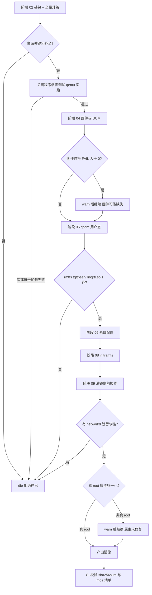
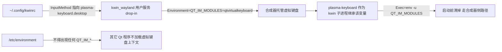

# 失败模式、不变量与静默退化陷阱

这一页是"改之前先读"的负面清单。它不重复 [`README.md`](../../README.md) §8 的排障叙事，也不重复各阶段脚本的流程细节，而是按**不变量**组织：每一条为什么存在、谁在守它、拿掉之后会静默退化成什么。

两类失败必须分开看：

| 类型 | 表现 | 代价 |
|:--|:--|:--|
| **一碰就炸** | 开不了机、进不了桌面、阶段直接 `die` | 立刻可见，改的人自己就撞上 |
| **静默残废** | 镜像能刷、能开机、能 SSH，但没有 Wi-Fi / 没有声音 / 蓝牙不可用 / `pacman` 装不了软件 | 只在真机上、用户手上暴露；`README` §8 里绝大多数条目都是这一类 |

[`HANDOVER.md`](../../HANDOVER.md) §8 的雷区第 6 条把这条原则写成明文：**产物校验不要降级成 warn**。本页在第 2 节逐个列出这条原则目前**没有被完全执行**的地方。

相关页面：[无 root 构建运行时](../architecture/rootless-build-runtime.md)（能力缺口与补偿手段）、[rootfs 布局与 fstab](./rootfs-layout-and-fstab.md)、[音频管线](../runtime/audio-pipeline.md)、[排障手册](../operations/troubleshooting-playbook.md)、[验证与烟雾测试](../testing/verification-and-smoke-tests.md)（每条不变量的验证命令都在那里，本页不重复）。

## 1. 硬失败闸门一览

产物出厂前依次经过这些闸门；绝大多数直接 `die` 中止阶段，但现状下有三处仍然会放行（§2 逐个说明）：固件自检只 `warn`、非真 root 时属主归一化降级为 `warn`、阶段 05 的硬失败集合不含 `pd-mapper` 与 `qrtr-lookup`。

| 闸门 | 位置 | 守的不变量 | 触发后 |
|:--|:--|:--|:--|
| 包名校验 | `02-pacman.sh` | 不存在的包只告警；但**选中桌面的关键包**缺失直接失败 | `die` |
| 全量升级 | `02-pacman.sh` | 整棵树必须对齐到同一个仓库快照（防半升级） | 失败即 `set -e` 退出 |
| 关键程序烟雾测试 | `02-pacman.sh` | 动态库/符号版本真的能加载 | `SMOKE_FAIL>0` → `die` |
| qcom 三件套 | `05-qcom.sh` | 缺 `rmtfs` / `tqftpserv` / `libqrtr.so.1` = 没 Wi-Fi 没声音 | `die` |
| 固件自检 | `04-firmware.sh` | 设备专属固件与"抢先文件"清理 | **只 warn**（见 §2.2） |
| 灌镜像前残留检查 | `09-image-rootfs.sh` | 镜像里不得有 `systemd-networkd*` / `systemd-resolved*` 的 `*.wants` 软链 | `die` |
| 属主归一化 | `lib.sh:normalize_ownership()` | 整树 `root:root` + setuid 位 + 5 个关键 setuid 程序 | 真 root：`die`；非真 root：**只 warn**（见 §2.1） |
| initramfs 自检 | `08-initramfs.sh` | 内核版本存在、`busybox` 及其 `mount/switch_root/findfs` 等 applet 齐全 | `die` |
| 密码哈希生成器 | `06-config.sh` | 宿主 `openssl passwd -6` 真能产出 `$6$` 哈希 | `die` |
| 蓝牙地址（刷机侧） | `11-flash.sh` / `bt-mac.sh` | 格式正确且注入成功 | `die` |
| CI 产物校验 | `.github/workflows/build.yml` | `sha256sum -c SHA256SUMS` + `mdir` 打印引导镜像内容 | `sha256sum` 失败即失败 |



上图：产物出厂前的闸门链，以及两条"warn 后照样出厂"的降级分支（阶段 04 固件自检、非真 root 属主归一化）。阶段 05 内部 `pd-mapper` / `qrtr-lookup` 缺失也只 warn，但它不改变主链走向（§2.3）。

阶段之间的传播规则很简单：每个阶段脚本都 `set -euo pipefail`，`build.sh` 逐阶段 `bash scripts/<阶段> | tee logs/build.log`，任一阶段非零退出就整体中止（[`build.sh`](../../build.sh)）。因此**闸门只在"阶段真的跑到"时生效**——`--from` / `--only` 跳过某阶段时，该阶段的检查也一并被跳过，这是增量调试的固有代价。

## 2. 文档口径 vs 代码现状

这一节只列**文档或脚本注释把某件事说成保证、而代码实际上只告警**的地方（§2.6 顺带说明一处"看起来矛盾、其实是分工"的情况，§2.7 则是刻意保留的告警）。修这些地方的正确方向是**把告警补成硬失败**（或明确写清楚它是可选项），绝不是反过来把硬失败降级成告警。

### 2.1 属主与 setuid：文档说"断言"，非真 root 下只 warn

- 文档口径：[`HANDOVER.md`](../../HANDOVER.md) §5.1 与 §8 雷区把 `normalize_ownership()` 描述成"整树 chown 回 `0:0`、恢复 setuid 清单、**断言** `/usr/bin/mount` 是 `0:0 4755`"。
- 代码行为：`normalize_ownership()` 先判 `is_real_root()`（`id -u` 为 0 **且** `/proc/self/uid_map` 首行是 `0 0`）。不是真 root 时它打印一段醒目横幅并 `return 1`——是的，**它自己就是告警**（[`scripts/lib.sh`](../../scripts/lib.sh)）。调用方 [`scripts/09-image-rootfs.sh`](../../scripts/09-image-rootfs.sh) 又写成 `normalize_ownership || warn "跳过属主归一化 (非真 root): 这份镜像的 setuid 程序会失效!"`，于是整条路径以 exit 0 继续产出镜像。
- 静默退化后的样子：镜像里 `/usr/bin/mount` 是 `setuid 1000`。root 执行它时内核会把 euid 改成 1000 → "must be superuser to use mount" → `systemd-remount-fs` / `boot.mount` / `tmp.mount` / `sys-kernel-config.mount` / `usb-ncm`（`mount -t configfs`）/ `sshd` 全部失败：进不了桌面也没有网络，但机器"确实开机了"。
- 现状的安全用法：**只用 `sudo ./build.sh` 构建**，并在日志里找那行 `校验通过: 0:0 4755 /usr/bin/mount`；构建日志里出现「非真 root 构建」横幅时，那份产物不能刷。验证入口见[验证与烟雾测试](../testing/verification-and-smoke-tests.md)。

### 2.2 固件自检：FAIL 只 warn，不阻断产物

`04-firmware.sh` 的自检会逐条检查设备专属固件（`adsp.mbn` / `cdsp.mbn` / `modem.mbn` / `a640_zap.mbn` / WCN3990 `firmware-5.bin.zst` / `qca/crnv21.bin.zst` …）以及"同名未压缩抢先文件"是否已删除，计数器 `FAIL` 累加后**只**走 `warn "固件自检有 N 项异常"`（[`scripts/04-firmware.sh`](../../scripts/04-firmware.sh)）。同文件里固件包安装/卸载失败同样只 warn。
后果：缺固件（或缺 `linux-firmware-atheros` 提供的 `crbtfw21.tlv`）的镜像会照常出厂，表现为 Wi-Fi 扫不到 AP、蓝牙 `Invalid Index`、调制解调器起不来。这与 §1 里其他闸门的严格程度不一致——属于"文档把固件当必需、代码只当参考"的缺口。

### 2.3 阶段 05 的硬失败集合：`pd-mapper` 与 `qrtr-lookup` 不在里面

`05-qcom.sh` 的产物校验只把 `rmtfs` / `tqftpserv`（进 `MISSING` 数组）与 `libqrtr.so.1` 当成硬失败；`pd-mapper` 与 `qrtr-lookup` 缺失只在日志里留一行"未生成"（[`scripts/05-qcom.sh`](../../scripts/05-qcom.sh)）。

这个划分本身有依据（内核 `qcom_pd_mapper` 覆盖必需电源域，见 §3.3），但要记住两点：

- **"没报错"不等于这两个程序不重要**：`pd-mapper` 缺失时是否真的残废，取决于同一次启动里内核模块给出的电源域够不够用。`05-qcom.sh` 的注释说内核已覆盖 adsp/cdsp/mpss，而 `06-config.sh` 的 §6b 注释说用户态 `pd-mapper` 必须开机自启（否则 SLIMbus 握手超时、WCD9340 不出现、完全没声音）——**在音频这条路径上两处口径相反**，这与 §2.4 的启用归属矛盾是同一处证据链的两个面。
- **改校验列表前先确认内核那一侧**：把 `pd-mapper` 加进硬失败集合，等于断言"镜像里没有这个二进制就不能出厂"；这个断言只有在确认内核 `qcom_pd_mapper` 不再提供音频/调制解调器所需的电源域时才成立（§3.3）。

### 2.4 pd-mapper 的启用归属：05 说禁用，06 又无条件启用

- `05-qcom.sh` 编译出用户态 `pd-mapper` 后**明确** `disable` 它、删掉 `*.wants` 软链，理由是"真机验证内核 `qcom_pd_mapper` 已覆盖 adsp/cdsp/mpss 等必需电源域"；[`HANDOVER.md`](../../HANDOVER.md) §4.4 也写"`pd-mapper` 用户态**默认禁用**"。
- 但 `06-config.sh` 的 §6b 段理由完全相反（"pd-mapper 必须开机自启"），并 `for u in pd-mapper.service rmtfs.service tqftpserv.service` 逐个 `enable_unit`。阶段顺序是 05 → 06，且 05 只删软链不删单元文件，所以**全量构建出来的镜像里 `pd-mapper.service` 是 enabled**。
- 这是两处注释互相矛盾的典型：改这里之前先确认镜像的真实状态（`systemctl --root=/ is-enabled pd-mapper.service`），别只读注释。它也不会造成功能损坏（两个提供者同时在场），但它决定了"内核模块与用户态谁负责 servreg"这条边界在文档里写不清楚。

### 2.5 输入法：文档的"不装 fcitx5"只对手机形态成立

[`HANDOVER.md`](../../HANDOVER.md) §5.5 的结论是"不要装 fcitx5……所以 `config/build.conf` 的 `PKGS_IME` 是空的、`07-desktop.sh` 也不再写 fcitx5/Rime 的任何配置"。
实际代码：`PKGS_IME` 只在**手机形态**为空，选 `plasma-desktop` 时会被填成 `fcitx5 fcitx5-rime fcitx5-qt fcitx5-gtk fcitx5-configtool`（[`config/build.conf`](../../config/build.conf)），并且 `07-desktop.sh` 的 13.8b/13.11 段会写 fcitx5 配置、把 KWin 虚拟键盘留空。规则本身没变（**一个形态只能有一个输入法来源**，见 §3.10），变的是这条规则有分支，而文档只描述了手机那支。

### 2.6 同一件事在构建期 warn、在刷机期 die

蓝牙地址的两种失败语义**不是**矛盾，而是分工：

- 构建期（`10-image-boot.sh`）：没给地址、格式不对、设备树里没有 `bluetooth` 节点、缺 `dtb/raphael-redmi-k20pro.dtb` —— 一律只 `warn`，并明确写出"该镜像蓝牙不可用"。因为地址是**每台设备唯一**的，公开镜像本来就不该带（[`HANDOVER.md`](../../HANDOVER.md) §3.3）。
- 刷机期（`11-flash.sh --bt-mac`、`bt-mac.sh`）：格式错或注入失败直接 `die`（[`scripts/11-flash.sh`](../../scripts/11-flash.sh)）。

也就是说"蓝牙不可用"是一份**合法产物**的合法状态；把它当构建错误会把公开镜像这条路堵死。真正不能降级的告警是那些"缺了就残废、又不该由用户补"的东西（§2.1–§2.4）。

### 2.7 有意的"只告警"分支

以下几处降级是刻意的，改它们之前要理解动机：

| 位置 | 只告警的原因 | 风险 |
|:--|:--|:--|
| `lib.sh:patch_wlroots_layer_shell()` | 二进制补丁带版本特征校验，找不到唯一的指令序列时**不能**乱改（会打断非 phosh 的构建），只提示"wlroots 升级了? 补丁需要重写" | 升级 wlroots 后 phosh 会话起不来；[`README.md`](../../README.md) §8.17 有完整证据链 |
| `10-image-boot.sh` 缺 `dtb/raphael-redmi-k20pro.dtb` | 设备树是修好的产物，缺失时构建不该整体失败 | 蓝牙与麦克风静默不可用 |
| `03-kernel.sh` `depmod` 失败 | 沿用 deb 内自带的 `modules.dep` | 新模块可能加载不到 |
| `06-config.sh` `locale-gen` / `07-desktop.sh` `dconf update` / `set-default` 失败 | 都不影响开机，且首次开机/登录能自愈 | 界面语言、屏幕键盘默认值可能不生效 |

## 3. 按不变量展开

### 3.1 属主与 setuid：三重防线，缺一层就"开机全挂"

**为什么存在**：整套构建默认在 user namespace 里以"假 root"运行，`cp -a` 会把宿主 uid（1000）带进镜像；而 setuid 程序的语义是"以文件属主身份执行"，属主变成 1000 就再也没人能 `mount`。详见[无 root 构建运行时](../architecture/rootless-build-runtime.md)。

三层防线各自的职责：

1. **阶段 01**：解包后按 tarball 元数据恢复 setuid/setgid 位（不依赖解包是否以 root 完成）——[`scripts/01-rootfs.sh`](../../scripts/01-rootfs.sh)。
2. **阶段 09（成像前）**：`normalize_ownership()` 先快照整棵树的 setuid/setgid 模式，整树 `chown -h 0:0`，把 `/home/<user>` 还给用户 uid/gid，恢复 setuid/setgid 位，再恢复 8 个"组属主"文件（`/usr/bin/wall`→`tty`、`utempter`→`utmp`、`dbus-daemon-launch-helper`→`dbus`、`/var/log/journal`→`systemd-journal` 等），最后断言 `usr/bin/{mount,umount,sudo,su,passwd}` 是 `0:0` 且带 s 位——[`scripts/lib.sh`](../../scripts/lib.sh)。
3. **设备首启动**：`/etc/tmpfiles.d/raphael-home.conf` 里 `Z /home/<user> - 1000 1000 -`（**无条件**写，不像旧版本写在"创建用户"分支里）＋ `raphael-firstboot.service` 再一次 `chown -R` 兜底——[`scripts/06-config.sh`](../../scripts/06-config.sh)。

第 3 层是必需的，因为 userns 里 `chown` 到 1000 是空操作：家目录属主为 `root:root` 时 KDE 存不了任何配置，表现是"每次开机都弹初始设置向导、向导里改的设置不生效"（[`README.md`](../../README.md) §8.4）。
第 1、2 层如果被绕过（例如用非真 root 构建并忽略横幅），退化形态见 §2.1。

### 3.2 包树只装不删 → 半升级

**为什么存在**：`pacman -S --needed <列表>` **只装列表里的包、不升级 rootfs tarball 自带的旧包**；ALARM 的 tarball 常年落后仓库几周，于是出现"新 `nftables` 配旧 `libnftnl`"这种半升级。运行时错误是符号版本层面的（``version `LIBNFTNL_19' not found``），**pacman 自己的依赖检查看不出来**，真机上表现为 `dnsmasq` 开机即 failed（[`README.md`](../../README.md) §8.14）。

不变量与守卫：

- 装完列表后必须 `pacman -Su --noscriptlet --ignore linux-firmware` 把整棵树对齐到同一快照（[`scripts/02-pacman.sh`](../../scripts/02-pacman.sh)）。`--ignore linux-firmware` 是刻意的：仓库里它已拆成 meta 包，升级会连带拉进 `linux-firmware-{mediatek,nvidia,radeon,realtek}` 几 GB 无关固件。
- 第二道防线是**烟雾测试**：用 qemu 实跑 `bash / dnsmasq / nft / nmcli / iw / wpa_supplicant`，只有输出里出现 `error while loading shared libraries` / `cannot open shared object` / ``version `X' not found`` 才算失败，`SMOKE_FAIL>0` 直接 `die`。
- 烟雾测试的两个盲点要知道：`[ -x "$ROOT$bin" ] || return 0` —— **程序不存在时它悄悄跳过**（包是否装上是 §1 的包校验与桌面关键包检查负责的）；退出码非零但输出不匹配那三种模式时也不算失败（例如配置错误）。

外部条件：这套守卫防的是"镜像仓库正在半同步"这种**上游瞬时状态**，本地镜像与 CI 镜像的同步状态不同，所以同样的脚本在两边可能给出不同结论——这本身不是代码 bug，但决定了"本地过 ≠ CI 过"（§3.13）。

### 3.3 qcom 用户态：软链只在干净 rootfs 暴露

**为什么存在**：`rmtfs` / `pd-mapper` / `tqftpserv` / `qrtr` 在 ALARM 仓库里没有，必须自己交叉编译。其中三个是"缺了镜像就是残废"的：

- `rmtfs`：给 MSS 提供 EFS/共享内存，缺了调制解调器固件起不来；
- `tqftpserv`：通过 QRTR 给 ADSP/CDSP 送固件，缺了 → 调制解调器不发布 `WLFW(69)` 服务 → `ath10k` 拿不到网卡（扫描为空）＋ Q6 的 AFE 端口使能 `-110` 超时（没声音）；
- `libqrtr.so.1`：上面所有东西的公共依赖。

**陷阱的形态**：编出 `libqrtr.so.1` 后**必须**在 `$STAGE` 里建 `libqrtr.so` 软链，因为 `-lqrtr` 只认 `libqrtr.so` / `libqrtr.a`。本地构建时 rootfs 里往往还留着上次装好的 `/usr/lib/libqrtr.so`，clang 的 sysroot 搜索路径会兜住，**所以在本地永远看不出问题**；CI 是全新 rootfs → `ld.lld: error: unable to find library -lqrtr` → `qrtr-lookup / qrtr-cfg / rmtfs / pd-mapper / tqftpserv` 全部链接失败。这段历史里脚本只 `warn`，于是静默产出了没有 Wi-Fi、没有声音的镜像（[`README.md`](../../README.md) §8.13）。

现在：软链照建（[`scripts/05-qcom.sh`](../../scripts/05-qcom.sh)），产物校验改成**硬失败**——缺 `rmtfs` / `tqftpserv` / `libqrtr.so.1` 直接 `die`。注意校验列表里 `pd-mapper` 与 `qrtr-lookup` **不在**硬失败集合内（只 warn），这条边界与它的代价见 §2.3。

同阶段还有两个时序不变量：

- servreg 电源域映射表必须由**内核** `qcom_pd_mapper` 提供（设备固件的 `.jsn` 只有 adsp/cdsp/slpi 条目，`msm/modem/wlan_pd` 只在硬编码表里），所以绝不能 blacklist 它，反而要用 `/etc/modules-load.d/raphael-pd-mapper.conf` **尽早加载**；阶段 05 还会主动删除历史遗留的 `modprobe.d` blacklist 与旧 `*.wants` 软链（拆增量重建的弹，见 §3.12）。
- `tqftpserv.service` 必须**直接写单元文件**，不能 sed 上游的 `*.service.in`：模板里有多个占位符，漏替换一个 systemd 就报 `bad unit file setting` 拒绝加载，结果同样是"没 Wi-Fi 没声音"（[`README.md`](../../README.md) §8.1）。

### 3.4 pacman 的 Landlock 沙箱

**为什么存在**：作者内核 `# CONFIG_SECURITY_LANDLOCK is not set`，而 pacman 7.1 默认用 Landlock 沙箱下载，于是设备上 `pacman -Sy` 直接失败（`switching to sandbox user 'alpm' failed`）——"什么软件都装不了"（[`README.md`](../../README.md) §8.7）。

不变量：**构建机的 pacman 配置和镜像里目标系统的 `/etc/pacman.conf` 必须都写 `DisableSandboxFilesystem` + `DisableSandboxSyscalls`**（[`scripts/02-pacman.sh`](../../scripts/02-pacman.sh)）。只改一边会出现"构建能过、用户装不了软件"（或反过来）的错位。这不是可选的优化项，删掉它等于把"镜像到手后无法安装任何软件"这个坑留给用户。

审计这条不变量时要看**最终镜像**里的 `/etc/pacman.conf`，而不是只看 02 阶段那段 `sed`：同一份文件在构建期还有别的写入者（阶段 07 的 KDE 形态会打开 `[multilib]`，阶段 02 还会插 `IgnorePkg = linux-firmware`，见 §3.7）。

### 3.5 rootfs 布局 / fstab / 引导参数三者一致

**为什么存在**：布局由 `lib.sh:rootfs_layout()` 统一决定并缓存在 `work/rootfs-layout`，但阶段 09 在真正 loop 挂载失败时会**回退**成单子卷。历史事故就是"缓存说 subvol、镜像里是 flat，而 fstab 早就按 subvol 写好"——镜像里没有 `/@` 却让内核挂 `subvol=/@`，**开不了机**。

不变量：

- fstab 由 `lib.sh:write_root_fstab()` 生成，**阶段 06 和阶段 09 各调一次**；09 的回退分支必须**先重写 fstab 再 `mkfs.btrfs -r`**，因为 `mkfs -r` 是直接把 `$ROOT` 写进镜像，晚一步改就来不及（[`scripts/09-image-rootfs.sh`](../../scripts/09-image-rootfs.sh)）。
- 根那一行**不能** `nofail`：加了 systemd 可能跳过"把根重挂成 rw"，根停在只读会导致 `sshd`（生成主机密钥）与 `usb-ncm`（写 configfs）等一连串失败。
- `/home`（`@home`）与 `/swap`（`@swap`）反过来**必须** `nofail`：挂不上时系统仍能用 `@/home` 里那份副本，不会掉进 emergency mode；`@swap` 上放交换文件还要求 `nodatacow,compress=no`。
- 阶段 10 的 `rootflags=` 与 fstab 的挂载选项来自同一组 `btrfs_opts()` 调用，三者必须同源。

细节与 `x-systemd.growfs`、首启动扩容、snapper 在哪些布局下自动跳过，见 [rootfs 布局与 fstab](./rootfs-layout-and-fstab.md)。

### 3.6 initramfs：`/lib` 软链与"早期固件"

**为什么存在**：`msm_dpu` / `adreno` 是**内建**驱动，0.6–0.9 秒就 probe 并 `request_firmware()`，那时 rootfs 还没挂上，固件只能来自 initramfs。而内核的 firmware loader **只按 `/lib/firmware`（及 `/lib/firmware/updates`）找文件，不认 `/usr/lib/firmware`**——initramfs 里只建了 `usr/lib/firmware/...` 却没有 `/lib -> usr/lib` 软链，等于把特意塞进去的 GPU 固件丢掉了：

```text
[ 0.63s] msm_dpu: Direct firmware load for qcom/a630_sqe.fw failed with error -2
[10.0s]  msm_dpu: [drm:adreno_request_fw] loaded qcom/a630_sqe.fw from new location
```

0.63 秒那次才是 GPU 初始化用的，10 秒后"补上"已经晚了。表现就是熄屏/开机瞬间花屏（[`README.md`](../../README.md) §8.12）。

守卫现状：

- `ln -sfn usr/lib "$IR/lib"` 是硬编码在阶段 08 里的，删掉就复发；
- 阶段 08 对 `busybox` 及其 `mount / umount / switch_root / findfs / modprobe / sh` applet 是**硬失败**，缺内核版本是硬失败；
- 但"固件有没有真的进 initramfs"是**静默跳过**：`for f in ...; do [ -f "$src" ] || continue`。GPU 固件行还带日志（`早期 GPU 固件: qcom/...`），`regulatory.db` 那两行则因为阶段 04 **故意删除**了它而必然跳过（见 §3.7）——看到没有输出时先分清"设计如此"和"源文件不在"。

### 3.7 固件优先级与 `regulatory.db`

两条独立的不变量：

1. **同名未压缩文件会抢先**：内核固件加载器优先尝试无后缀文件名，所以设备专属固件是 `.zst` 时，必须删掉通用固件里的同名未压缩文件，否则 Wi-Fi/蓝牙会加载到通用版本（板级校准不匹配 → 控制器上报全零 BD_ADDR → 内核立刻关掉蓝牙）。阶段 04 的第 3 步按 `.zst` 清单逐个 `rm` 抢先文件，自检里的 `check_absent` 就是在守这条（[`scripts/04-firmware.sh`](../../scripts/04-firmware.sh)）。注意这也解释了为什么 `PKGS_FIRMWARE` **不含** `linux-firmware-atheros`（它的未压缩 WCN3990 固件会覆盖设备专属那份），以及为什么原厂蓝牙 NVM 要靠 `raphael-bt-firmware.service` 从 `bluetooth` 分区回填。
2. **`regulatory.db` 是被故意删掉的**：内核 `CONFIG_CFG80211_REQUIRE_SIGNED_REGDB=y`，`wireless-regdb` 包的签名密钥不被这个内核信任，加载必然失败，所以阶段 04 主动 `rm -f` 它，退化成 world 域。dmesg 里 `Direct firmware load for regulatory.db failed` 是**预期输出**，不要"修"。
   一个未被贯彻的收尾：`IgnorePkg` 在两份 pacman 配置里的内容**不一样**。构建用配置（`$WORK/pacman-build.conf`）写的是 `IgnorePkg = wireless-regdb`；镜像里目标系统的 `/etc/pacman.conf` 只被写入 `IgnorePkg = linux-firmware`（而且只在原本没有任何 `IgnorePkg` 行时才插入），`wireless-regdb` **不在**其中（[`scripts/02-pacman.sh`](../../scripts/02-pacman.sh)），而 [`notes/porting-checklist.md`](../../notes/porting-checklist.md) §12.6 的建议是连 `IgnorePkg` 一起移植。
   两个后果并不对称：设备上 `pacman -Syu` 不会把发行版的 `linux-firmware` 元包（连带几 GB 无关固件）拉回来，但**会**把被刻意删掉的 `regulatory.db` 装回来——文件装回来只是重现上面那行 dmesg（代价有限），真正值得记住的是"设备上的一次 `pacman -Syu` 会改变一个被刻意手工处理过的文件"。

固件自检本身只 warn（§2.2），所以**不要**把它当作出厂门禁。

### 3.8 单元所有权与"失败单元归零"

**为什么存在**：构建时跳过了 pacman scriptlet/preset，发行版自带的 enable 状态会被原样带进镜像，而它和本项目选择的运行时不一致：

- ALARM 基础镜像默认 enable `systemd-networkd` + `systemd-resolved`，会和 NetworkManager 抢网卡/DNS。阶段 06 先 `disable` 再 **`mask`**（`mask` 指向 `/dev/null`，优先级高于任何 enable/preset），并顺手删掉残留 `*.wants` 软链；`systemd-networkd-wait-online` 也必须一起禁掉，否则每次开机多一个 failed 单元（[`scripts/06-config.sh`](../../scripts/06-config.sh)）。
- 阶段 09 在灌镜像前**再查一次** `*.wants/` 里有没有 `systemd-networkd*` / `systemd-resolved*` 软链，有就 `die`——因为 CI 上出现过"日志说 disable 了、镜像里 9 个软链还在"（mtime 还是 tarball 的）。
- 反过来，"用户级"服务必须由脚本**显式 enable**：`pipewire.socket` / `pipewire-pulse.socket` / `wireplumber.service` 的软链由 `07-desktop.sh` 手工建，否则症状是"有声音选项但一个声音设备都没有"（[`README.md`](../../README.md) §8.8）。
- 同类：`/etc/dconf/profile/user` 必须自己建，否则 `system-db:local` 根本不会被读取——GNOME/Phosh 的"自动弹屏幕键盘"设置会**静默失效**（[`scripts/07-desktop.sh`](../../scripts/07-desktop.sh)）。

不变量可以概括成一句：**镜像里每个单元的存在、启用、屏蔽状态都必须由阶段脚本显式声明**，因为没有任何 preset 会替你决定。

### 3.9 电源与重启：看门狗、挂起、单一 power-key owner

- **看门狗必须 off**：PM8150 的看门狗不支持 systemd 的 `RebootWatchdogSec`（编译默认 10 分钟），设置失败会让重启卡在关机流程（`Fail to set watchdog hardware timeout to 10 minutes: Invalid argument`，sshd 已停但 USB gadget 还在，看起来像"卡死"）。修复是 `/etc/systemd/system.conf.d/10-raphael-watchdog.conf` 里三行 `off`（[`scripts/06-config.sh`](../../scripts/06-config.sh)、[`README.md`](../../README.md) §8.2）。
- **挂起整体屏蔽**：`sleep.target / suspend.target / hibernate.target / hybrid-sleep.target` 全部 `mask`，因为 SM8150 只有 s2idle 且会出问题；熄屏用 `leijun`（`kscreen-doctor --dpms off`）代替。
- **电源键只能有一个 owner**：`logind` 的 `HandlePowerKey=ignore` 交出按键，然后按形态二选一——KDE 交给 PowerDevil（自研 `raphael-power-key.service` 装了但**不 enable**），GNOME/Phosh/纯命令行没有 PowerDevil，则必须 `enable` 自研守护，否则电源键完全没反应。两个同时接管会重复触发（[`scripts/07-desktop.sh`](../../scripts/07-desktop.sh)）。

### 3.10 输入法只能有一个来源

**为什么存在**：手机只有触屏键盘。真机实测的三种错法（[`HANDOVER.md`](../../HANDOVER.md) §5.5）：全局设 `QT_IM_MODULE=fcitx`（单数）→ 键盘弹得出来但字进不了输入框；全局设 `QT_IM_MODULE=qtvirtualkeyboard` → plasma-keyboard 走它自己声明不支持的 client-side 路径而闪退；装了 fcitx5 → KWin 莫名选中它，屏幕键盘反复闪退。

正确组合（手机/Plasma 形态，三处齐了才成立）：

1. `~/.config/kwinrc` 的 `[Wayland] InputMethod[$e]=/usr/share/applications/org.kde.plasma.keyboard.desktop`（**只写这一个键**，不要同时写 `VirtualKeyboardEnabled`/`VirtualKeyboardMode`）；
2. **只有合成器** `kwin_wayland` 通过 systemd user drop-in 拿到 `QT_IM_MODULES=qtvirtualkeyboard`（复数）；
3. plasma-keyboard 自己的 `Exec=env -u QT_IM_MODULES plasma-keyboard`；
4. `/etc/environment` 里**不得**出现任何 `QT_IM_*`（阶段 06 只写 `EDITOR/VISUAL`；只有桌面形态才写单数 `QT_IM_MODULE=fcitx` 那四个变量，见下文形态分支）。



上图：手机形态的输入法变量作用域——复数变量只给合成器，键盘自己启动时清掉继承值。

形态分支（**每条分支内部仍然只有一个来源**）：

- `plasma-desktop`（有物理键盘的场景）：镜像装 fcitx5 + Rime，KWin 虚拟键盘**留空**（`InputMethod[$e]=`），应用侧走单数 `QT_IM_MODULE=fcitx` 等四个变量，并删掉 kwin_wayland 的 drop-in；
- Phosh / GNOME：屏幕键盘由 squeekboard / GNOME 自带 OSK 负责，靠 dconf 的 `screen-keyboard-enabled=true` 自动弹出；
- 语言列表只有在 KCM 里改才真正生效（`~/.config/plasma-keyboardrc` 的 `enabledLocales`），且 **KConfig 的 QStringList 逗号后不能有空格**：`"zh_CN, en_US"` 会变成非法的 `" en_US"`，表现为"地球键变灰、只剩一种语言"。

还有一个**顺序**不变量：`07-desktop.sh` 的 13.10 段会"撤销 Shorin 个性化"，其中包括 `rm -rf` 家目录里的 fcitx5 配置并重写 `kwinrc`，所以 13.11 段的 fcitx5/Rime 收尾**必须写在它之后**——写在前面会被静默清掉，镜像里只剩 `/etc/skel` 那份。同一段还负责把 `InputMethod[$e]` 按形态写回。

### 3.11 设备唯一值：不要写进仓库

- **蓝牙地址**：产线写进设备自己的数据，本项目刷机流程会 `fastboot erase dtbo` 把它清掉，而且 `persist` / `bluetooth` 分区里**没有明文地址**。地址在设备树里是**小端字节序**，与 `bluetoothctl` 显示正好相反（`11 22 33 44 55 66` ↔ `66:55:44:33:22:11`），原因是内核 `hci_dev_get_bd_addr_from_property()` 把 DT 数组原样拷进 `bdaddr_t` 而 `%pMR` 反序打印。三种注入方式（`config/local.conf`、CI Secret `IMAGE_BT_MAC`、刷机时 `--bt-mac`）共用 `normalize_bt_mac()`（[`scripts/lib.sh`](../../scripts/lib.sh)、[`README.md`](../../README.md) §8.9）。**刷机前先记下地址**是流程上唯一可靠的防线。
- **`/etc/machine-id`**：Arch 镜像里是空的，而 USB NCM gadget 的序列号取自它；阶段 06 在构建期就 `systemd-machine-id-setup`（失败则退回随机 uuid），阶段 09 再把它重置成 `uninitialized` 由首启动生成。
- 私密值（Wi-Fi 密码、真实 BT_MAC、序列号）一律只进 `config/local.conf`（已 gitignore）或 CI Secret；文档与示例统一用假值。

### 3.12 增量重建的"拆弹"不变量

**为什么存在**：`work/root` 会被复用，而多数阶段是"只加不减"的——上一版留下的开关、单元、软链会继续生效，于是**增量构建的镜像与全量构建不一致**，且这种差异往往只在一边暴露（CI 全新环境 vs 本地复用树）。

已知的拆弹点（每个都是"必须显式删"）：

| 残留 | 谁在拆 | 不拆会怎样 |
|:--|:--|:--|
| 上一版装进去但现在被去重掉的包 | `02-pacman.sh` 对 `PKGS_PRUNE` 逐个 `-Rdd`（只删点名的包，不连带删依赖） | 镜像里同时存在两份同功能软件（[`README.md`](../../README.md) §8.19） |
| `display-manager.service`、`sddm.service` 软链与 `/etc/sddm.conf.d/10-raphael.conf` | `07-desktop.sh` 纯命令行分支显式 `rm` 并 `set-default multi-user.target` | 纯命令行镜像开机去拉一个不存在的单元 → 多一个 failed 单元并停在等图形界面 |
| AUR 首启动安装（脚本/单元/定时器/免密 sudoers）、`/etc/motd` 里的提示 | `06-config.sh` 13.8 段的清理循环 | 老镜像每次开机重试并往 motd 刷"AUR 安装失败"（[`README.md`](../../README.md) §8.15） |
| 历史 `modprobe.d/raphael-pd-mapper.conf`（blacklist）与 `pd-mapper.service` 的 `*.wants` | `05-qcom.sh` 显式 `rm` | 黑名单会让 Wi-Fi 完全不可用 |
| `$ROOT/.raphael-build`（qemu 宿主垫片） | `09-image-rootfs.sh` 在成像前删除 | 单独重跑阶段 05/06/07 时会因为没有垫片而**静默失败**，所以这些阶段开头都要重新 `setup_qemu_shim` |
| 家目录里的 fcitx5 配置 / 个性化 `kwinrc` | `07-desktop.sh` 13.10，随后 13.11 按形态重写 | 输入法来源变成两个（§3.10） |

通用规则：**任何"旧版本写入过的开关"，当前版本都要在阶段里显式拆除**，不能依赖"新版本不再写它"。

### 3.13 平台差异：本地 ≠ CI，也不是"CI 一定对"

三类差异会让同一个脚本在两处得出不同结论：

| 差异 | 本地 | CI |
|:--|:--|:--|
| 是否真 root | 常见 userns 构建 → 属主归一化只 warn（§2.1） | `sudo` 构建 → 断言生效 |
| loop 设备 | 宿主缺 `/dev/loop*` → 回退单子卷布局 | workflow 显式 `mknod /dev/loop*` 并自检，能建 `@/@home`（[`.github/workflows/build.yml`](../../.github/workflows/build.yml)） |
| rootfs 是否干净 | 复用 `work/root`，旧 `/usr/lib/libqrtr.so` 会掩盖软链缺失（§3.3）；旧包的半升级也可能被掩盖（§3.2） | 全新 rootfs，这两类问题**只在这里暴露** |

反过来也有 CI 掩盖不了的东西：内核模块树与运行内核不匹配（升级后没重启）会让 `modprobe loop` 失败；宿主 `/dev/loop*` 只缺设备节点时 `modprobe` 也没用，得自己 `mknod`（[`HANDOVER.md`](../../HANDOVER.md) §8 雷区 3）。所以**改构建脚本后跑一次 CI** 是流程不变量，但本地真机验证同样不可省。

## 4. 症状 → 根因索引

排障时先在这张表里定位属于哪条不变量，再去对应页面拿命令。

| 症状 | 根因（一句话） | 不变量 | 详细出处 |
|:--|:--|:--|:--|
| 能开机但 `systemd-remount-fs` 等一批服务失败，`mount` 是 setuid 1000 | userns 构建的属主没修回 `root:root` | §3.1 | [`HANDOVER.md`](../../HANDOVER.md) §5.1、[`README.md`](../../README.md) §8.4 |
| 每次登录都弹初始设置向导、改的设置不生效 | `/home/<user>` 属主是 `root:root`，KDE 写不了配置 | §3.1 | [`README.md`](../../README.md) §8.4 |
| 熄屏/开机瞬间花屏，`failed to load a630_sqe.fw` | initramfs 缺 `/lib -> usr/lib`，早期 GPU 固件等于没放 | §3.6 | [`README.md`](../../README.md) §8.12、[`HANDOVER.md`](../../HANDOVER.md) §5.3 |
| Wi-Fi 开着但一个 AP 都扫不到；`qrtr-lookup` 里没有 69 号 WLFW | `tqftpserv` 没跑（占位符导致单元加载失败 / 未发布 WLFW 服务） | §3.3、§3.8 | [`README.md`](../../README.md) §8.1 |
| 没有 Wi-Fi、没有声音，`/usr/bin/{rmtfs,tqftpserv,pd-mapper}` 根本不存在 | 阶段 05 缺 `libqrtr.so` 软链，全部链接失败 | §3.3 | [`README.md`](../../README.md) §8.13、[`HANDOVER.md`](../../HANDOVER.md) §4.6 |
| 一调音量就卡、扬声器没声音，`AFE enable for port 0x1006 failed -110` | `pro-audio` 下 ACP 选了 8 声道，QUAT_MI2S 只吃 1/2 声道 | （音频不变量） | [`README.md`](../../README.md) §8.11、[`HANDOVER.md`](../../HANDOVER.md) §5.4、[音频管线](../runtime/audio-pipeline.md) |
| 有声音选项但一个输出设备都没有、`wpctl` 连不上 PipeWire | 用户级 `pipewire`/`wireplumber` 单元从没被 enable（preset 没跑） | §3.8 | [`README.md`](../../README.md) §8.8、[`HANDOVER.md`](../../HANDOVER.md) §5.9 |
| `dnsmasq` 开机即 failed，``version `LIBNFTNL_19' not found`` | 半升级：新包 + tarball 旧包 | §3.2 | [`README.md`](../../README.md) §8.14、[`HANDOVER.md`](../../HANDOVER.md) §4.5 |
| 设备上 `pacman -Sy` 报 `Landlock is not supported by the kernel` | 内核没编 Landlock，pacman 沙箱没关 | §3.4 | [`README.md`](../../README.md) §8.7 |
| 蓝牙没有控制器 / `btmgmt` 报 `Invalid Index` | DT 缺 `local-bd-address`（或地址字节序写反）＋ 通用 NVM 不匹配 | §3.11、§3.7 | [`README.md`](../../README.md) §8.9、[`HANDOVER.md`](../../HANDOVER.md) §5.7 |
| `systemctl reboot` 卡在 `Fail to set watchdog hardware timeout` | PM8150 不支持 10 分钟看门狗超时 | §3.9 | [`README.md`](../../README.md) §8.2、[`HANDOVER.md`](../../HANDOVER.md) §5.6 |
| 屏幕键盘弹得出来但字打不进去 / 关不掉 | 输入法变量作用域错了，或有两个输入法来源 | §3.10 | [`HANDOVER.md`](../../HANDOVER.md) §5.5、[`README.md`](../../README.md) §8.16 |
| 登录界面闪一下回到登录界面（Phosh） | atomic 提交 / 用户服务看不到 `WAYLAND_DISPLAY` / layer-shell 校验 | §2.7 | [`README.md`](../../README.md) §8.17、[`HANDOVER.md`](../../HANDOVER.md) §5.10 |
| 每次开机多一个 failed 单元（`systemd-networkd-wait-online`） | networkd/resolved 的 `*.wants` 软链残留在镜像里 | §3.8 | [`HANDOVER.md`](../../HANDOVER.md) §2.2 阶段 09、[`README.md`](../../README.md) §8.16 |

## 5. 改这里的守则

1. **不要新增 warn 代替 die**。判断标准很简单：这件事如果做不成，镜像是不是"能刷但残废"或"开不了机"？是就必须 `die`（[`HANDOVER.md`](../../HANDOVER.md) §8 雷区 6）。
2. **不要拆掉硬失败闸门**：阶段 02 的桌面关键包检查与烟雾测试、阶段 05 的三件套校验、阶段 09 的残留软链检查，都是"防止静默产出残废镜像"的保险。要"暂时放过"应该加显式开关并在文档里写清代价，而不是把它改成 `warn`。
3. **改一个不变量，同时改它的所有落点**：fstab 有 06/09 两个写入点；布局有 `lib.sh` / `06` / `09` / `10` 四处读取；属主有 `01` / `09` / `06` 三层；输入法变量有环境、drop-in、desktop 文件、kwinrc 四处。
4. **把检查放在"数据离开构建树"之前**：09 的残留检查、`normalize_ownership()` 都在 `mkfs`/`cp -a` 之前，这类位置才拦得住"已经把坏东西写进镜像"。
5. **每次改完都问一句"这条在干净 rootfs / 真 root / 有 loop 的环境里会怎样"**，然后跑一次 CI（§3.13）。
6. **不要只读注释或文档判断现状**：`pd-mapper` 的启用归属（§2.3、§2.4）、镜像里 `IgnorePkg` 到底写了什么（§3.7）、`/etc/pacman.conf` 的最终内容（§3.4）都是"注释与产物不一致"的实例。改这些之前先在产物或 `--root=` 下实测（`systemctl --root=/ is-enabled`、直接 `grep` 镜像里的配置文件），验证命令见[验证与烟雾测试](../testing/verification-and-smoke-tests.md)。
7. 每条不变量的**验证入口**统一放在[验证与烟雾测试](../testing/verification-and-smoke-tests.md)；排障动作放在[排障手册](../operations/troubleshooting-playbook.md)。本页只描述"为什么"和"退化后会怎样"。
