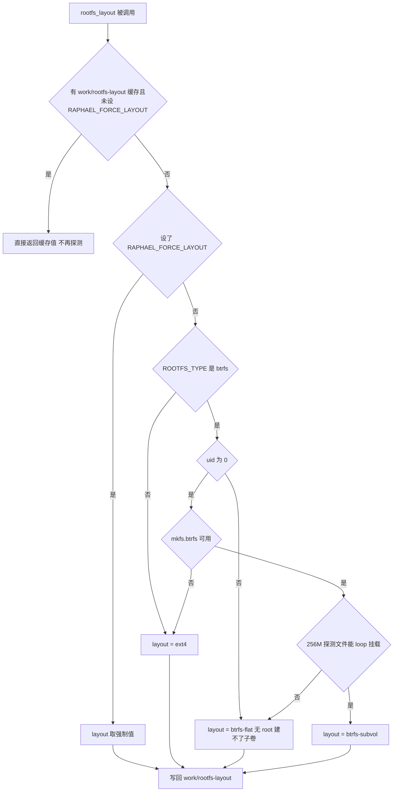
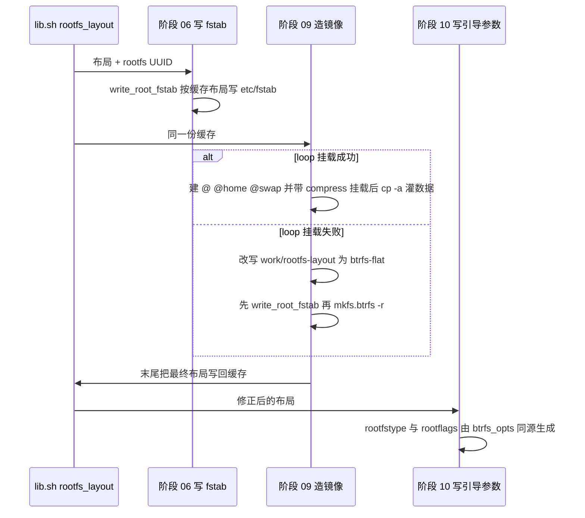

# rootfs 布局决策与 fstab/引导参数一致性

根文件系统的形态（`ext4` 还是 `btrfs`、有没有 `@` / `@home` / `@swap` 子卷）在本项目里**只决定一次**，然后被四个地方消费：阶段 06 按它写 `/etc/fstab`、阶段 09 按它造 `rootfs.img`、阶段 10 按它写 systemd-boot 的 `rootfstype=` / `rootflags=`、阶段 08 生成的 initramfs 在运行时按 `rootflags=` 把根挂起来。

只要这四处对布局的理解不一致，产出的就是一个**刷进去开不了机的镜像**——历史上真实发生过一次（见下文「历史事故」）。因此本页的关键不是「有哪几种布局」，而是「布局信息是怎么被单向传播、又在哪里被兜住的」。

## 决策点：`lib.sh:rootfs_layout()`

布局判定集中在 [`scripts/lib.sh`](../../scripts/lib.sh#L310-L354) 的 `rootfs_layout()`，返回值只有三种：

| 返回值 | 含义 | 什么时候得到 |
|:--|:--|:--|
| `ext4` | 传统 ext4 镜像 | `ROOTFS_TYPE` 不是 `btrfs`，或宿主没有 `mkfs.btrfs` |
| `btrfs-subvol` | btrfs + `@` / `@home` / `@swap` 子卷（参考 Shorin 指南） | 有 root（uid 0）、有 `mkfs.btrfs`，且 256 MB 探测文件能 `mount -o loop` |
| `btrfs-flat` | btrfs 单子卷，数据在顶层，无子卷 | 没有 root（建子卷必须挂载文件系统），或 loop 挂载探测失败 |

判定顺序是有意义的：`RAPHAEL_FORCE_LAYOUT` 优先于一切；`ROOTFS_TYPE` 优先于权限；权限优先于可执行文件是否存在；最后才是 loop 探测。探测前如果宿主缺 `/dev/loop-control`，函数会自己 `modprobe loop` 并 `mknod /dev/loop0..7` 补齐设备节点，所以「容器里没有 loop 设备」并不必然导致退化成 flat。

上图：`rootfs_layout()` 的判定分支——短路点在最前面的缓存，退出点只有 ext4 / btrfs-flat / btrfs-subvol 三个。

**缓存是粘性的**：结果写在 `work/rootfs-layout`，只要该文件非空且没设 `RAPHAEL_FORCE_LAYOUT`，函数就 `cat` 它并直接返回，**不会重新探测**（[`scripts/lib.sh`](../../scripts/lib.sh#L317-L320)）。这意味着：

- 一次无 root 构建落下的 `btrfs-flat` 会一直粘着，之后即使用 `sudo ./build.sh` 也不会自动升级成 `@` / `@home` 布局——要换布局必须删掉 `work/rootfs-layout`，或显式 `RAPHAEL_FORCE_LAYOUT=btrfs-subvol`。
- 反过来，强制值本身也会被写回缓存（[`scripts/lib.sh`](../../scripts/lib.sh#L351-L353)），所以「临时强制一次」实际上会持久化，之后的阶段（甚至之后的构建）都会读到它。
- 缓存说 `btrfs-subvol` 但宿主此刻已经挂不了 loop（例如内核升级后没重启、模块树不匹配）时，兜底在阶段 09 而不是这里（见下节）。

`ROOTFS_TYPE` / `BTRFS_SUBVOL_ROOT` / `BTRFS_SUBVOL_HOME` / `BTRFS_SUBVOL_SWAP` / `BTRFS_SWAP_SIZE` 等旋钮都集中在 [`config/build.conf`](../../config/build.conf#L26-L38)，默认 `btrfs` + `@` / `@home` / `@swap` + `zstd:3`；`IMAGE_SIZE`（默认 8G）只是**下限**，阶段 09 会按实际内容放大（[`config/build.conf`](../../config/build.conf#L43-L47)、[`scripts/09-image-rootfs.sh`](../../scripts/09-image-rootfs.sh#L44-L60)）。

## 一个决定，四处消费

上图：布局信息的传播路径，以及阶段 09 在回退时**先把修正写回缓存、再成像**的顺序。

- **fstab 只有一个生成器**：`lib.sh:write_root_fstab()`（[`scripts/lib.sh`](../../scripts/lib.sh#L395-L432)）。阶段 06 调一次（[`scripts/06-config.sh`](../../scripts/06-config.sh#L64-L70)），阶段 09 在实际确定布局后再调一次；两处调用都是幂等覆盖 `$ROOT/etc/fstab`，所以不存在「谁先写谁赢」的歧义。
- **阶段 09 的回退顺序是硬约束**：loop 挂载失败时，它先 `echo "$LAYOUT" > "$WORK/rootfs-layout"` 并把 fstab 改写成 flat 版，**然后才** `mkfs.btrfs -r`——因为 `mkfs -r` 是直接把 `$ROOT` 整棵树写进镜像，晚一步改就来不及了（[`scripts/09-image-rootfs.sh`](../../scripts/09-image-rootfs.sh#L137-L146)）。成像末尾它再把最终 `LAYOUT` 与 UUID 写回 `$WORK/`（[`scripts/09-image-rootfs.sh`](../../scripts/09-image-rootfs.sh#L183-L185)），于是**阶段 10 读到的必然是修正后的布局**。
- **阶段 09 造镜像的方式随布局而变**：`btrfs-subvol` 走「空文件系统 → 带 `compress=` loop 挂载 → `btrfs subvolume create` 建三个子卷 → `cp -a` 灌数据」，只有这样写进去的数据才真正被 zstd 压缩；`btrfs-flat` 与 `ext4` 分别用 `mkfs.btrfs -r` / `mke2fs -d` 直接把树写进镜像（[`scripts/09-image-rootfs.sh`](../../scripts/09-image-rootfs.sh#L106-L172)）。
- **同一布局决定 loader 参数**：阶段 10 按布局算出 `rootfstype=`，`btrfs-subvol` 额外把 `btrfs_opts "@"` 作为 `rootflags=`（[`scripts/10-image-boot.sh`](../../scripts/10-image-boot.sh#L96-L118)）。fstab 里的 btrfs 选项和这里的 `rootflags=` 来自**同一个** `btrfs_opts()`（[`scripts/lib.sh`](../../scripts/lib.sh#L434-L439)），所以两者不会各写一套 `compress=` / `noatime`。
- **initramfs 是第四个消费者**：它自己解析 `/proc/cmdline` 里的 `root=` / `rootfstype=` / `rootflags=`，用它们挂载 `/newroot` 后再 `switch_root`（[`scripts/08-initramfs.sh`](../../scripts/08-initramfs.sh#L114-L159)）。也就是说 `rootflags=` 是布局进入运行时的第一道门。

## 历史事故：三者不一致 = 开不了机

`lib.sh` 的注释里记着这次事故（[`scripts/lib.sh`](../../scripts/lib.sh#L396-L400)，[`HANDOVER.md`](../../HANDOVER.md#L195-L205)）：`work/rootfs-layout` 缓存里写着 `btrfs-subvol`，但阶段 09 的 loop 挂载失败、实际回退成了 `btrfs-flat`，而 fstab 还是阶段 06 按 subvol 写的那份——**镜像里根本没有 `/@` 子卷，却让内核去挂 `subvol=/@`**，结果是刷进去起不来（initramfs 挂根失败，落到救援 shell）。

今天这条路径由三件事共同兜住，缺一个就会复发：

1. fstab 只有 `write_root_fstab()` 一个生成器，阶段 06 与 09 各写一次；
2. 阶段 09 回退分支必须先重写 fstab、再 `mkfs -r`；
3. 阶段 09 末尾把最终布局写回 `work/rootfs-layout`，让阶段 10 生成匹配的 `rootflags=`（阶段 09 同时把 `@` 设为**默认子卷**，[`scripts/09-image-rootfs.sh`](../../scripts/09-image-rootfs.sh#L131-L133)，即使引导参数里的 `subvol=` 整个丢了，内核挂到的也是 `@` 的内容——这是第二道保险）。

## fstab 具体长什么样

`write_root_fstab()` 按布局打三种行组合（[`scripts/lib.sh`](../../scripts/lib.sh#L401-L431)）：

- **根那一行用 `UUID=` 定位，不用 `PARTLABEL=`**。原因写在注释里：`PARTLABEL` 解析不到时 `systemd-remount-fs` 会失败，根可能停在只读，随后一串服务跟着挂。根行还带 `x-systemd.growfs`，`pass` 列为 `1`。
- **`btrfs-subvol`**：三行——`/`（`subvol=/@`）、`/home`（`subvol=/@home`）、`/swap`（`subvol=/@swap`）。`btrfs-flat` 只有 `/` 一行（不带 `subvol=` 前缀）。`ext4` 是 `rw,errors=remount-ro,x-systemd.growfs`。
- **`/boot` 行对所有布局都一样**：`PARTLABEL=cache` + `vfat` + `umask=0077,nofail,noatime,x-systemd.device-timeout=10`。分区名解析不到时只让这一个单元失败，不会拖垮启动。

`nofail` 的分工是刻意的，方向相反：

| 行 | `nofail` | 为什么 |
|:--|:--|:--|
| `/` | **不加** | 加了 systemd 可能跳过「把根重挂成 rw」，根一直只读 → `sshd`（生成主机密钥）、`usb-ncm`（写 configfs）等一连串失败（[`scripts/lib.sh`](../../scripts/lib.sh#L409-L411)） |
| `/home` | **加** | `@home` 万一挂不上，系统仍能起来并使用 `@/home` 里那份副本，不会掉进 emergency mode |
| `/swap` | **加** | 交换文件可用性不该阻塞启动；`@swap` 上放交换文件还需要 `nodatacow,compress=no` |

## 为什么 `/home` 的数据要写两遍

在 `btrfs-subvol` 路径里，阶段 09 把 `@/home` 里的内容 `cp -a` 复制进 `@home`，**两份都在镜像里**（[`scripts/09-image-rootfs.sh`](../../scripts/09-image-rootfs.sh#L123-L129)）。这不是冗余失误，而是配合 `nofail` 的设计：挂上 `@home` 时用的是 `@home`；万一挂载失败，`@/home` 里的同一份数据照样能让用户登录进桌面。

触发这个设计的是实测故障：单独挂 `@home` 时出现过 `user@1000` 的 `Dependency failed` → SDDM respawn 循环，根因是 `@home` 里**没有家目录**（[`scripts/lib.sh`](../../scripts/lib.sh#L413-L418)）。所以「双写」和「`nofail`」是一对：只有副本存在，`nofail` 才真的安全。

## `/swap` 子卷与首启动交换文件

btrfs 上的交换文件有两个硬要求——**不能被压缩**、**必须 nocow**（`chattr +C`），所以单独开一个 `@swap` 子卷并按 `nodatacow,compress=no` 挂到 `/swap`（[`scripts/lib.sh`](../../scripts/lib.sh#L419-L420)）。

镜像里**不预置** 4 GB 的交换文件（白胖镜像），改由首启动的 `raphael-swapfile.sh` 创建：先建 nocow 空文件再 `fallocate` 写大小，`mkswap`，把 `/swap/swapfile none swap defaults 0 0` 追加进 `/etc/fstab`，最后 `systemctl disable` 自己（[`scripts/06-config.sh`](../../scripts/06-config.sh#L398-L444)）。把 `BTRFS_SWAP_SIZE=0` 就不会生成这套脚本与单元。

两类退化行为值得记住：

- 脚本对「`/swap` 没挂上」是安全的：`mountpoint -q /swap || { echo "/swap 未挂载, 跳过交换文件"; exit 0; }`（[`scripts/06-config.sh`](../../scripts/06-config.sh#L409-L411)）。因此 `btrfs-flat` / `ext4` 布局（fstab 里没有 `/swap` 行）下 `/swap` 不会被挂载、交换文件也就不会被创建，系统只剩 `zram-generator` 那个 10 GB `zram0` 交换（[`scripts/06-config.sh`](../../scripts/06-config.sh#L320-L326)）。
- 首启动脚本会**追加**一行到镜像内的 `/etc/fstab`；这发生在设备上，与构建期的 `write_root_fstab()` 不冲突，但意味着设备上的 fstab 可能比 `lib.sh` 生成的多一行。

## 首启动扩容：`x-systemd.growfs`

根行带 `x-systemd.growfs`，由 systemd 在首启动把根文件系统撑满 `userdata` 分区（8 GiB 镜像 → 设备实际容量）——这解释了为什么 `IMAGE_SIZE` 只是下限却不必精确。若镜像里找不到 `systemd-growfs@.service`，阶段 06 会装一个兜底：`raphael-growfs.service` 调用 `/usr/local/sbin/raphael-growfs.sh`，用 `blkid` 判断类型后分别执行 `btrfs filesystem resize max /` 或 `resize2fs`（[`scripts/06-config.sh`](../../scripts/06-config.sh#L71-L105)）。

## UUID 必须成套：`work/rootfs.uuid`

`rootfs_uuid()` 只生成一次并缓存到 `work/rootfs.uuid`，同一份值进入三个地方（[`scripts/lib.sh`](../../scripts/lib.sh#L157-L166)）：

- `mkfs.btrfs -U` / `mke2fs -U`（镜像）——[`scripts/09-image-rootfs.sh`](../../scripts/09-image-rootfs.sh#L20)，[`#L113`](../../scripts/09-image-rootfs.sh#L113)；
- fstab 的 `UUID=...`（镜像内文件系统）；
- loader 的 `root=UUID=...`（boot-cache.img 这个**另一个产物**）。

由此得到一条操作不变量：`rootfs.sparse.img` 与 `boot-cache.img` 必须来自同一次 `work/`（成套构建、成套刷写）。删掉 `work/` 后只重跑阶段 09/10 会生成新 UUID，新的 `boot-cache.img` 配上旧的 rootfs 镜像时，initramfs 会「无法解析根设备」并落到救援 shell（[`scripts/08-initramfs.sh`](../../scripts/08-initramfs.sh#L125-L150)）。

## 谁还依赖布局

- **snapper（快照）**：首启动的 `raphael-snapper-setup.sh` 自己探测——根不是 btrfs 就跳过；是 btrfs 但 `btrfs subvolume show /` 失败（即单子卷 `btrfs-flat`）也跳过并打印原因（[`scripts/06-config.sh`](../../scripts/06-config.sh#L1030-L1046)）。所以「想要快照」实际等价于「要有 `@` 子卷」，也就是要用有 root 的构建（CI 或 `sudo ./build.sh`）并清掉旧的 `work/rootfs-layout` 缓存。
- **README 的示例已漂移**：`README.md` §1.1 展示的 fstab 仍是旧的 `PARTLABEL=userdata` 形式、`pass` 列写 `2`（[`README.md`](../../README.md#L102-L107)），而当前实际写出的是 `UUID=` 形式、`/home` 带 `nofail`。排障与改动一律以 `write_root_fstab()` 为准。

## 扩展与改动要点

- **改布局**要同时动的地方：`config/build.conf` 的 `ROOTFS_TYPE` / `BTRFS_*` 旋钮、`lib.sh:rootfs_layout()`、`lib.sh:write_root_fstab()`、`btrfs_opts()`、阶段 09 的成像分支、阶段 10 的 `rootfstype=`/`rootflags=`。任何一处单独改都会破坏三处一致。
- **调试用敲门砖**：`RAPHAEL_FORCE_LAYOUT=ext4|btrfs-flat|btrfs-subvol` 可跳过探测；注意它会写回缓存（见上文「缓存是粘性的」）。
- **这条不变量没有自动化交叉校验**。CI 只在构建前探测一次 loop 挂载能力并给出 `::warning::`（[`.github/workflows/build.yml`](../../.github/workflows/build.yml#L170-L188)）；阶段 09 只做 `btrfs check` / `dumpe2fs`，阶段 10 只列一遍 FAT 内容（[`scripts/09-image-rootfs.sh`](../../scripts/09-image-rootfs.sh#L156-L171)，[`scripts/10-image-boot.sh`](../../scripts/10-image-boot.sh#L187-L193)）——**没有任何步骤把 loader 条目里的 `rootflags=` 与镜像里 `/etc/fstab` 的内容对比**。改动这一带时，唯一的验证手段是真的刷机启动（`arch-direct.conf` 与 `arch-debug.conf` 两个备用条目是排障入口），或至少手工 `mount -o loop,subvol=/@` 试挂成品镜像。

相关背景：布局判定与无 root 约束的关系见[构建运行环境与无根构建](../architecture/rootless-build-runtime.md)，三处不一致在故障语义里的位置见[失败模式与不变量](./failure-modes-and-invariants.md)，产物与启动链的整体拼装见[镜像打包与启动链](../workflows/image-packaging-and-boot-chain.md)与[系统总览](../architecture/overview.md)。
