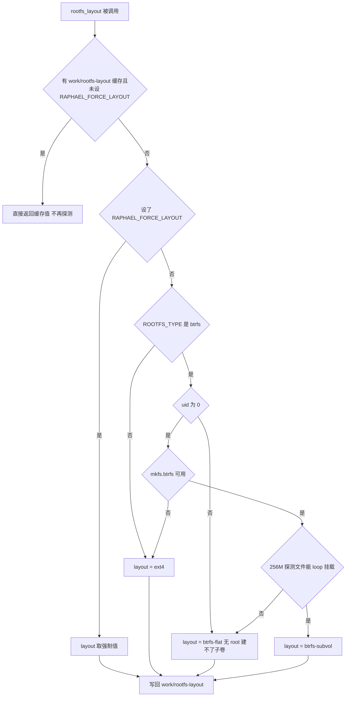
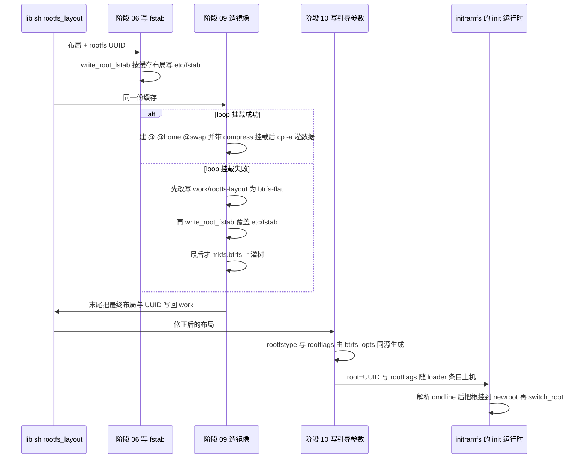
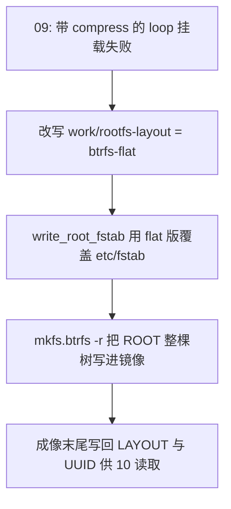

# rootfs 布局、fstab 与 UUID 的一致性契约

根文件系统的形态（`ext4` 还是 `btrfs`、有没有 `@` / `@home` / `@swap` 子卷）在本项目里**只决定一次**，然后被三处构建期消费者加一处运行时消费者分头解读：阶段 06 按它写 `/etc/fstab`、阶段 09 按它造 `rootfs.img`、阶段 10 按它写 systemd-boot 的 `rootfstype=` / `rootflags=`，而阶段 08 生成的 initramfs 在**运行时**解析 `root=` / `rootfstype=` / `rootflags=` 把根挂起来。

只要这几处对布局的理解不一致，产出的就是一个**刷进去开不了机的镜像**——历史上真实发生过一次（见下文「历史事故」）。因此本页的重点不是「有哪几种布局」，而是「布局信息怎么被单向传播、在哪里被兜住、哪里还没被兜住」。

判定只有一个出口（`work/rootfs-layout`），却有四处消费者：

| 环节 | 谁写 / 谁读 | 落点 | 不一致的表现 |
|:--|:--|:--|:--|
| 布局判定 | 写 | `work/rootfs-layout`（`lib.sh:rootfs_layout()`） | 缓存粘性：一次无 root 构建落下的 `btrfs-flat` 会一直粘着 |
| fstab | 写 | `$ROOT/etc/fstab`（`lib.sh:write_root_fstab()`，阶段 06 与 09 各写一次） | 根行写 `subvol=/@` 而镜像里没有 `@` → 挂根失败 |
| 镜像 | 读（决定成像方式） | [`scripts/09-image-rootfs.sh`](../../scripts/09-image-rootfs.sh#L103-L172) | 回退成 flat 却没重写 fstab = 那个历史事故 |
| 引导条目 | 读 | [`scripts/10-image-boot.sh`](../../scripts/10-image-boot.sh#L96-L118) 的 `rootfstype=` / `rootflags=` | 与镜像布局错位，和上面同一种失败 |
| 运行时 | 读（解析 cmdline） | [`scripts/08-initramfs.sh`](../../scripts/08-initramfs.sh#L114-L166) 里 `/init` 对 `root=` / `rootfstype=` / `rootflags=` 的解析 | 解析不到根设备或挂载失败 → 救援 shell |

## 布局只决定一次：`rootfs_layout()`

布局判定集中在 [`scripts/lib.sh`](../../scripts/lib.sh#L310-L354) 的 `rootfs_layout()`，返回值只有三种：

| 返回值 | 含义 | 什么时候得到 |
|:--|:--|:--|
| `ext4` | 传统 ext4 镜像 | `ROOTFS_TYPE` 不是 `btrfs`，或宿主没有 `mkfs.btrfs`，或强制值不是两个 btrfs 取值之一 |
| `btrfs-subvol` | btrfs + `@` / `@home` / `@swap` 子卷（参考 Shorin 指南） | 有 root（uid 0）、有 `mkfs.btrfs`，且 256 MB 探测文件能 `mount -o loop` |
| `btrfs-flat` | btrfs 单子卷，数据在顶层，无子卷 | 没有 root（建子卷必须挂载文件系统），或 loop 挂载探测失败 |

判定顺序是有意义的：`RAPHAEL_FORCE_LAYOUT` 优先于一切；`ROOTFS_TYPE` 优先于权限；权限优先于可执行文件是否存在；最后才是 loop 探测。

上图：`rootfs_layout()` 的判定分支——短路点在最前面的缓存，退出点只有 ext4 / btrfs-flat / btrfs-subvol 三个。

**缓存是粘性的**：结果写在 `work/rootfs-layout`（`WORK="$PROJ/work"` 见 [`scripts/lib.sh`](../../scripts/lib.sh#L15-L23)），只要该文件非空且没设 `RAPHAEL_FORCE_LAYOUT`，函数就 `cat` 它并直接返回，**不会重新探测**（[`scripts/lib.sh`](../../scripts/lib.sh#L317-L320)）。这意味着：

- 一次无 root 构建落下的 `btrfs-flat` 会一直粘着，之后即使用 `sudo ./build.sh` 也不会自动升级成 `@` / `@home` 布局——要换布局必须删掉 `work/rootfs-layout`，或显式 `RAPHAEL_FORCE_LAYOUT=btrfs-subvol`。
- 反过来，强制值本身也会被写回缓存（[`scripts/lib.sh`](../../scripts/lib.sh#L351-L353)），所以「临时强制一次」实际上会持久化，之后的阶段（甚至之后的构建）都会读到它。`build.sh --only` / `--from` 的部分重建同样继续读 `work/` 里的旧值（[`build.sh`](../../build.sh#L51-L75)）。
- 强制值**不做取值校验**：写成 `RAPHAEL_FORCE_LAYOUT=brtfs-subvol` 这类拼写错误时，三处消费者会一致地走进各自的 `*)` 兜底分支（fstab 的 `*)` 写 ext4 行、阶段 09 的 `*)` 走 `mke2fs -d`、阶段 10 的 `*)` 给 `ext4`），结果是一个**自洽但非你所愿**的 ext4 镜像。这不会造成不一致，只会让「强制值」这个调试开关变得容易误用。

**loop 探测本身有兜底**：探测前如果宿主缺 `/dev/loop-control`，函数会自己 `modprobe loop` 并 `mknod /dev/loop0..7` 补齐设备节点（[`scripts/lib.sh`](../../scripts/lib.sh#L331-L337)），所以「容器里没有 loop 设备节点」并不必然导致退化成 flat——这类环境正是 CI 用同样几个 `mknod` 预先准备的（[`.github/workflows/build.yml`](../../.github/workflows/build.yml#L170-L188)）。真正会让探测失败的是**内核 loop 模块不可用，或模块树与运行内核不匹配（升级后没重启）**（[`HANDOVER.md`](../../HANDOVER.md#L195-L205)）。探测文件固定 256 MB 也是有原因的：btrfs 最小设备尺寸约 114 MB，注释明确记着「给 64M 会 mkfs 失败 → 误判 flat」（[`scripts/lib.sh`](../../scripts/lib.sh#L338-L349)）。

`ROOTFS_TYPE` / `BTRFS_SUBVOL_ROOT` / `BTRFS_SUBVOL_HOME` / `BTRFS_SUBVOL_SWAP` / `BTRFS_COMPRESS` / `BTRFS_SWAP_SIZE` 等旋钮都集中在 [`config/build.conf`](../../config/build.conf#L26-L38)，默认 `btrfs` + `@` / `@home` / `@swap` + `zstd:3`；`IMAGE_SIZE`（默认 8G）只是**下限**，阶段 09 会按实际内容放大（[`config/build.conf`](../../config/build.conf#L43-L47)、[`scripts/09-image-rootfs.sh`](../../scripts/09-image-rootfs.sh#L44-L60)）。

## 一个决定，四处消费

上图：布局信息的传播路径、阶段 09 回退时的落盘顺序，以及它在运行时经由内核命令行抵达 initramfs。

- **阶段 09 造镜像的方式随布局而变**：`btrfs-subvol` 走「空文件系统 → 带 `compress=` loop 挂载 → `btrfs subvolume create` 建三个子卷 → `cp -a` 灌数据」，只有这样写进去的数据才真正被 zstd 压缩；`btrfs-flat` 与 `ext4` 分别用 `mkfs.btrfs -r` / `mke2fs -d` 直接把 `$ROOT` 树写进镜像，即**裸块写入、不压缩**（[`scripts/09-image-rootfs.sh`](../../scripts/09-image-rootfs.sh#L106-L172)）。
- **阶段 09 的回退顺序是硬约束**（下节单独展开）：loop 挂载失败时先改缓存、再改 fstab，**然后才** `mkfs.btrfs -r`。
- **阶段 09 末尾把最终 `LAYOUT` 与 UUID 写回 `work/`**（[`scripts/09-image-rootfs.sh`](../../scripts/09-image-rootfs.sh#L183-L185)），于是**阶段 10 读到的必然是修正后的布局**。
- **同一布局决定 loader 参数**：阶段 10 按布局算出 `rootfstype=`，`btrfs-subvol` 额外把 `btrfs_opts "@"` 作为 `rootflags=`，`btrfs-flat` 用不带 `subvol=` 的 `btrfs_opts`，`ext4` 干脆不写 `rootflags=`（[`scripts/10-image-boot.sh`](../../scripts/10-image-boot.sh#L96-L118)）。fstab 里的 btrfs 选项和这里的 `rootflags=` 来自**同一个** `btrfs_opts()`（[`scripts/lib.sh`](../../scripts/lib.sh#L434-L439)），即 `compress=<BTRFS_COMPRESS>,noatime,ssd,discard=async,space_cache=v2`，有子卷时前面再加 `subvol=/<名字>`，所以两者不会各写一套 `compress=` / `noatime`。
- **initramfs 是第四个消费者，也是唯一一个运行时消费者**：它自己解析 `/proc/cmdline` 里的 `root=` / `rootfstype=` / `rootflags=`（再按 `rw` / `ro` 决定读写，缺省当 `rw`），用 `findfs` 或 `by-partlabel` 解析设备、最多轮询 10 秒（40 × 0.25 s），挂到 `/newroot` 后 `switch_root`（[`scripts/08-initramfs.sh`](../../scripts/08-initramfs.sh#L114-L166)）。也就是说 `rootflags=` 是布局进入运行时的第一道门；解析不到设备或挂载失败就落进 `rescue()` 的救援 shell。

### 回退分支的落盘顺序

上图：回退路径的顺序硬约束——`mkfs -r` 是「把 `$ROOT` 当前内容整棵写进镜像」，fstab 必须在这之前落盘。

## 历史事故：缓存说 subvol，镜像里却是 flat

`lib.sh` 的注释里记着这次事故（[`scripts/lib.sh`](../../scripts/lib.sh#L395-L400)，[`HANDOVER.md`](../../HANDOVER.md#L195-L205)）：`work/rootfs-layout` 缓存里写着 `btrfs-subvol`，但阶段 09 的 loop 挂载失败、实际回退成了 `btrfs-flat`，而 fstab 还是阶段 06 按 subvol 写的那份——**镜像里根本没有 `/@` 子卷，却让内核去挂 `subvol=/@`**，结果是刷进去起不来（initramfs 挂根失败，落到救援 shell）。

今天这条路径由三件事共同兜住，缺一个就会复发：

1. fstab 只有 `write_root_fstab()` 一个生成器，阶段 06 与 09 各写一次（都是 `> "$ROOT/etc/fstab"` 的幂等覆盖，所以不存在「谁先写谁赢」的歧义）；
2. 阶段 09 的回退分支**必须先重写 fstab、再 `mkfs -r`**——晚一步改就来不及了（[`scripts/09-image-rootfs.sh`](../../scripts/09-image-rootfs.sh#L137-L146)）；
3. 阶段 09 末尾把最终布局写回 `work/rootfs-layout`，让阶段 10 生成匹配的 `rootflags=`；同时在 `btrfs-subvol` 布局里把 `@` 设为**默认子卷**（[`scripts/09-image-rootfs.sh`](../../scripts/09-image-rootfs.sh#L131-L133)），即使引导参数里的 `subvol=` 整个丢了，内核挂到的也是 `@` 的内容——这是第二道保险。

回退时日志里会留下 `warn "loop 挂载失败 (容器缺 /dev/loop*?) -> 回退单子卷布局"` 这行；构建「成功」但出现它，意味着这次产出的不是子卷布局（snapper 随后也会在设备上自动跳过）。

### 残留缺口：只重跑某个阶段时没人兜底

第二次落笔只覆盖 btrfs 的两条分支——回退分支与 flat 分支各调一次 `write_root_fstab`（[`scripts/09-image-rootfs.sh`](../../scripts/09-image-rootfs.sh#L137-L152)），而 **`btrfs-subvol` 成功路径和 `ext4` 分支都不重写 fstab**（[`scripts/09-image-rootfs.sh`](../../scripts/09-image-rootfs.sh#L106-L172)）。所以「只重跑阶段 09」这类操作不被兜住：`RAPHAEL_FORCE_LAYOUT=ext4 ./build.sh --only 09` 时，阶段 06 早先按 `btrfs-subvol` 写好的 fstab（含 `subvol=/@` 与 `/swap` 行）会被原样塞进 ext4 镜像；同理，用不同的 `BTRFS_SUBVOL_*` 只重跑 09 也不会更新镜像里的 fstab。

改动这一带时要记住兜底机制的前提：**兜底靠的是「06 和 09 读同一份缓存、且 09 在落盘前把不一致纠正掉」**，一旦跳过其中一个阶段，这个前提就只剩缓存文件本身在撑。`work/rootfs-layout` 与 `work/rootfs.uuid` 都是 `work/` 下跨阶段复用的状态文件，部分重建既不会重新探测布局，也不会换 UUID。

## fstab 具体长什么样

`/etc/fstab` 全仓库只由 `lib.sh:write_root_fstab()` 写（[`scripts/lib.sh`](../../scripts/lib.sh#L401-L432)）：阶段 06 在写系统配置时调一次（[`scripts/06-config.sh`](../../scripts/06-config.sh#L56-L70)），阶段 09 在实际确定布局后再调一次。它有两个默认参数，都回落到同一份状态——布局默认取 `rootfs_layout()`（即缓存），UUID 默认取 `rootfs_uuid()`（即 `work/rootfs.uuid`）——因此调用方即使不传参也不会与缓存跑偏。

子卷名同样是单一来源：fstab 里的 `subvol=/@`、`subvol=/@home`、`subvol=/@swap` 来自 `config/build.conf` 的 `BTRFS_SUBVOL_*`，而阶段 09 建子卷用的是**同一组变量**（[`config/build.conf`](../../config/build.conf#L34-L37)、[`scripts/09-image-rootfs.sh`](../../scripts/09-image-rootfs.sh#L117-L120)），所以改名不会只改一半。

按布局打三种行组合：

- **根那一行用 `UUID=` 定位，不用 `PARTLABEL=`**。原因写在注释里：`PARTLABEL` 解析不到时 `systemd-remount-fs` 会失败，根可能停在只读，随后一串服务跟着挂（[`scripts/lib.sh`](../../scripts/lib.sh#L404-L407)）。三种布局的根行都带 `x-systemd.growfs`、`pass` 列为 `1`。
- **`btrfs-subvol`**：三行——`/`（`subvol=/@`）、`/home`（`subvol=/@home`）、`/swap`（`subvol=/@swap`）。**`btrfs-flat`** 只有 `/` 一行（不带 `subvol=` 前缀）。**`ext4`** 是 `rw,errors=remount-ro,x-systemd.growfs`。
- **`/boot` 行对所有布局都一样**：`PARTLABEL=cache` + `vfat` + `umask=0077,nofail,noatime,x-systemd.device-timeout=10`。分区名解析不到时只让这一个单元失败，不会拖垮启动。

`nofail` 的分工是刻意的，方向相反：

| 行 | `nofail` | 为什么 |
|:--|:--|:--|
| `/` | **不加** | 加了 systemd 可能跳过「把根重挂成 rw」，根一直只读 → `sshd`（生成主机密钥）、`usb-ncm`（写 configfs）等一连串失败（[`scripts/lib.sh`](../../scripts/lib.sh#L408-L411)） |
| `/home` | **加** | `@home` 万一挂不上，系统仍能起来并使用 `@/home` 里那份副本，不会掉进 emergency mode |
| `/swap` | **加** | 交换文件可用性不该阻塞启动；`@swap` 上放交换文件还需要 `nodatacow,compress=no` |

## 为什么 `/home` 的数据要写两遍

在 `btrfs-subvol` 路径里，阶段 09 把 `@/home` 里的内容 `cp -a` 复制进 `@home`，**两份都在镜像里**（[`scripts/09-image-rootfs.sh`](../../scripts/09-image-rootfs.sh#L123-L129)）。这不是冗余失误，而是配合 `nofail` 的设计：挂上 `@home` 时用的是 `@home`；万一挂载失败，`@/home` 里的同一份数据照样能让用户登录进桌面。

触发这个设计的是实测故障：单独挂 `@home` 时出现过 `user@1000` 的 `Dependency failed` → SDDM respawn 循环，根因是 `@home` 里**没有家目录**（[`scripts/lib.sh`](../../scripts/lib.sh#L413-L418)）。所以「双写」和「`nofail`」是一对：只有副本存在，`nofail` 才真的安全。

## `/swap` 子卷与首启动交换文件

btrfs 上的交换文件有两个硬要求——**不能被压缩**、**必须 nocow**（`chattr +C`），所以单独开一个 `@swap` 子卷并按 `nodatacow,compress=no` 挂到 `/swap`（[`scripts/lib.sh`](../../scripts/lib.sh#L419-L420)）。

镜像里**不预置** 4 GB 的交换文件（免得镜像白胖），改由首启动的 `raphael-swapfile.sh` 创建：先建 nocow 空文件再 `fallocate` 写大小，`mkswap`，把 `/swap/swapfile none swap defaults 0 0` 追加进 `/etc/fstab`，最后 `systemctl disable` 自己（[`scripts/06-config.sh`](../../scripts/06-config.sh#L412-L458)）。把 `BTRFS_SWAP_SIZE=0` 就不会生成这套脚本与单元。

两类退化行为值得记住：

- 脚本对「`/swap` 没挂上」是安全的：`mountpoint -q /swap || { echo "/swap 未挂载, 跳过交换文件"; exit 0; }`（[`scripts/06-config.sh`](../../scripts/06-config.sh#L424-L425)）。因此 `btrfs-flat` / `ext4` 布局（fstab 里没有 `/swap` 行）下 `/swap` 不会被挂载、交换文件也就不会被创建，系统只剩 `zram-generator` 那个 10 GB `zram0` 交换（[`scripts/06-config.sh`](../../scripts/06-config.sh#L317-L326)）。换句话说，**4 GB 磁盘交换文件只存在于 `btrfs-subvol` 布局**，与 `/home` 双写一样是子卷布局独有的行为。
- 首启动脚本会**追加**一行到设备上的 `/etc/fstab`；这发生在设备上，与构建期的 `write_root_fstab()` 不冲突，但意味着设备上的 fstab 可能比 `lib.sh` 生成的多一行。

## 首启动扩容：`x-systemd.growfs`

三种布局的 fstab 根行都带 `x-systemd.growfs`，由 systemd 在首启动把根文件系统撑满 `userdata` 分区（8 GiB 下限镜像 → 设备实际容量），所以扩容这件事**与布局无关**——这解释了为什么 `IMAGE_SIZE` 只是下限却不必精确。若镜像里找不到 `systemd-growfs@.service`，阶段 06 会装一个兜底：`raphael-growfs.service` 调用 `/usr/local/sbin/raphael-growfs.sh`，按 `blkid` 判断类型后分别执行 `btrfs filesystem resize max /` 或 `resize2fs`（[`scripts/06-config.sh`](../../scripts/06-config.sh#L71-L105)）。

扩容与 `/swap` 交换文件的时序也对得上：交换文件服务是 `After=local-fs.target`、`RequiresMountsFor=/swap` 的 oneshot（[`scripts/06-config.sh`](../../scripts/06-config.sh#L441-L446)），而 `x-systemd.growfs` 触发的扩容单元排在 `local-fs.target` 之前完成，所以正常路径上根文件系统先被撑到 `userdata` 全尺寸，才轮到在上面建那 4 GB 交换文件（这也解释了为什么下限 8 GiB 的镜像里塞得下一个 4 GB 文件）。兜底路径的 `raphael-growfs.service` 同样挂在 `multi-user.target` 上，与交换文件服务之间**没有**显式的先后依赖——那是唯一一处靠同层顺序巧合而非显式排序的配合。

## UUID 必须成套：`work/rootfs.uuid`

`rootfs_uuid()` 只生成一次并缓存到 `work/rootfs.uuid`（文件为空时用 `python3 -c 'import uuid;print(uuid.uuid4())'` 现生成），同一份值进入三个地方（[`scripts/lib.sh`](../../scripts/lib.sh#L157-L166)）：

- `mkfs.btrfs -U` / `mke2fs -U`（镜像）——[`scripts/09-image-rootfs.sh`](../../scripts/09-image-rootfs.sh#L113-L113)、[`#L164`](../../scripts/09-image-rootfs.sh#L164)；
- fstab 的 `UUID=...`（镜像内文件系统）；
- loader 的 `root=UUID=...`（[`scripts/10-image-boot.sh`](../../scripts/10-image-boot.sh#L112-L113)）——注意这是**另一个产物** `boot-cache.img`。

由此得到一条操作不变量：`rootfs.sparse.img` 与 `boot-cache.img` 必须来自同一次 `work/`（成套构建、成套刷写）。删掉 `work/` 后只重跑阶段 09/10 会生成新 UUID，新的 `boot-cache.img` 配上旧的 rootfs 镜像时，initramfs 会「无法解析根设备」并落到救援 shell（[`scripts/08-initramfs.sh`](../../scripts/08-initramfs.sh#L125-L150)）。[`scripts/11-flash.sh`](../../scripts/11-flash.sh#L36-L39) 只是从 `out/` 取 `rootfs.sparse.img`（没有则退回 `rootfs.img`）与 `boot-cache.img` 刷进去，**不校验它们是否同源**。

## 谁还依赖布局

- **snapper（快照）**：首启动的 `raphael-snapper-setup.sh` 自己探测——`findmnt -no FSTYPE /` 不是 btrfs 就跳过；是 btrfs 但 `btrfs subvolume show /` 失败（即单子卷 `btrfs-flat`）也跳过并打印原因（[`scripts/06-config.sh`](../../scripts/06-config.sh#L1094-L1142)）。所以「想要快照」实际等价于「要有 `@` 子卷」，也就是要用有 root 的构建（CI 或 `sudo ./build.sh`）并清掉旧的 `work/rootfs-layout` 缓存。
- **README 的示例已漂移**：`README.md` §1.1 展示的 fstab 仍是旧的 `PARTLABEL=userdata` 形式、`pass` 列写 `2`（[`README.md`](../../README.md#L97-L127)），而当前实际写出的是 `UUID=` 形式、`/home` 带 `nofail`、`@swap` 那一行也不在里面。排障与改动一律以 `write_root_fstab()` 为准。

## 验证：没有自动交叉校验，只能手工或刷机

**这一带没有任何自动化步骤把 loader 条目里的 `rootflags=` 与镜像里 `/etc/fstab` 的内容对比。** CI 只在构建前探测一次 loop 挂载能力并给出 `::warning::`（[`.github/workflows/build.yml`](../../.github/workflows/build.yml#L170-L188)），构建后只打印 `boot-cache.img` 的 FAT 目录列表与 `arch.conf` 原文（[`.github/workflows/build.yml`](../../.github/workflows/build.yml#L354-L367)）；成品侧只有阶段 09 的 `btrfs check` / `dumpe2fs` 与阶段 10 的 FAT 内容列表（[`scripts/09-image-rootfs.sh`](../../scripts/09-image-rootfs.sh#L156-L171)、[`scripts/10-image-boot.sh`](../../scripts/10-image-boot.sh#L187-L193)）。这些都是「镜像结构没坏」的检查，不是「四处说法一致」的检查。

可行的核对手段只有两种：

1. **手工挂载成品镜像**：`sudo mount -o loop,ro,subvol=/@ out/rootfs.img /mnt`（`btrfs-flat` 去掉 `subvol=`，`ext4` 直接 `-o loop,ro`）读出 `/mnt/etc/fstab`，再用 `mdir -i out/boot-cache.img ::/loader/entries/arch.conf`（或仓库自带的 `tools/mtools/usr/bin/mdir`）读出 `rootflags=` 原文，逐项人眼比对。注意只能挂 `out/rootfs.img`——`rootfs.sparse.img` 是 fastboot 用的 sparse 格式，不能直接 loop 挂载。
2. **刷机启动**：`arch-direct.conf`（不加载 initramfs，由内核直接挂根）与 `arch-debug.conf`（`loglevel=7` + `systemd.log_level=debug`）两个备用条目就是排障入口（[`scripts/10-image-boot.sh`](../../scripts/10-image-boot.sh#L136-L151)、[`scripts/11-flash.sh`](../../scripts/11-flash.sh#L127-L130)）。挂根失败时 initramfs 会列出 `/dev/sd*` / `/dev/mmcblk*` 并给出救援 shell，那是「布局与 fstab 对不上」最典型的现场。

## 改动清单

- **改布局**要同时动的地方：`config/build.conf` 的 `ROOTFS_TYPE` / `BTRFS_*` 旋钮、`lib.sh:rootfs_layout()`、`lib.sh:write_root_fstab()`、`btrfs_opts()`、阶段 09 的成像分支与回退分支、阶段 10 的 `rootfstype=`/`rootflags=`。任何一处单独改都会破坏一致性。
- **调试用敲门砖**：`RAPHAEL_FORCE_LAYOUT=ext4|btrfs-flat|btrfs-subvol` 可跳过探测；注意它会写回缓存（见上文「缓存是粘性的」），而且它只保证 09 与 10 一致，**不会重写 06 写过的 fstab**（见上文「残留缺口」）。
- **改缓存就要成套重跑**：改了 `work/rootfs-layout` 或删了 `work/rootfs.uuid` 之后，至少要从阶段 06 重新跑（fstab 在 06 落盘），且 09/10 必须同一次跑完，否则 UUID 与布局会分散在两个产物里。

相关背景：布局判定与无 root 约束的关系见[构建运行环境与无根构建](../architecture/rootless-build-runtime.md)，布局旋钮的下游效果见[配置模型](./configuration-model.md)，三处不一致在故障语义里的位置见[失败模式与不变量](./failure-modes-and-invariants.md)，产物与启动链的整体拼装见[镜像打包与启动链](../workflows/image-packaging-and-boot-chain.md)与[系统总览](../architecture/overview.md)。
